# Awesome MiniMax M3.1 Flash

[English](README.md) · 简体中文

[](https://awesome.re) [](#contents) [](docs/zh-CN/prompts.md) [](https://github.com/sandbase-lab/awesome-minimax-m3-1-flash/actions/workflows/sync.yml) [](https://www.sandbase.ai/model/minimax/minimax-m3.1-flash?utm_source=github&utm_medium=readme&utm_campaign=awesome-minimax-m3-1-flash)

[](https://www.sandbase.ai/lab/ai-videos/minimax-m3-1-flash?lang=zh-CN&utm_source=github&utm_medium=readme&utm_campaign=awesome-minimax-m3-1-flash&utm_content=banner)

精选 **MiniMax M3.1 Flash 案例**合集：用 MiniMax-M3.1-Flash（MiniMax M3.1 系列中更快、更便宜的一档，2026 年 10 月 19 日发布）做出的视频、提示词和演示。包括 Three.js 与 WebGPU 3D 场景、SVG 与 Canvas 动画、动效、产品界面和可在浏览器里玩的游戏，大多是模型根据提示词写成的单文件网页，均注明作者并链接原帖。

共 **209 条视频**，来自 **156 位创作者** · **31 条**附作者提示词 · 每天从 [SandBase Lab](https://www.sandbase.ai/lab/ai-videos/minimax-m3-1-flash?lang=zh-CN&utm_source=github&utm_medium=readme&utm_campaign=awesome-minimax-m3-1-flash&utm_content=stats) 同步

## 从这里开始

| 我想… | 去这里 |
|---|---|
| 看视频 | 在下方 [按分类浏览](#contents)，或 [在 SandBase Lab 大屏播放](https://www.sandbase.ai/lab/ai-videos/minimax-m3-1-flash?lang=zh-CN&utm_source=github&utm_medium=readme&utm_campaign=awesome-minimax-m3-1-flash&utm_content=quickstart) |
| 复制提示词 | [提示词索引](docs/zh-CN/prompts.md)：所有附带提示词的视频 |
| 自己写提示词 | [提示词写法](docs/zh-CN/prompt-guide.md)：7 条写法和一个填空模板 |
| 做一个视频 | [教程](docs/zh-CN/tutorial.md)：提示词 → HTML → MP4，含 API、CLI 调用和录屏脚本 |
| 选模型 | [MiniMax M3.1 Flash 对比 DeepSeek V4.1 Flash 1017、Claude Opus 5.5 和 Gemini 4 Argon](docs/zh-CN/model-comparison.md) |
| 马上试试 | [在 Lab 竞技场运行 MiniMax M3.1 Flash](https://www.sandbase.ai/lab/x/llm-arena?models=minimax%2Fminimax-m3.1-flash&lang=zh-CN&utm_source=github&utm_medium=readme&utm_campaign=awesome-minimax-m3-1-flash&utm_content=quickstart)，和其他模型并排对比 |

<a id="contents"></a>

## 目录

- [精选](#featured) (8)
- [3D 场景](#3d-scene) (38)
- [动效](#motion-graphics) (19)
- [游戏](#game) (32)
- [产品界面](#ui-demo) (20)
- [粒子与形状](#particles) (2)
- [图表图解](#data-viz) (2)
- [讲解](#explainer) (5)
- [发布片](#launch-film) (3)
- [测试对比](#comparison) (88)
- [用 MiniMax M3.1 Flash 复刻视频](#recreate)
- [常见问题](#faq)
- [推荐作品](#contribute)

点击预览图播放视频；点击标题前往 SandBase Lab 查看原帖、提示词，并一键 **复刻**；**@作者** 链接到 X 原帖。

<a id="featured"></a>

## 精选

<table>
<tr><td width="33%" valign="top"><a href="https://www.sandbase.ai/lab/media/x/minimax-m3-1-flash/2115044003582460079/video.mp4">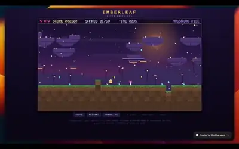</a><br><a href="https://www.sandbase.ai/lab/ai-videos/minimax-m3-1-flash/2115044003582460079?lang=zh-CN&utm_source=github&utm_medium=readme&utm_campaign=awesome-minimax-m3-1-flash&utm_content=card"><b>使用 MiniMax Code 构建的像素风冒险游戏</b></a><br><sub><a href="https://x.com/JayBisen473370/status/2115044003582460079">@JayBisen473370</a> · 0:30</sub></td><td width="33%" valign="top"><a href="https://www.sandbase.ai/lab/media/x/minimax-m3-1-flash/2113225129862062523/video.mp4">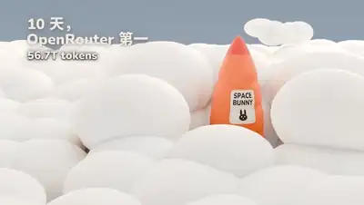</a><br><a href="https://www.sandbase.ai/lab/ai-videos/minimax-m3-1-flash/2113225129862062523?lang=zh-CN&utm_source=github&utm_medium=readme&utm_campaign=awesome-minimax-m3-1-flash&utm_content=card"><b>纯代码生成的3D动效宣传片</b></a><br><sub><a href="https://x.com/Saccc_c/status/2113225129862062523">@Saccc_c</a> · 0:26</sub></td><td width="33%" valign="top"><a href="https://www.sandbase.ai/lab/media/x/minimax-m3-1-flash/2113572358334345570/video.mp4"></a><br><a href="https://www.sandbase.ai/lab/ai-videos/minimax-m3-1-flash/2113572358334345570?lang=zh-CN&utm_source=github&utm_medium=readme&utm_campaign=awesome-minimax-m3-1-flash&utm_content=card"><b>带交互式图表的SaaS分析仪表板</b></a><br><sub><a href="https://x.com/aresotik/status/2113572358334345570">@aresotik</a> · 0:36</sub></td></tr>
<tr><td width="33%" valign="top"><a href="https://www.sandbase.ai/lab/media/x/minimax-m3-1-flash/2114607746830262597/video.mp4">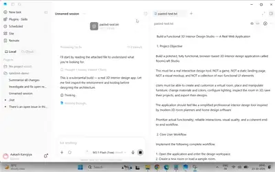</a><br><a href="https://www.sandbase.ai/lab/ai-videos/minimax-m3-1-flash/2114607746830262597?lang=zh-CN&utm_source=github&utm_medium=readme&utm_campaign=awesome-minimax-m3-1-flash&utm_content=card"><b>交互式3D室内设计工作室</b></a><br><sub><a href="https://x.com/Kanojiyaaakash1/status/2114607746830262597">@Kanojiyaaakash1</a> · 0:27 · <a href="https://www.sandbase.ai/lab/ai-videos/minimax-m3-1-flash/2114607746830262597?lang=zh-CN&utm_source=github&utm_medium=readme&utm_campaign=awesome-minimax-m3-1-flash&utm_content=card">提示词</a></sub></td><td width="33%" valign="top"><a href="https://www.sandbase.ai/lab/media/x/minimax-m3-1-flash/2114621544177787011/video.mp4">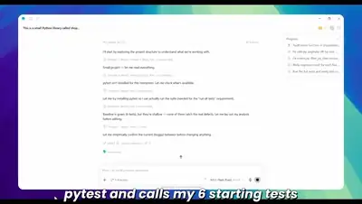</a><br><a href="https://www.sandbase.ai/lab/ai-videos/minimax-m3-1-flash/2114621544177787011?lang=zh-CN&utm_source=github&utm_medium=readme&utm_campaign=awesome-minimax-m3-1-flash&utm_content=card"><b>用AI调试Python商城代码库</b></a><br><sub><a href="https://x.com/codedailyML/status/2114621544177787011">@codedailyML</a> · 0:44</sub></td><td width="33%" valign="top"><a href="https://www.sandbase.ai/lab/media/x/minimax-m3-1-flash/2115102820668219428/video.mp4">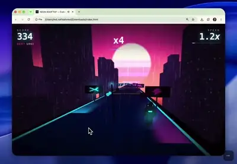</a><br><a href="https://www.sandbase.ai/lab/ai-videos/minimax-m3-1-flash/2115102820668219428?lang=zh-CN&utm_source=github&utm_medium=readme&utm_campaign=awesome-minimax-m3-1-flash&utm_content=card"><b>单HTML文件构建的3D霓虹屋顶跑酷游戏</b></a><br><sub><a href="https://x.com/ethancoder0/status/2115102820668219428">@ethancoder0</a> · 1:02 · <a href="https://www.sandbase.ai/lab/ai-videos/minimax-m3-1-flash/2115102820668219428?lang=zh-CN&utm_source=github&utm_medium=readme&utm_campaign=awesome-minimax-m3-1-flash&utm_content=card">提示词</a></sub></td></tr>
<tr><td width="33%" valign="top"><a href="https://www.sandbase.ai/lab/media/x/minimax-m3-1-flash/2113138389172224237/video.mp4">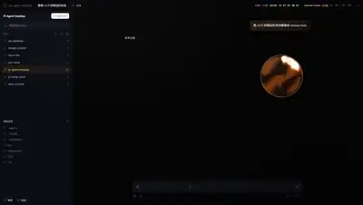</a><br><a href="https://www.sandbase.ai/lab/ai-videos/minimax-m3-1-flash/2113138389172224237?lang=zh-CN&utm_source=github&utm_medium=readme&utm_campaign=awesome-minimax-m3-1-flash&utm_content=card"><b>Pi Agent Desktop产品宣传片</b></a><br><sub><a href="https://x.com/chasen_liao/status/2113138389172224237">@chasen_liao</a> · 0:30 · <a href="https://www.sandbase.ai/lab/ai-videos/minimax-m3-1-flash/2113138389172224237?lang=zh-CN&utm_source=github&utm_medium=readme&utm_campaign=awesome-minimax-m3-1-flash&utm_content=card">提示词</a></sub></td><td width="33%" valign="top"><a href="https://www.sandbase.ai/lab/media/x/minimax-m3-1-flash/2113542688276693342/video.mp4">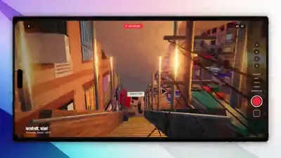</a><br><a href="https://www.sandbase.ai/lab/ai-videos/minimax-m3-1-flash/2113542688276693342?lang=zh-CN&utm_source=github&utm_medium=readme&utm_campaign=awesome-minimax-m3-1-flash&utm_content=card"><b>Three.js重现达卡傍晚街景Vlog</b></a><br><sub><a href="https://x.com/nahid_pro09/status/2113542688276693342">@nahid_pro09</a> · 0:59</sub></td></tr>
</table>

<a id="3d-scene"></a>

## 3D 场景

<table>
<tr><td width="33%" valign="top"><a href="https://www.sandbase.ai/lab/media/x/minimax-m3-1-flash/2112111033359933516/video.mp4"></a><br><a href="https://www.sandbase.ai/lab/ai-videos/minimax-m3-1-flash/2112111033359933516?lang=zh-CN&utm_source=github&utm_medium=readme&utm_campaign=awesome-minimax-m3-1-flash&utm_content=card"><b>使用 Three.js 生成的 3D 花盆查看器</b></a><br><sub><a href="https://x.com/ItsmeAjayKV/status/2112111033359933516">@ItsmeAjayKV</a> · 0:32 · <a href="https://www.sandbase.ai/lab/ai-videos/minimax-m3-1-flash/2112111033359933516?lang=zh-CN&utm_source=github&utm_medium=readme&utm_campaign=awesome-minimax-m3-1-flash&utm_content=card">提示词</a></sub></td><td width="33%" valign="top"><a href="https://www.sandbase.ai/lab/media/x/minimax-m3-1-flash/2112121327285084300/video.mp4"></a><br><a href="https://www.sandbase.ai/lab/ai-videos/minimax-m3-1-flash/2112121327285084300?lang=zh-CN&utm_source=github&utm_medium=readme&utm_campaign=awesome-minimax-m3-1-flash&utm_content=card"><b>单次生成的宝塔 3D 场景展示</b></a><br><sub><a href="https://x.com/ItsmeAjayKV/status/2112121327285084300">@ItsmeAjayKV</a> · 0:51</sub></td><td width="33%" valign="top"><a href="https://www.sandbase.ai/lab/media/x/minimax-m3-1-flash/2112181307111555498/video.mp4"></a><br><a href="https://www.sandbase.ai/lab/ai-videos/minimax-m3-1-flash/2112181307111555498?lang=zh-CN&utm_source=github&utm_medium=readme&utm_campaign=awesome-minimax-m3-1-flash&utm_content=card"><b>3D版骑自行车动画测试</b></a><br><sub><a href="https://x.com/mspd4100/status/2112181307111555498">@mspd4100</a> · 0:06</sub></td></tr>
<tr><td width="33%" valign="top"><a href="https://www.sandbase.ai/lab/media/x/minimax-m3-1-flash/2112207157177561460/video.mp4"></a><br><a href="https://www.sandbase.ai/lab/ai-videos/minimax-m3-1-flash/2112207157177561460?lang=zh-CN&utm_source=github&utm_medium=readme&utm_campaign=awesome-minimax-m3-1-flash&utm_content=card"><b>基于Three.js构建的交互式水上飞机</b></a><br><sub><a href="https://x.com/debugsenpai/status/2112207157177561460">@debugsenpai</a> · 0:26</sub></td><td width="33%" valign="top"><a href="https://www.sandbase.ai/lab/media/x/minimax-m3-1-flash/2112212819395432700/video.mp4"></a><br><a href="https://www.sandbase.ai/lab/ai-videos/minimax-m3-1-flash/2112212819395432700?lang=zh-CN&utm_source=github&utm_medium=readme&utm_campaign=awesome-minimax-m3-1-flash&utm_content=card"><b>WebGPU写实水面场景与悬浮相机</b></a><br><sub><a href="https://x.com/ivanfioravanti/status/2112212819395432700">@ivanfioravanti</a> · 0:13 · <a href="https://www.sandbase.ai/lab/ai-videos/minimax-m3-1-flash/2112212819395432700?lang=zh-CN&utm_source=github&utm_medium=readme&utm_campaign=awesome-minimax-m3-1-flash&utm_content=card">提示词</a></sub></td><td width="33%" valign="top"><a href="https://www.sandbase.ai/lab/media/x/minimax-m3-1-flash/2112257677543829665/video.mp4"></a><br><a href="https://www.sandbase.ai/lab/ai-videos/minimax-m3-1-flash/2112257677543829665?lang=zh-CN&utm_source=github&utm_medium=readme&utm_campaign=awesome-minimax-m3-1-flash&utm_content=card"><b>MiniMax M3.1 Flash 运行三组 3D 场景测试</b></a><br><sub><a href="https://x.com/domsilvestre/status/2112257677543829665">@domsilvestre</a> · 0:35</sub></td></tr>
</table>

<details>
<summary><b>展开全部 38 条</b></summary>

<table>
<tr><td width="33%" valign="top"><a href="https://www.sandbase.ai/lab/media/x/minimax-m3-1-flash/2112259993382920430/video.mp4"></a><br><a href="https://www.sandbase.ai/lab/ai-videos/minimax-m3-1-flash/2112259993382920430?lang=zh-CN&utm_source=github&utm_medium=readme&utm_campaign=awesome-minimax-m3-1-flash&utm_content=card"><b>MiniMax生成的万圣节主题3D环境</b></a><br><sub><a href="https://x.com/DrstaOne/status/2112259993382920430">@DrstaOne</a> · 1:29</sub></td><td width="33%" valign="top"><a href="https://www.sandbase.ai/lab/media/x/minimax-m3-1-flash/2112362454751863127/video.mp4">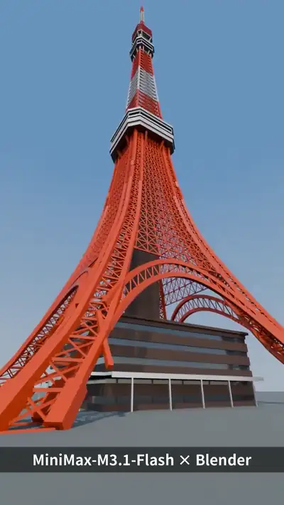</a><br><a href="https://www.sandbase.ai/lab/ai-videos/minimax-m3-1-flash/2112362454751863127?lang=zh-CN&utm_source=github&utm_medium=readme&utm_campaign=awesome-minimax-m3-1-flash&utm_content=card"><b>Blender中生成的东京塔3D模型</b></a><br><sub><a href="https://x.com/seki_anos/status/2112362454751863127">@seki_anos</a> · 0:25</sub></td><td width="33%" valign="top"><a href="https://www.sandbase.ai/lab/media/x/minimax-m3-1-flash/2112423796527559136/video.mp4">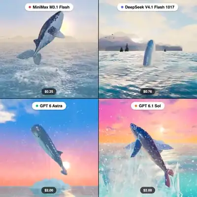</a><br><a href="https://www.sandbase.ai/lab/ai-videos/minimax-m3-1-flash/2112423796527559136?lang=zh-CN&utm_source=github&utm_medium=readme&utm_campaign=awesome-minimax-m3-1-flash&utm_content=card"><b>鲸鱼破水跃出的3D场景</b></a><br><sub><a href="https://x.com/Bhavani_00007/status/2112423796527559136">@Bhavani_00007</a> · 0:18</sub></td></tr>
<tr><td width="33%" valign="top"><a href="https://www.sandbase.ai/lab/media/x/minimax-m3-1-flash/2112458848971952580/video.mp4">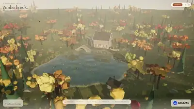</a><br><a href="https://www.sandbase.ai/lab/ai-videos/minimax-m3-1-flash/2112458848971952580?lang=zh-CN&utm_source=github&utm_medium=readme&utm_campaign=awesome-minimax-m3-1-flash&utm_content=card"><b>可交互的秋季山谷3D前端场景</b></a><br><sub><a href="https://x.com/AiHubMix/status/2112458848971952580">@AiHubMix</a> · 0:31</sub></td><td width="33%" valign="top"><a href="https://www.sandbase.ai/lab/media/x/minimax-m3-1-flash/2112553288994337204/video.mp4">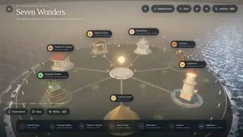</a><br><a href="https://www.sandbase.ai/lab/ai-videos/minimax-m3-1-flash/2112553288994337204?lang=zh-CN&utm_source=github&utm_medium=readme&utm_campaign=awesome-minimax-m3-1-flash&utm_content=card"><b>可探索的世界古代七大奇迹3D场景</b></a><br><sub><a href="https://x.com/vikktorrrre/status/2112553288994337204">@vikktorrrre</a> · 0:17</sub></td><td width="33%" valign="top"><a href="https://www.sandbase.ai/lab/media/x/minimax-m3-1-flash/2112556765674082545/video.mp4">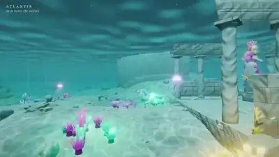</a><br><a href="https://www.sandbase.ai/lab/ai-videos/minimax-m3-1-flash/2112556765674082545?lang=zh-CN&utm_source=github&utm_medium=readme&utm_campaign=awesome-minimax-m3-1-flash&utm_content=card"><b>亚特兰蒂斯海底3D场景</b></a><br><sub><a href="https://x.com/alannnfx/status/2112556765674082545">@alannnfx</a> · 0:30</sub></td></tr>
<tr><td width="33%" valign="top"><a href="https://www.sandbase.ai/lab/media/x/minimax-m3-1-flash/2112574212783112245/video.mp4">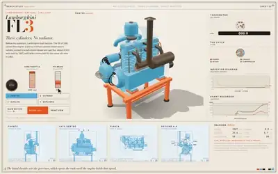</a><br><a href="https://www.sandbase.ai/lab/ai-videos/minimax-m3-1-flash/2112574212783112245?lang=zh-CN&utm_source=github&utm_medium=readme&utm_campaign=awesome-minimax-m3-1-flash&utm_content=card"><b>交互式 3D 兰博基尼拖拉机引擎演示</b></a><br><sub><a href="https://x.com/exploraX_/status/2112574212783112245">@exploraX_</a> · 0:46</sub></td><td width="33%" valign="top"><a href="https://www.sandbase.ai/lab/media/x/minimax-m3-1-flash/2112680245778338172/video.mp4">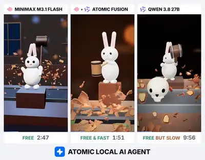</a><br><a href="https://www.sandbase.ai/lab/ai-videos/minimax-m3-1-flash/2112680245778338172?lang=zh-CN&utm_source=github&utm_medium=readme&utm_campaign=awesome-minimax-m3-1-flash&utm_content=card"><b>万圣节连续三维场景</b></a><br><sub><a href="https://x.com/atomicagent_io/status/2112680245778338172">@atomicagent_io</a> · 0:31</sub></td><td width="33%" valign="top"><a href="https://www.sandbase.ai/lab/media/x/minimax-m3-1-flash/2112800216608886787/video.mp4">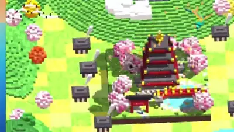</a><br><a href="https://www.sandbase.ai/lab/ai-videos/minimax-m3-1-flash/2112800216608886787?lang=zh-CN&utm_source=github&utm_medium=readme&utm_campaign=awesome-minimax-m3-1-flash&utm_content=card"><b>含宝塔与飞龙的体素风日式庭院</b></a><br><sub><a href="https://x.com/k2sbhai/status/2112800216608886787">@k2sbhai</a> · 0:17</sub></td></tr>
<tr><td width="33%" valign="top"><a href="https://www.sandbase.ai/lab/media/x/minimax-m3-1-flash/2112806500519571625/video.mp4">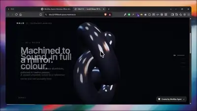</a><br><a href="https://www.sandbase.ai/lab/ai-videos/minimax-m3-1-flash/2112806500519571625?lang=zh-CN&utm_source=github&utm_medium=readme&utm_campaign=awesome-minimax-m3-1-flash&utm_content=card"><b>MiniMax生成的3D滚动交互产品展示</b></a><br><sub><a href="https://x.com/Manixh02/status/2112806500519571625">@Manixh02</a> · 0:20</sub></td><td width="33%" valign="top"><a href="https://www.sandbase.ai/lab/media/x/minimax-m3-1-flash/2112827596279054795/video.mp4"></a><br><a href="https://www.sandbase.ai/lab/ai-videos/minimax-m3-1-flash/2112827596279054795?lang=zh-CN&utm_source=github&utm_medium=readme&utm_campaign=awesome-minimax-m3-1-flash&utm_content=card"><b>人类头部与大脑交互式3D图谱</b></a><br><sub><a href="https://x.com/alannnfx/status/2112827596279054795">@alannnfx</a> · 0:36</sub></td><td width="33%" valign="top"><a href="https://www.sandbase.ai/lab/media/x/minimax-m3-1-flash/2112836206723563684/video.mp4">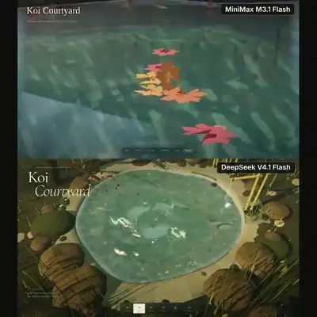</a><br><a href="https://www.sandbase.ai/lab/ai-videos/minimax-m3-1-flash/2112836206723563684?lang=zh-CN&utm_source=github&utm_medium=readme&utm_campaign=awesome-minimax-m3-1-flash&utm_content=card"><b>带池塘与喷泉的3D锦鲤庭院</b></a><br><sub><a href="https://x.com/SahilPanhotra/status/2112836206723563684">@SahilPanhotra</a> · 0:34</sub></td></tr>
<tr><td width="33%" valign="top"><a href="https://www.sandbase.ai/lab/media/x/minimax-m3-1-flash/2112921548910641329/video.mp4">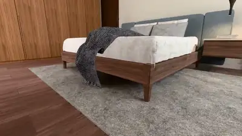</a><br><a href="https://www.sandbase.ai/lab/ai-videos/minimax-m3-1-flash/2112921548910641329?lang=zh-CN&utm_source=github&utm_medium=readme&utm_campaign=awesome-minimax-m3-1-flash&utm_content=card"><b>卧室图像转Three.js三维场景</b></a><br><sub><a href="https://x.com/NickDevFE/status/2112921548910641329">@NickDevFE</a> · 0:59</sub></td><td width="33%" valign="top"><a href="https://www.sandbase.ai/lab/media/x/minimax-m3-1-flash/2112960492696457278/video.mp4"></a><br><a href="https://www.sandbase.ai/lab/ai-videos/minimax-m3-1-flash/2112960492696457278?lang=zh-CN&utm_source=github&utm_medium=readme&utm_campaign=awesome-minimax-m3-1-flash&utm_content=card"><b>基于 Three.js 构建的逼真水面与天空</b></a><br><sub><a href="https://x.com/rubenssoto_ai/status/2112960492696457278">@rubenssoto_ai</a> · 1:00</sub></td><td width="33%" valign="top"><a href="https://www.sandbase.ai/lab/media/x/minimax-m3-1-flash/2113226691543978078/video.mp4">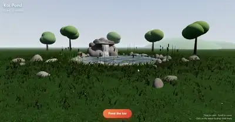</a><br><a href="https://www.sandbase.ai/lab/ai-videos/minimax-m3-1-flash/2113226691543978078?lang=zh-CN&utm_source=github&utm_medium=readme&utm_campaign=awesome-minimax-m3-1-flash&utm_content=card"><b>Three.js 交互式锦鲤池塘</b></a><br><sub><a href="https://x.com/darshal_/status/2113226691543978078">@darshal_</a> · 0:32</sub></td></tr>
<tr><td width="33%" valign="top"><a href="https://www.sandbase.ai/lab/media/x/minimax-m3-1-flash/2113275650920636666/video.mp4">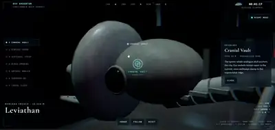</a><br><a href="https://www.sandbase.ai/lab/ai-videos/minimax-m3-1-flash/2113275650920636666?lang=zh-CN&utm_source=github&utm_medium=readme&utm_campaign=awesome-minimax-m3-1-flash&utm_content=card"><b>巨鲸骨骼内的交互式三维城市</b></a><br><sub><a href="https://x.com/HeyZoyaKhan/status/2113275650920636666">@HeyZoyaKhan</a> · 0:50</sub></td><td width="33%" valign="top"><a href="https://www.sandbase.ai/lab/media/x/minimax-m3-1-flash/2113297653106675739/video.mp4">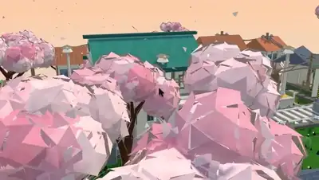</a><br><a href="https://www.sandbase.ai/lab/ai-videos/minimax-m3-1-flash/2113297653106675739?lang=zh-CN&utm_source=github&utm_medium=readme&utm_campaign=awesome-minimax-m3-1-flash&utm_content=card"><b>日本火车站3D春季微缩模型场景</b></a><br><sub><a href="https://x.com/vikktorrrre/status/2113297653106675739">@vikktorrrre</a> · 0:50</sub></td><td width="33%" valign="top"><a href="https://www.sandbase.ai/lab/media/x/minimax-m3-1-flash/2113519833186808070/video.mp4">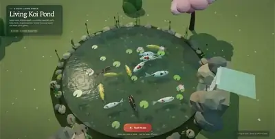</a><br><a href="https://www.sandbase.ai/lab/ai-videos/minimax-m3-1-flash/2113519833186808070?lang=zh-CN&utm_source=github&utm_medium=readme&utm_campaign=awesome-minimax-m3-1-flash&utm_content=card"><b>MiniMax生成的Three.js互动锦鲤池</b></a><br><sub><a href="https://x.com/painn_x/status/2113519833186808070">@painn_x</a> · 0:35</sub></td></tr>
<tr><td width="33%" valign="top"><a href="https://www.sandbase.ai/lab/media/x/minimax-m3-1-flash/2113528840056410204/video.mp4">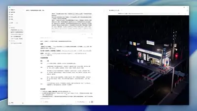</a><br><a href="https://www.sandbase.ai/lab/ai-videos/minimax-m3-1-flash/2113528840056410204?lang=zh-CN&utm_source=github&utm_medium=readme&utm_campaign=awesome-minimax-m3-1-flash&utm_content=card"><b>MiniMax M3.1 Flash三组3D与动效实测</b></a><br><sub><a href="https://x.com/xueyu1125/status/2113528840056410204">@xueyu1125</a> · 1:39</sub></td><td width="33%" valign="top"><a href="https://www.sandbase.ai/lab/media/x/minimax-m3-1-flash/2113542688276693342/video.mp4"></a><br><a href="https://www.sandbase.ai/lab/ai-videos/minimax-m3-1-flash/2113542688276693342?lang=zh-CN&utm_source=github&utm_medium=readme&utm_campaign=awesome-minimax-m3-1-flash&utm_content=card"><b>Three.js重现达卡傍晚街景Vlog</b></a><br><sub><a href="https://x.com/nahid_pro09/status/2113542688276693342">@nahid_pro09</a> · 0:59</sub></td><td width="33%" valign="top"><a href="https://www.sandbase.ai/lab/media/x/minimax-m3-1-flash/2113573520076886140/video.mp4">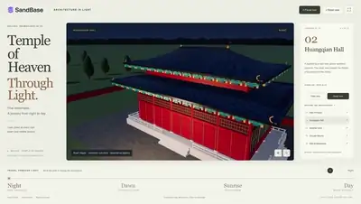</a><br><a href="https://www.sandbase.ai/lab/ai-videos/minimax-m3-1-flash/2113573520076886140?lang=zh-CN&utm_source=github&utm_medium=readme&utm_campaign=awesome-minimax-m3-1-flash&utm_content=card"><b>夜幕下的北京天坛3D建模场景</b></a><br><sub><a href="https://x.com/SandbaseAI/status/2113573520076886140">@SandbaseAI</a> · 0:20</sub></td></tr>
<tr><td width="33%" valign="top"><a href="https://www.sandbase.ai/lab/media/x/minimax-m3-1-flash/2113582203984850965/video.mp4">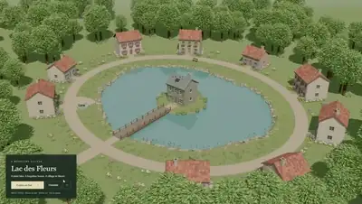</a><br><a href="https://www.sandbase.ai/lab/ai-videos/minimax-m3-1-flash/2113582203984850965?lang=zh-CN&utm_source=github&utm_medium=readme&utm_campaign=awesome-minimax-m3-1-flash&utm_content=card"><b>MiniMax Code构建的互联虚拟世界</b></a><br><sub><a href="https://x.com/DAIEvolutionHub/status/2113582203984850965">@DAIEvolutionHub</a> · 0:41</sub></td><td width="33%" valign="top"><a href="https://www.sandbase.ai/lab/media/x/minimax-m3-1-flash/2113654429362647515/video.mp4">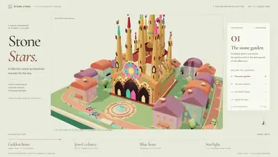</a><br><a href="https://www.sandbase.ai/lab/ai-videos/minimax-m3-1-flash/2113654429362647515?lang=zh-CN&utm_source=github&utm_medium=readme&utm_campaign=awesome-minimax-m3-1-flash&utm_content=card"><b>皮克斯3D风格重构圣家堂景观</b></a><br><sub><a href="https://x.com/SandbaseAI/status/2113654429362647515">@SandbaseAI</a> · 0:24</sub></td><td width="33%" valign="top"><a href="https://www.sandbase.ai/lab/media/x/minimax-m3-1-flash/2113697869312192587/video.mp4"></a><br><a href="https://www.sandbase.ai/lab/ai-videos/minimax-m3-1-flash/2113697869312192587?lang=zh-CN&utm_source=github&utm_medium=readme&utm_campaign=awesome-minimax-m3-1-flash&utm_content=card"><b>Three.js实时渲染的3D森林神社漫游</b></a><br><sub><a href="https://x.com/0xReso/status/2113697869312192587">@0xReso</a> · 1:00</sub></td></tr>
<tr><td width="33%" valign="top"><a href="https://www.sandbase.ai/lab/media/x/minimax-m3-1-flash/2114070923116491139/video.mp4"></a><br><a href="https://www.sandbase.ai/lab/ai-videos/minimax-m3-1-flash/2114070923116491139?lang=zh-CN&utm_source=github&utm_medium=readme&utm_campaign=awesome-minimax-m3-1-flash&utm_content=card"><b>带有飞鸟和云朵的生成场景</b></a><br><sub><a href="https://x.com/Chris_Wozniczek/status/2114070923116491139">@Chris_Wozniczek</a> · 1:46</sub></td><td width="33%" valign="top"><a href="https://www.sandbase.ai/lab/media/x/minimax-m3-1-flash/2114470807942447223/video.mp4">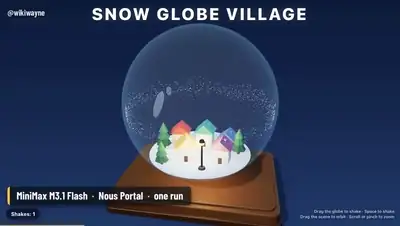</a><br><a href="https://www.sandbase.ai/lab/ai-videos/minimax-m3-1-flash/2114470807942447223?lang=zh-CN&utm_source=github&utm_medium=readme&utm_campaign=awesome-minimax-m3-1-flash&utm_content=card"><b>Three.js雪花水晶球粒子场景</b></a><br><sub><a href="https://x.com/wikiwayne/status/2114470807942447223">@wikiwayne</a> · 0:29</sub></td><td width="33%" valign="top"><a href="https://www.sandbase.ai/lab/media/x/minimax-m3-1-flash/2114607746830262597/video.mp4"></a><br><a href="https://www.sandbase.ai/lab/ai-videos/minimax-m3-1-flash/2114607746830262597?lang=zh-CN&utm_source=github&utm_medium=readme&utm_campaign=awesome-minimax-m3-1-flash&utm_content=card"><b>交互式3D室内设计工作室</b></a><br><sub><a href="https://x.com/Kanojiyaaakash1/status/2114607746830262597">@Kanojiyaaakash1</a> · 0:27 · <a href="https://www.sandbase.ai/lab/ai-videos/minimax-m3-1-flash/2114607746830262597?lang=zh-CN&utm_source=github&utm_medium=readme&utm_campaign=awesome-minimax-m3-1-flash&utm_content=card">提示词</a></sub></td></tr>
<tr><td width="33%" valign="top"><a href="https://www.sandbase.ai/lab/media/x/minimax-m3-1-flash/2115352877916946508/video.mp4"></a><br><a href="https://www.sandbase.ai/lab/ai-videos/minimax-m3-1-flash/2115352877916946508?lang=zh-CN&utm_source=github&utm_medium=readme&utm_campaign=awesome-minimax-m3-1-flash&utm_content=card"><b>Apinex上单提示词生成的3D直升机</b></a><br><sub><a href="https://x.com/CallMeCSZ/status/2115352877916946508">@CallMeCSZ</a> · 1:29</sub></td><td width="33%" valign="top"><a href="https://www.sandbase.ai/lab/media/x/minimax-m3-1-flash/2115460580144271462/video.mp4">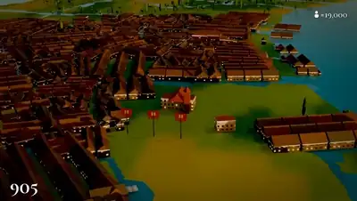</a><br><a href="https://www.sandbase.ai/lab/ai-videos/minimax-m3-1-flash/2115460580144271462?lang=zh-CN&utm_source=github&utm_medium=readme&utm_campaign=awesome-minimax-m3-1-flash&utm_content=card"><b>威尼斯历史演进3D场景重塑</b></a><br><sub><a href="https://x.com/SandbaseAI/status/2115460580144271462">@SandbaseAI</a> · 3:00</sub></td><td width="33%" valign="top"><a href="https://www.sandbase.ai/lab/media/x/minimax-m3-1-flash/2115490348491591891/video.mp4">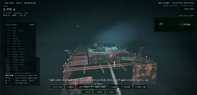</a><br><a href="https://www.sandbase.ai/lab/ai-videos/minimax-m3-1-flash/2115490348491591891?lang=zh-CN&utm_source=github&utm_medium=readme&utm_campaign=awesome-minimax-m3-1-flash&utm_content=card"><b>单HTML文件可探索泰坦尼克号残骸3D场景</b></a><br><sub><a href="https://x.com/chetaslua/status/2115490348491591891">@chetaslua</a> · 0:36 · <a href="https://www.sandbase.ai/lab/ai-videos/minimax-m3-1-flash/2115490348491591891?lang=zh-CN&utm_source=github&utm_medium=readme&utm_campaign=awesome-minimax-m3-1-flash&utm_content=card">提示词</a></sub></td></tr>
<tr><td width="33%" valign="top"><a href="https://www.sandbase.ai/lab/media/x/minimax-m3-1-flash/2115777338839289997/video.mp4">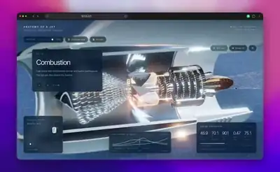</a><br><a href="https://www.sandbase.ai/lab/ai-videos/minimax-m3-1-flash/2115777338839289997?lang=zh-CN&utm_source=github&utm_medium=readme&utm_campaign=awesome-minimax-m3-1-flash&utm_content=card"><b>喷气发动机级数的爆炸图拆解</b></a><br><sub><a href="https://x.com/kanavtwt/status/2115777338839289997">@kanavtwt</a> · 0:49</sub></td><td width="33%" valign="top"><a href="https://www.sandbase.ai/lab/media/x/minimax-m3-1-flash/2115813563461726567/video.mp4">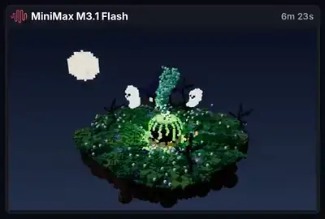</a><br><a href="https://www.sandbase.ai/lab/ai-videos/minimax-m3-1-flash/2115813563461726567?lang=zh-CN&utm_source=github&utm_medium=readme&utm_campaign=awesome-minimax-m3-1-flash&utm_content=card"><b>浮空岛上的体素女巫大釜场景</b></a><br><sub><a href="https://x.com/semichenkko/status/2115813563461726567">@semichenkko</a> · 0:13 · <a href="https://www.sandbase.ai/lab/ai-videos/minimax-m3-1-flash/2115813563461726567?lang=zh-CN&utm_source=github&utm_medium=readme&utm_campaign=awesome-minimax-m3-1-flash&utm_content=card">提示词</a></sub></td></tr>
</table>

</details>

<a id="motion-graphics"></a>

## 动效

<table>
<tr><td width="33%" valign="top"><a href="https://www.sandbase.ai/lab/media/x/minimax-m3-1-flash/2112115396434084243/video.mp4"></a><br><a href="https://www.sandbase.ai/lab/ai-videos/minimax-m3-1-flash/2112115396434084243?lang=zh-CN&utm_source=github&utm_medium=readme&utm_campaign=awesome-minimax-m3-1-flash&utm_content=card"><b>MiniMax-M3.1-Flash API 速度测试</b></a><br><sub><a href="https://x.com/ivanfioravanti/status/2112115396434084243">@ivanfioravanti</a> · 0:06</sub></td><td width="33%" valign="top"><a href="https://www.sandbase.ai/lab/media/x/minimax-m3-1-flash/2112134450926739599/video.mp4"></a><br><a href="https://www.sandbase.ai/lab/ai-videos/minimax-m3-1-flash/2112134450926739599?lang=zh-CN&utm_source=github&utm_medium=readme&utm_campaign=awesome-minimax-m3-1-flash&utm_content=card"><b>用MiniCode生成的SVG鹈鹕动画</b></a><br><sub><a href="https://x.com/leo114119/status/2112134450926739599">@leo114119</a></sub></td><td width="33%" valign="top"><a href="https://www.sandbase.ai/lab/media/x/minimax-m3-1-flash/2112149035259973835/video.mp4"></a><br><a href="https://www.sandbase.ai/lab/ai-videos/minimax-m3-1-flash/2112149035259973835?lang=zh-CN&utm_source=github&utm_medium=readme&utm_campaign=awesome-minimax-m3-1-flash&utm_content=card"><b>赛博朋克风格鹈鹕骑车动画</b></a><br><sub><a href="https://x.com/leo114119/status/2112149035259973835">@leo114119</a></sub></td></tr>
<tr><td width="33%" valign="top"><a href="https://www.sandbase.ai/lab/media/x/minimax-m3-1-flash/2112166611805229452/video.mp4"></a><br><a href="https://www.sandbase.ai/lab/ai-videos/minimax-m3-1-flash/2112166611805229452?lang=zh-CN&utm_source=github&utm_medium=readme&utm_campaign=awesome-minimax-m3-1-flash&utm_content=card"><b>香蕉绘图测试</b></a><br><sub><a href="https://x.com/AdamHoltererer/status/2112166611805229452">@AdamHoltererer</a> · 0:12</sub></td><td width="33%" valign="top"><a href="https://www.sandbase.ai/lab/media/x/minimax-m3-1-flash/2112178844715381059/video.mp4"></a><br><a href="https://www.sandbase.ai/lab/ai-videos/minimax-m3-1-flash/2112178844715381059?lang=zh-CN&utm_source=github&utm_medium=readme&utm_campaign=awesome-minimax-m3-1-flash&utm_content=card"><b>MiniMax-M3.1-Flash模型效果展示</b></a><br><sub><a href="https://x.com/atomtanstudio/status/2112178844715381059">@atomtanstudio</a> · 0:17</sub></td><td width="33%" valign="top"><a href="https://www.sandbase.ai/lab/media/x/minimax-m3-1-flash/2112179818192408617/video.mp4"></a><br><a href="https://www.sandbase.ai/lab/ai-videos/minimax-m3-1-flash/2112179818192408617?lang=zh-CN&utm_source=github&utm_medium=readme&utm_campaign=awesome-minimax-m3-1-flash&utm_content=card"><b>M3.1-Flash max 性能与生成测试</b></a><br><sub><a href="https://x.com/klarkxy/status/2112179818192408617">@klarkxy</a> · 0:15</sub></td></tr>
</table>

<details>
<summary><b>展开全部 19 条</b></summary>

<table>
<tr><td width="33%" valign="top"><a href="https://www.sandbase.ai/lab/media/x/minimax-m3-1-flash/2112185206387970065/video.mp4"></a><br><a href="https://www.sandbase.ai/lab/ai-videos/minimax-m3-1-flash/2112185206387970065?lang=zh-CN&utm_source=github&utm_medium=readme&utm_campaign=awesome-minimax-m3-1-flash&utm_content=card"><b>MiniMax M3.1 Flash生成的视频演示</b></a><br><sub><a href="https://x.com/AISuperDomain/status/2112185206387970065">@AISuperDomain</a> · 0:15</sub></td><td width="33%" valign="top"><a href="https://www.sandbase.ai/lab/media/x/minimax-m3-1-flash/2112194493793333657/video.mp4"></a><br><a href="https://www.sandbase.ai/lab/ai-videos/minimax-m3-1-flash/2112194493793333657?lang=zh-CN&utm_source=github&utm_medium=readme&utm_campaign=awesome-minimax-m3-1-flash&utm_content=card"><b>使用 MiniMax M3.1 Flash 生成的效果演示</b></a><br><sub><a href="https://x.com/quadcode_ai/status/2112194493793333657">@quadcode_ai</a> · 0:24</sub></td><td width="33%" valign="top"><a href="https://www.sandbase.ai/lab/media/x/minimax-m3-1-flash/2112200254590447641/video.mp4"></a><br><a href="https://www.sandbase.ai/lab/ai-videos/minimax-m3-1-flash/2112200254590447641?lang=zh-CN&utm_source=github&utm_medium=readme&utm_campaign=awesome-minimax-m3-1-flash&utm_content=card"><b>正在跑马拉松的鹈鹕</b></a><br><sub><a href="https://x.com/geekbb/status/2112200254590447641">@geekbb</a> · 0:11</sub></td></tr>
<tr><td width="33%" valign="top"><a href="https://www.sandbase.ai/lab/media/x/minimax-m3-1-flash/2112217267513499850/video.mp4"></a><br><a href="https://www.sandbase.ai/lab/ai-videos/minimax-m3-1-flash/2112217267513499850?lang=zh-CN&utm_source=github&utm_medium=readme&utm_campaign=awesome-minimax-m3-1-flash&utm_content=card"><b>使用 MiniMax-M3.1-Flash 尝试生成小熊软糖</b></a><br><sub><a href="https://x.com/MiaAI_lab/status/2112217267513499850">@MiaAI_lab</a> · 0:31</sub></td><td width="33%" valign="top"><a href="https://www.sandbase.ai/lab/media/x/minimax-m3-1-flash/2112225953472741531/video.mp4"></a><br><a href="https://www.sandbase.ai/lab/ai-videos/minimax-m3-1-flash/2112225953472741531?lang=zh-CN&utm_source=github&utm_medium=readme&utm_campaign=awesome-minimax-m3-1-flash&utm_content=card"><b>鹈鹕脱把骑摩托车</b></a><br><sub><a href="https://x.com/cnyzgkc/status/2112225953472741531">@cnyzgkc</a> · 0:10</sub></td><td width="33%" valign="top"><a href="https://www.sandbase.ai/lab/media/x/minimax-m3-1-flash/2112241373961416717/video.mp4"></a><br><a href="https://www.sandbase.ai/lab/ai-videos/minimax-m3-1-flash/2112241373961416717?lang=zh-CN&utm_source=github&utm_medium=readme&utm_campaign=awesome-minimax-m3-1-flash&utm_content=card"><b>将孔雀 SVG 动画化为儿童卡通片</b></a><br><sub><a href="https://x.com/SahilPanhotra/status/2112241373961416717">@SahilPanhotra</a> · 0:10</sub></td></tr>
<tr><td width="33%" valign="top"><a href="https://www.sandbase.ai/lab/media/x/minimax-m3-1-flash/2112275978097480186/video.mp4"></a><br><a href="https://www.sandbase.ai/lab/ai-videos/minimax-m3-1-flash/2112275978097480186?lang=zh-CN&utm_source=github&utm_medium=readme&utm_campaign=awesome-minimax-m3-1-flash&utm_content=card"><b>MiniMax M3.1 Flash 在 Keygen Bench 上的测试</b></a><br><sub><a href="https://x.com/JustMicrock/status/2112275978097480186">@JustMicrock</a> · 0:18</sub></td><td width="33%" valign="top"><a href="https://www.sandbase.ai/lab/media/x/minimax-m3-1-flash/2112779955994001715/video.mp4">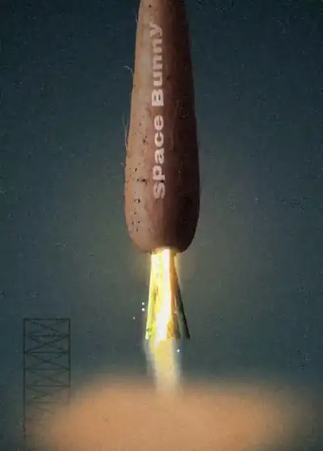</a><br><a href="https://www.sandbase.ai/lab/ai-videos/minimax-m3-1-flash/2112779955994001715?lang=zh-CN&utm_source=github&utm_medium=readme&utm_campaign=awesome-minimax-m3-1-flash&utm_content=card"><b>p5.js重塑复古胶片质感宣传片</b></a><br><sub><a href="https://x.com/Charles__Kira/status/2112779955994001715">@Charles__Kira</a> · 0:24</sub></td><td width="33%" valign="top"><a href="https://www.sandbase.ai/lab/media/x/minimax-m3-1-flash/2113569157400928345/video.mp4"></a><br><a href="https://www.sandbase.ai/lab/ai-videos/minimax-m3-1-flash/2113569157400928345?lang=zh-CN&utm_source=github&utm_medium=readme&utm_campaign=awesome-minimax-m3-1-flash&utm_content=card"><b>纯代码生成的MiniMax品牌宣传视频</b></a><br><sub><a href="https://x.com/xueyu1125/status/2113569157400928345">@xueyu1125</a> · 0:54 · <a href="https://www.sandbase.ai/lab/ai-videos/minimax-m3-1-flash/2113569157400928345?lang=zh-CN&utm_source=github&utm_medium=readme&utm_campaign=awesome-minimax-m3-1-flash&utm_content=card">提示词</a></sub></td></tr>
<tr><td width="33%" valign="top"><a href="https://www.sandbase.ai/lab/media/x/minimax-m3-1-flash/2114376165930717366/video.mp4">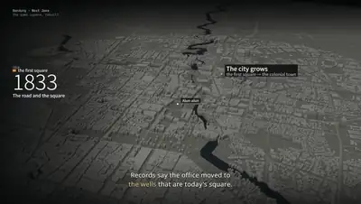</a><br><a href="https://www.sandbase.ai/lab/ai-videos/minimax-m3-1-flash/2114376165930717366?lang=zh-CN&utm_source=github&utm_medium=readme&utm_campaign=awesome-minimax-m3-1-flash&utm_content=card"><b>万隆保留的广场动态视频</b></a><br><sub><a href="https://x.com/airplanestar_/status/2114376165930717366">@airplanestar_</a> · 2:30</sub></td><td width="33%" valign="top"><a href="https://www.sandbase.ai/lab/media/x/minimax-m3-1-flash/2114944135354597560/video.mp4"></a><br><a href="https://www.sandbase.ai/lab/ai-videos/minimax-m3-1-flash/2114944135354597560?lang=zh-CN&utm_source=github&utm_medium=readme&utm_campaign=awesome-minimax-m3-1-flash&utm_content=card"><b>雅加达从胡椒港口到2045年的历史演变</b></a><br><sub><a href="https://x.com/ovynovi91/status/2114944135354597560">@ovynovi91</a> · 2:10</sub></td><td width="33%" valign="top"><a href="https://www.sandbase.ai/lab/media/x/minimax-m3-1-flash/2115444454727524614/video.mp4">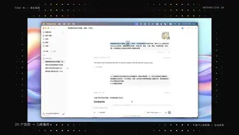</a><br><a href="https://www.sandbase.ai/lab/ai-videos/minimax-m3-1-flash/2115444454727524614?lang=zh-CN&utm_source=github&utm_medium=readme&utm_campaign=awesome-minimax-m3-1-flash&utm_content=card"><b>3D 看房与动效设计自动化渲染演示</b></a><br><sub><a href="https://x.com/GeekCatX/status/2115444454727524614">@GeekCatX</a> · 2:18</sub></td></tr>
<tr><td width="33%" valign="top"><a href="https://www.sandbase.ai/lab/media/x/minimax-m3-1-flash/2116246641661678057/video.mp4">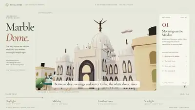</a><br><a href="https://www.sandbase.ai/lab/ai-videos/minimax-m3-1-flash/2116246641661678057?lang=zh-CN&utm_source=github&utm_medium=readme&utm_campaign=awesome-minimax-m3-1-flash&utm_content=card"><b>加尔各答维多利亚纪念堂的一天</b></a><br><sub><a href="https://x.com/adityawaslost/status/2116246641661678057">@adityawaslost</a> · 1:48</sub></td></tr>
</table>

</details>

<a id="game"></a>

## 游戏

<table>
<tr><td width="33%" valign="top"><a href="https://www.sandbase.ai/lab/media/x/minimax-m3-1-flash/2112166543899378130/video.mp4"></a><br><a href="https://www.sandbase.ai/lab/ai-videos/minimax-m3-1-flash/2112166543899378130?lang=zh-CN&utm_source=github&utm_medium=readme&utm_campaign=awesome-minimax-m3-1-flash&utm_content=card"><b>Moonfall Bastion 塔防游戏测试</b></a><br><sub><a href="https://x.com/AdamHoltererer/status/2112166543899378130">@AdamHoltererer</a> · 0:23</sub></td><td width="33%" valign="top"><a href="https://www.sandbase.ai/lab/media/x/minimax-m3-1-flash/2112187468141465864/video.mp4"></a><br><a href="https://www.sandbase.ai/lab/ai-videos/minimax-m3-1-flash/2112187468141465864?lang=zh-CN&utm_source=github&utm_medium=readme&utm_campaign=awesome-minimax-m3-1-flash&utm_content=card"><b>用MiniMax制作的Among Us复刻游戏</b></a><br><sub><a href="https://x.com/yohakujpn/status/2112187468141465864">@yohakujpn</a> · 1:10</sub></td><td width="33%" valign="top"><a href="https://www.sandbase.ai/lab/media/x/minimax-m3-1-flash/2112201323106222579/video.mp4"></a><br><a href="https://www.sandbase.ai/lab/ai-videos/minimax-m3-1-flash/2112201323106222579?lang=zh-CN&utm_source=github&utm_medium=readme&utm_campaign=awesome-minimax-m3-1-flash&utm_content=card"><b>MiniMax生成的霓虹赛车游戏</b></a><br><sub><a href="https://x.com/kepochnik/status/2112201323106222579">@kepochnik</a> · 1:30</sub></td></tr>
<tr><td width="33%" valign="top"><a href="https://www.sandbase.ai/lab/media/x/minimax-m3-1-flash/2112213565566587346/video.mp4">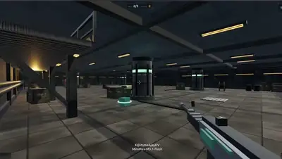</a><br><a href="https://www.sandbase.ai/lab/ai-videos/minimax-m3-1-flash/2112213565566587346?lang=zh-CN&utm_source=github&utm_medium=readme&utm_campaign=awesome-minimax-m3-1-flash&utm_content=card"><b>使用 Three.js 制作的第一人称射击游戏</b></a><br><sub><a href="https://x.com/ItsmeAjayKV/status/2112213565566587346">@ItsmeAjayKV</a> · 1:43</sub></td><td width="33%" valign="top"><a href="https://www.sandbase.ai/lab/media/x/minimax-m3-1-flash/2112220100300513770/video.mp4"></a><br><a href="https://www.sandbase.ai/lab/ai-videos/minimax-m3-1-flash/2112220100300513770?lang=zh-CN&utm_source=github&utm_medium=readme&utm_campaign=awesome-minimax-m3-1-flash&utm_content=card"><b>用单次提示词构建的SkyGarden网页游戏</b></a><br><sub><a href="https://x.com/Amank1412/status/2112220100300513770">@Amank1412</a> · 0:25</sub></td><td width="33%" valign="top"><a href="https://www.sandbase.ai/lab/media/x/minimax-m3-1-flash/2112245072301302078/video.mp4">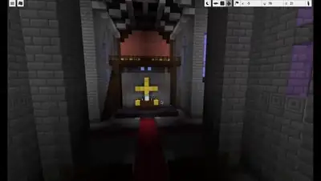</a><br><a href="https://www.sandbase.ai/lab/ai-videos/minimax-m3-1-flash/2112245072301302078?lang=zh-CN&utm_source=github&utm_medium=readme&utm_campaign=awesome-minimax-m3-1-flash&utm_content=card"><b>在Minecraft中建造的哥特式大教堂</b></a><br><sub><a href="https://x.com/Aizkmusic/status/2112245072301302078">@Aizkmusic</a> · 0:26</sub></td></tr>
</table>

<details>
<summary><b>展开全部 32 条</b></summary>

<table>
<tr><td width="33%" valign="top"><a href="https://www.sandbase.ai/lab/media/x/minimax-m3-1-flash/2112459195521896760/video.mp4">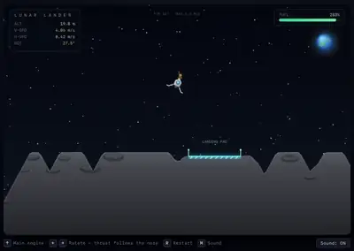</a><br><a href="https://www.sandbase.ai/lab/ai-videos/minimax-m3-1-flash/2112459195521896760?lang=zh-CN&utm_source=github&utm_medium=readme&utm_campaign=awesome-minimax-m3-1-flash&utm_content=card"><b>通过纯代码生成的登月着陆器游戏</b></a><br><sub><a href="https://x.com/ivanfioravanti/status/2112459195521896760">@ivanfioravanti</a> · 0:27 · <a href="https://www.sandbase.ai/lab/ai-videos/minimax-m3-1-flash/2112459195521896760?lang=zh-CN&utm_source=github&utm_medium=readme&utm_campaign=awesome-minimax-m3-1-flash&utm_content=card">提示词</a></sub></td><td width="33%" valign="top"><a href="https://www.sandbase.ai/lab/media/x/minimax-m3-1-flash/2112481123343474731/video.mp4">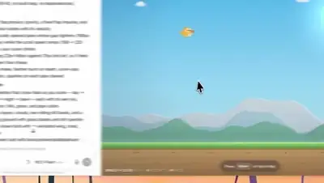</a><br><a href="https://www.sandbase.ai/lab/ai-videos/minimax-m3-1-flash/2112481123343474731?lang=zh-CN&utm_source=github&utm_medium=readme&utm_campaign=awesome-minimax-m3-1-flash&utm_content=card"><b>Flappy Bird复刻游戏</b></a><br><sub><a href="https://x.com/k2sbhai/status/2112481123343474731">@k2sbhai</a> · 0:20 · <a href="https://www.sandbase.ai/lab/ai-videos/minimax-m3-1-flash/2112481123343474731?lang=zh-CN&utm_source=github&utm_medium=readme&utm_campaign=awesome-minimax-m3-1-flash&utm_content=card">提示词</a></sub></td><td width="33%" valign="top"><a href="https://www.sandbase.ai/lab/media/x/minimax-m3-1-flash/2112541287622578567/video.mp4">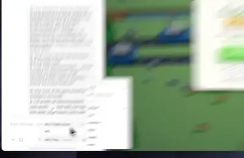</a><br><a href="https://www.sandbase.ai/lab/ai-videos/minimax-m3-1-flash/2112541287622578567?lang=zh-CN&utm_source=github&utm_medium=readme&utm_campaign=awesome-minimax-m3-1-flash&utm_content=card"><b>使用 MiniMax 复刻的天天过马路游戏</b></a><br><sub><a href="https://x.com/neropursue/status/2112541287622578567">@neropursue</a> · 0:24</sub></td></tr>
<tr><td width="33%" valign="top"><a href="https://www.sandbase.ai/lab/media/x/minimax-m3-1-flash/2112546817833390485/video.mp4">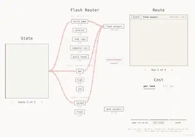</a><br><a href="https://www.sandbase.ai/lab/ai-videos/minimax-m3-1-flash/2112546817833390485?lang=zh-CN&utm_source=github&utm_medium=readme&utm_campaign=awesome-minimax-m3-1-flash&utm_content=card"><b>由 MiniMax M3.1 Flash 编写的网页游戏</b></a><br><sub><a href="https://x.com/starmexxx/status/2112546817833390485">@starmexxx</a> · 0:19</sub></td><td width="33%" valign="top"><a href="https://www.sandbase.ai/lab/media/x/minimax-m3-1-flash/2112563840567374031/video.mp4">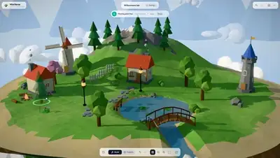</a><br><a href="https://www.sandbase.ai/lab/ai-videos/minimax-m3-1-flash/2112563840567374031?lang=zh-CN&utm_source=github&utm_medium=readme&utm_campaign=awesome-minimax-m3-1-flash&utm_content=card"><b>在浏览器中构建浮岛微缩世界的网页游戏</b></a><br><sub><a href="https://x.com/Amank1412/status/2112563840567374031">@Amank1412</a> · 0:48</sub></td><td width="33%" valign="top"><a href="https://www.sandbase.ai/lab/media/x/minimax-m3-1-flash/2112580693200912469/video.mp4">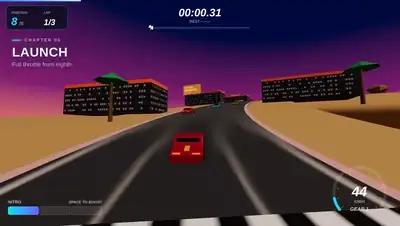</a><br><a href="https://www.sandbase.ai/lab/ai-videos/minimax-m3-1-flash/2112580693200912469?lang=zh-CN&utm_source=github&utm_medium=readme&utm_campaign=awesome-minimax-m3-1-flash&utm_content=card"><b>MiniMax生成的3D小游戏测试</b></a><br><sub><a href="https://x.com/zephyr_ov/status/2112580693200912469">@zephyr_ov</a> · 0:20</sub></td></tr>
<tr><td width="33%" valign="top"><a href="https://www.sandbase.ai/lab/media/x/minimax-m3-1-flash/2112791024112140782/video.mp4">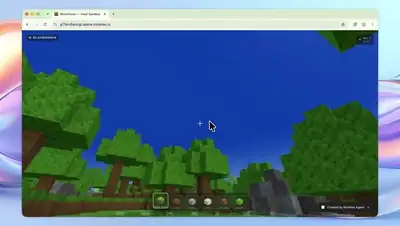</a><br><a href="https://www.sandbase.ai/lab/ai-videos/minimax-m3-1-flash/2112791024112140782?lang=zh-CN&utm_source=github&utm_medium=readme&utm_campaign=awesome-minimax-m3-1-flash&utm_content=card"><b>可玩的类我的世界3D体素沙盒游戏</b></a><br><sub><a href="https://x.com/MAXdeg0/status/2112791024112140782">@MAXdeg0</a> · 0:29 · <a href="https://www.sandbase.ai/lab/ai-videos/minimax-m3-1-flash/2112791024112140782?lang=zh-CN&utm_source=github&utm_medium=readme&utm_campaign=awesome-minimax-m3-1-flash&utm_content=card">提示词</a></sub></td><td width="33%" valign="top"><a href="https://www.sandbase.ai/lab/media/x/minimax-m3-1-flash/2112874036619591968/video.mp4">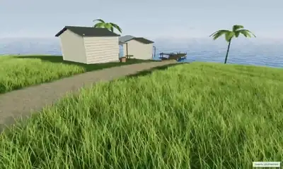</a><br><a href="https://www.sandbase.ai/lab/ai-videos/minimax-m3-1-flash/2112874036619591968?lang=zh-CN&utm_source=github&utm_medium=readme&utm_campaign=awesome-minimax-m3-1-flash&utm_content=card"><b>交互式三维海岛游戏</b></a><br><sub><a href="https://x.com/buildwithsid/status/2112874036619591968">@buildwithsid</a> · 0:46</sub></td><td width="33%" valign="top"><a href="https://www.sandbase.ai/lab/media/x/minimax-m3-1-flash/2113134403291660488/video.mp4"></a><br><a href="https://www.sandbase.ai/lab/ai-videos/minimax-m3-1-flash/2113134403291660488?lang=zh-CN&utm_source=github&utm_medium=readme&utm_campaign=awesome-minimax-m3-1-flash&utm_content=card"><b>东京街头跑酷游戏</b></a><br><sub><a href="https://x.com/rakibalislamm/status/2113134403291660488">@rakibalislamm</a> · 0:41</sub></td></tr>
<tr><td width="33%" valign="top"><a href="https://www.sandbase.ai/lab/media/x/minimax-m3-1-flash/2113233139115909536/video.mp4">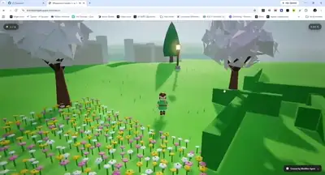</a><br><a href="https://www.sandbase.ai/lab/ai-videos/minimax-m3-1-flash/2113233139115909536?lang=zh-CN&utm_source=github&utm_medium=readme&utm_campaign=awesome-minimax-m3-1-flash&utm_content=card"><b>可游玩的3D花园探索游戏</b></a><br><sub><a href="https://x.com/itsjdraven/status/2113233139115909536">@itsjdraven</a> · 0:48</sub></td><td width="33%" valign="top"><a href="https://www.sandbase.ai/lab/media/x/minimax-m3-1-flash/2113246843085959593/video.mp4">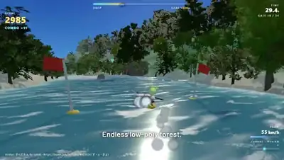</a><br><a href="https://www.sandbase.ai/lab/ai-videos/minimax-m3-1-flash/2113246843085959593?lang=zh-CN&utm_source=github&utm_medium=readme&utm_campaign=awesome-minimax-m3-1-flash&utm_content=card"><b>使用 OpenCode 制作的可玩 3D 网页游戏演示</b></a><br><sub><a href="https://x.com/vrc_diver/status/2113246843085959593">@vrc_diver</a> · 0:30</sub></td><td width="33%" valign="top"><a href="https://www.sandbase.ai/lab/media/x/minimax-m3-1-flash/2113280663214571605/video.mp4">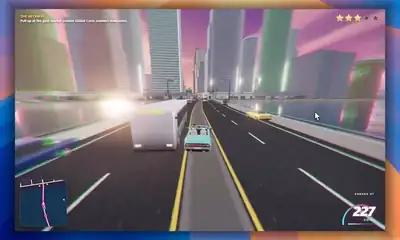</a><br><a href="https://www.sandbase.ai/lab/ai-videos/minimax-m3-1-flash/2113280663214571605?lang=zh-CN&utm_source=github&utm_medium=readme&utm_campaign=awesome-minimax-m3-1-flash&utm_content=card"><b>使用MiniMax构建的网页版GTA游戏</b></a><br><sub><a href="https://x.com/kaif9998/status/2113280663214571605">@kaif9998</a> · 0:45</sub></td></tr>
<tr><td width="33%" valign="top"><a href="https://www.sandbase.ai/lab/media/x/minimax-m3-1-flash/2113494641416790373/video.mp4">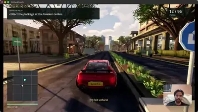</a><br><a href="https://www.sandbase.ai/lab/ai-videos/minimax-m3-1-flash/2113494641416790373?lang=zh-CN&utm_source=github&utm_medium=readme&utm_campaign=awesome-minimax-m3-1-flash&utm_content=card"><b>多模型协作打造的新加坡可游玩GTA游戏</b></a><br><sub><a href="https://x.com/ashen_one/status/2113494641416790373">@ashen_one</a> · 2:21</sub></td><td width="33%" valign="top"><a href="https://www.sandbase.ai/lab/media/x/minimax-m3-1-flash/2113617558981279919/video.mp4">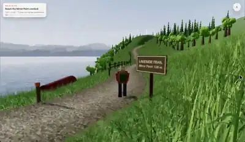</a><br><a href="https://www.sandbase.ai/lab/ai-videos/minimax-m3-1-flash/2113617558981279919?lang=zh-CN&utm_source=github&utm_medium=readme&utm_campaign=awesome-minimax-m3-1-flash&utm_content=card"><b>Three.js 实现的高山湖泊试玩游戏</b></a><br><sub><a href="https://x.com/1kartikkabadi1/status/2113617558981279919">@1kartikkabadi1</a> · 0:39</sub></td><td width="33%" valign="top"><a href="https://www.sandbase.ai/lab/media/x/minimax-m3-1-flash/2113668078798266522/video.mp4"></a><br><a href="https://www.sandbase.ai/lab/ai-videos/minimax-m3-1-flash/2113668078798266522?lang=zh-CN&utm_source=github&utm_medium=readme&utm_campaign=awesome-minimax-m3-1-flash&utm_content=card"><b>宇航员小兔收集落星3D游戏</b></a><br><sub><a href="https://x.com/Im_IrushiK/status/2113668078798266522">@Im_IrushiK</a> · 0:24</sub></td></tr>
<tr><td width="33%" valign="top"><a href="https://www.sandbase.ai/lab/media/x/minimax-m3-1-flash/2113736043212239179/video.mp4"></a><br><a href="https://www.sandbase.ai/lab/ai-videos/minimax-m3-1-flash/2113736043212239179?lang=zh-CN&utm_source=github&utm_medium=readme&utm_campaign=awesome-minimax-m3-1-flash&utm_content=card"><b>三款视觉模型实时识别涂鸦对决</b></a><br><sub><a href="https://x.com/sujee_dev/status/2113736043212239179">@sujee_dev</a> · 0:47</sub></td><td width="33%" valign="top"><a href="https://www.sandbase.ai/lab/media/x/minimax-m3-1-flash/2114699875078017066/video.mp4"></a><br><a href="https://www.sandbase.ai/lab/ai-videos/minimax-m3-1-flash/2114699875078017066?lang=zh-CN&utm_source=github&utm_medium=readme&utm_campaign=awesome-minimax-m3-1-flash&utm_content=card"><b>纯HTML编写的可玩太空兔游戏</b></a><br><sub><a href="https://x.com/ArchiveExplorer/status/2114699875078017066">@ArchiveExplorer</a> · 0:24</sub></td><td width="33%" valign="top"><a href="https://www.sandbase.ai/lab/media/x/minimax-m3-1-flash/2114944252384055460/video.mp4"></a><br><a href="https://www.sandbase.ai/lab/ai-videos/minimax-m3-1-flash/2114944252384055460?lang=zh-CN&utm_source=github&utm_medium=readme&utm_campaign=awesome-minimax-m3-1-flash&utm_content=card"><b>Neon Velocity 3D赛博朋克赛车游戏</b></a><br><sub><a href="https://x.com/HeyZaraKhan/status/2114944252384055460">@HeyZaraKhan</a> · 0:38</sub></td></tr>
<tr><td width="33%" valign="top"><a href="https://www.sandbase.ai/lab/media/x/minimax-m3-1-flash/2114985293141229688/video.mp4"></a><br><a href="https://www.sandbase.ai/lab/ai-videos/minimax-m3-1-flash/2114985293141229688?lang=zh-CN&utm_source=github&utm_medium=readme&utm_campaign=awesome-minimax-m3-1-flash&utm_content=card"><b>Fish Survival 3D 网页游戏概念展示</b></a><br><sub><a href="https://x.com/hey_simanto/status/2114985293141229688">@hey_simanto</a> · 0:20</sub></td><td width="33%" valign="top"><a href="https://www.sandbase.ai/lab/media/x/minimax-m3-1-flash/2115041504284811540/video.mp4"></a><br><a href="https://www.sandbase.ai/lab/ai-videos/minimax-m3-1-flash/2115041504284811540?lang=zh-CN&utm_source=github&utm_medium=readme&utm_campaign=awesome-minimax-m3-1-flash&utm_content=card"><b>完全由代码生成的开放世界FPS游戏</b></a><br><sub><a href="https://x.com/ItsmeAjayKV/status/2115041504284811540">@ItsmeAjayKV</a> · 1:35</sub></td><td width="33%" valign="top"><a href="https://www.sandbase.ai/lab/media/x/minimax-m3-1-flash/2115044003582460079/video.mp4"></a><br><a href="https://www.sandbase.ai/lab/ai-videos/minimax-m3-1-flash/2115044003582460079?lang=zh-CN&utm_source=github&utm_medium=readme&utm_campaign=awesome-minimax-m3-1-flash&utm_content=card"><b>使用 MiniMax Code 构建的像素风冒险游戏</b></a><br><sub><a href="https://x.com/JayBisen473370/status/2115044003582460079">@JayBisen473370</a> · 0:30</sub></td></tr>
<tr><td width="33%" valign="top"><a href="https://www.sandbase.ai/lab/media/x/minimax-m3-1-flash/2115074454007304216/video.mp4"></a><br><a href="https://www.sandbase.ai/lab/ai-videos/minimax-m3-1-flash/2115074454007304216?lang=zh-CN&utm_source=github&utm_medium=readme&utm_campaign=awesome-minimax-m3-1-flash&utm_content=card"><b>3D糖果工厂模拟游戏</b></a><br><sub><a href="https://x.com/iam_elias1/status/2115074454007304216">@iam_elias1</a> · 0:41</sub></td><td width="33%" valign="top"><a href="https://www.sandbase.ai/lab/media/x/minimax-m3-1-flash/2115102820668219428/video.mp4"></a><br><a href="https://www.sandbase.ai/lab/ai-videos/minimax-m3-1-flash/2115102820668219428?lang=zh-CN&utm_source=github&utm_medium=readme&utm_campaign=awesome-minimax-m3-1-flash&utm_content=card"><b>单HTML文件构建的3D霓虹屋顶跑酷游戏</b></a><br><sub><a href="https://x.com/ethancoder0/status/2115102820668219428">@ethancoder0</a> · 1:02 · <a href="https://www.sandbase.ai/lab/ai-videos/minimax-m3-1-flash/2115102820668219428?lang=zh-CN&utm_source=github&utm_medium=readme&utm_campaign=awesome-minimax-m3-1-flash&utm_content=card">提示词</a></sub></td><td width="33%" valign="top"><a href="https://www.sandbase.ai/lab/media/x/minimax-m3-1-flash/2115727918550987087/video.mp4"></a><br><a href="https://www.sandbase.ai/lab/ai-videos/minimax-m3-1-flash/2115727918550987087?lang=zh-CN&utm_source=github&utm_medium=readme&utm_campaign=awesome-minimax-m3-1-flash&utm_content=card"><b>争夺一个工作岗位的3D小游戏</b></a><br><sub><a href="https://x.com/Gamingtronium/status/2115727918550987087">@Gamingtronium</a> · 0:54</sub></td></tr>
<tr><td width="33%" valign="top"><a href="https://www.sandbase.ai/lab/media/x/minimax-m3-1-flash/2115776273285083535/video.mp4"></a><br><a href="https://www.sandbase.ai/lab/ai-videos/minimax-m3-1-flash/2115776273285083535?lang=zh-CN&utm_source=github&utm_medium=readme&utm_campaign=awesome-minimax-m3-1-flash&utm_content=card"><b>浏览器内运行的可玩3D花园游戏</b></a><br><sub><a href="https://x.com/LetsGrowithAI/status/2115776273285083535">@LetsGrowithAI</a> · 2:06</sub></td><td width="33%" valign="top"><a href="https://www.sandbase.ai/lab/media/x/minimax-m3-1-flash/2116313123183554958/video.mp4"></a><br><a href="https://www.sandbase.ai/lab/ai-videos/minimax-m3-1-flash/2116313123183554958?lang=zh-CN&utm_source=github&utm_medium=readme&utm_campaign=awesome-minimax-m3-1-flash&utm_content=card"><b>太空兔主角的可玩太空街机游戏</b></a><br><sub><a href="https://x.com/omarsar0/status/2116313123183554958">@omarsar0</a> · 0:42</sub></td></tr>
</table>

</details>

<a id="ui-demo"></a>

## 产品界面

<table>
<tr><td width="33%" valign="top"><a href="https://www.sandbase.ai/lab/media/x/minimax-m3-1-flash/2112160831118983171/video.mp4"></a><br><a href="https://www.sandbase.ai/lab/ai-videos/minimax-m3-1-flash/2112160831118983171?lang=zh-CN&utm_source=github&utm_medium=readme&utm_campaign=awesome-minimax-m3-1-flash&utm_content=card"><b>MiniMax M3.1 单次生成的网站页面展示</b></a><br><sub><a href="https://x.com/MichaelGannotti/status/2112160831118983171">@MichaelGannotti</a> · 1:11</sub></td><td width="33%" valign="top"><a href="https://www.sandbase.ai/lab/media/x/minimax-m3-1-flash/2112178619120534014/video.mp4"></a><br><a href="https://www.sandbase.ai/lab/ai-videos/minimax-m3-1-flash/2112178619120534014?lang=zh-CN&utm_source=github&utm_medium=readme&utm_campaign=awesome-minimax-m3-1-flash&utm_content=card"><b>通过录屏视频重建落地页</b></a><br><sub><a href="https://x.com/PrajwalTomar_/status/2112178619120534014">@PrajwalTomar_</a> · 0:43</sub></td><td width="33%" valign="top"><a href="https://www.sandbase.ai/lab/media/x/minimax-m3-1-flash/2112206475968086093/video.mp4"></a><br><a href="https://www.sandbase.ai/lab/ai-videos/minimax-m3-1-flash/2112206475968086093?lang=zh-CN&utm_source=github&utm_medium=readme&utm_campaign=awesome-minimax-m3-1-flash&utm_content=card"><b>MiniMax M3.1 Flash生成的前端界面展示</b></a><br><sub><a href="https://x.com/bei351009016/status/2112206475968086093">@bei351009016</a> · 0:14</sub></td></tr>
<tr><td width="33%" valign="top"><a href="https://www.sandbase.ai/lab/media/x/minimax-m3-1-flash/2112500742829277565/video.mp4"></a><br><a href="https://www.sandbase.ai/lab/ai-videos/minimax-m3-1-flash/2112500742829277565?lang=zh-CN&utm_source=github&utm_medium=readme&utm_campaign=awesome-minimax-m3-1-flash&utm_content=card"><b>具备光影交互效果的太空兔网页展示</b></a><br><sub><a href="https://x.com/0x_fokki/status/2112500742829277565">@0x_fokki</a> · 0:15 · <a href="https://www.sandbase.ai/lab/ai-videos/minimax-m3-1-flash/2112500742829277565?lang=zh-CN&utm_source=github&utm_medium=readme&utm_campaign=awesome-minimax-m3-1-flash&utm_content=card">提示词</a></sub></td><td width="33%" valign="top"><a href="https://www.sandbase.ai/lab/media/x/minimax-m3-1-flash/2112500802275148073/video.mp4"></a><br><a href="https://www.sandbase.ai/lab/ai-videos/minimax-m3-1-flash/2112500802275148073?lang=zh-CN&utm_source=github&utm_medium=readme&utm_campaign=awesome-minimax-m3-1-flash&utm_content=card"><b>终端自动修复代码Bug演示</b></a><br><sub><a href="https://x.com/slash1sol/status/2112500802275148073">@slash1sol</a> · 0:58</sub></td><td width="33%" valign="top"><a href="https://www.sandbase.ai/lab/media/x/minimax-m3-1-flash/2112519745270321496/video.mp4"></a><br><a href="https://www.sandbase.ai/lab/ai-videos/minimax-m3-1-flash/2112519745270321496?lang=zh-CN&utm_source=github&utm_medium=readme&utm_campaign=awesome-minimax-m3-1-flash&utm_content=card"><b>AI智能体指挥中心实时交互仪表盘</b></a><br><sub><a href="https://x.com/0xRicker/status/2112519745270321496">@0xRicker</a> · 0:39</sub></td></tr>
</table>

<details>
<summary><b>展开全部 20 条</b></summary>

<table>
<tr><td width="33%" valign="top"><a href="https://www.sandbase.ai/lab/media/x/minimax-m3-1-flash/2112564618786652484/video.mp4"></a><br><a href="https://www.sandbase.ai/lab/ai-videos/minimax-m3-1-flash/2112564618786652484?lang=zh-CN&utm_source=github&utm_medium=readme&utm_campaign=awesome-minimax-m3-1-flash&utm_content=card"><b>将Obsidian笔记整理为维基页面</b></a><br><sub><a href="https://x.com/Mr_Buzzoni/status/2112564618786652484">@Mr_Buzzoni</a> · 0:24</sub></td><td width="33%" valign="top"><a href="https://www.sandbase.ai/lab/media/x/minimax-m3-1-flash/2112598256731451713/video.mp4"></a><br><a href="https://www.sandbase.ai/lab/ai-videos/minimax-m3-1-flash/2112598256731451713?lang=zh-CN&utm_source=github&utm_medium=readme&utm_campaign=awesome-minimax-m3-1-flash&utm_content=card"><b>发光卡片风格的习惯打卡应用UI重构</b></a><br><sub><a href="https://x.com/gippp69/status/2112598256731451713">@gippp69</a> · 0:27</sub></td><td width="33%" valign="top"><a href="https://www.sandbase.ai/lab/media/x/minimax-m3-1-flash/2112938798262919675/video.mp4"></a><br><a href="https://www.sandbase.ai/lab/ai-videos/minimax-m3-1-flash/2112938798262919675?lang=zh-CN&utm_source=github&utm_medium=readme&utm_campaign=awesome-minimax-m3-1-flash&utm_content=card"><b>级联语音交互系统对话演示</b></a><br><sub><a href="https://x.com/GenAI_is_real/status/2112938798262919675">@GenAI_is_real</a> · 3:08</sub></td></tr>
<tr><td width="33%" valign="top"><a href="https://www.sandbase.ai/lab/media/x/minimax-m3-1-flash/2112954956210729048/video.mp4"></a><br><a href="https://www.sandbase.ai/lab/ai-videos/minimax-m3-1-flash/2112954956210729048?lang=zh-CN&utm_source=github&utm_medium=readme&utm_campaign=awesome-minimax-m3-1-flash&utm_content=card"><b>将书签整理为可搜索的书签库</b></a><br><sub><a href="https://x.com/leopardracer/status/2112954956210729048">@leopardracer</a> · 0:20</sub></td><td width="33%" valign="top"><a href="https://www.sandbase.ai/lab/media/x/minimax-m3-1-flash/2113022535612924212/video.mp4"></a><br><a href="https://www.sandbase.ai/lab/ai-videos/minimax-m3-1-flash/2113022535612924212?lang=zh-CN&utm_source=github&utm_medium=readme&utm_campaign=awesome-minimax-m3-1-flash&utm_content=card"><b>从零构建的内容策划应用</b></a><br><sub><a href="https://x.com/rewind02/status/2113022535612924212">@rewind02</a> · 0:36</sub></td><td width="33%" valign="top"><a href="https://www.sandbase.ai/lab/media/x/minimax-m3-1-flash/2113182324628308476/video.mp4"></a><br><a href="https://www.sandbase.ai/lab/ai-videos/minimax-m3-1-flash/2113182324628308476?lang=zh-CN&utm_source=github&utm_medium=readme&utm_campaign=awesome-minimax-m3-1-flash&utm_content=card"><b>单HTML文件完整操作系统演示</b></a><br><sub><a href="https://x.com/Israfilv2/status/2113182324628308476">@Israfilv2</a> · 0:58 · <a href="https://www.sandbase.ai/lab/ai-videos/minimax-m3-1-flash/2113182324628308476?lang=zh-CN&utm_source=github&utm_medium=readme&utm_campaign=awesome-minimax-m3-1-flash&utm_content=card">提示词</a></sub></td></tr>
<tr><td width="33%" valign="top"><a href="https://www.sandbase.ai/lab/media/x/minimax-m3-1-flash/2113235956518010903/video.mp4"></a><br><a href="https://www.sandbase.ai/lab/ai-videos/minimax-m3-1-flash/2113235956518010903?lang=zh-CN&utm_source=github&utm_medium=readme&utm_campaign=awesome-minimax-m3-1-flash&utm_content=card"><b>牙医网站自动抓取与分析演示</b></a><br><sub><a href="https://x.com/LeoCreaIA/status/2113235956518010903">@LeoCreaIA</a> · 0:35</sub></td><td width="33%" valign="top"><a href="https://www.sandbase.ai/lab/media/x/minimax-m3-1-flash/2113553675482525940/video.mp4"></a><br><a href="https://www.sandbase.ai/lab/ai-videos/minimax-m3-1-flash/2113553675482525940?lang=zh-CN&utm_source=github&utm_medium=readme&utm_campaign=awesome-minimax-m3-1-flash&utm_content=card"><b>交互式落地页与3D场景演示</b></a><br><sub><a href="https://x.com/MengTo/status/2113553675482525940">@MengTo</a> · 0:51 · <a href="https://www.sandbase.ai/lab/ai-videos/minimax-m3-1-flash/2113553675482525940?lang=zh-CN&utm_source=github&utm_medium=readme&utm_campaign=awesome-minimax-m3-1-flash&utm_content=card">提示词</a></sub></td><td width="33%" valign="top"><a href="https://www.sandbase.ai/lab/media/x/minimax-m3-1-flash/2113572358334345570/video.mp4"></a><br><a href="https://www.sandbase.ai/lab/ai-videos/minimax-m3-1-flash/2113572358334345570?lang=zh-CN&utm_source=github&utm_medium=readme&utm_campaign=awesome-minimax-m3-1-flash&utm_content=card"><b>带交互式图表的SaaS分析仪表板</b></a><br><sub><a href="https://x.com/aresotik/status/2113572358334345570">@aresotik</a> · 0:36</sub></td></tr>
<tr><td width="33%" valign="top"><a href="https://www.sandbase.ai/lab/media/x/minimax-m3-1-flash/2113613603676783051/video.mp4"></a><br><a href="https://www.sandbase.ai/lab/ai-videos/minimax-m3-1-flash/2113613603676783051?lang=zh-CN&utm_source=github&utm_medium=readme&utm_campaign=awesome-minimax-m3-1-flash&utm_content=card"><b>交互式AI智能体控制中心仪表板</b></a><br><sub><a href="https://x.com/He1s_Sammy/status/2113613603676783051">@He1s_Sammy</a> · 0:38</sub></td><td width="33%" valign="top"><a href="https://www.sandbase.ai/lab/media/x/minimax-m3-1-flash/2113675111056220364/video.mp4"></a><br><a href="https://www.sandbase.ai/lab/ai-videos/minimax-m3-1-flash/2113675111056220364?lang=zh-CN&utm_source=github&utm_medium=readme&utm_campaign=awesome-minimax-m3-1-flash&utm_content=card"><b>Ghast AI钱包隐私工作流测试</b></a><br><sub><a href="https://x.com/tiny_hunter5/status/2113675111056220364">@tiny_hunter5</a> · 0:47</sub></td><td width="33%" valign="top"><a href="https://www.sandbase.ai/lab/media/x/minimax-m3-1-flash/2114621544177787011/video.mp4"></a><br><a href="https://www.sandbase.ai/lab/ai-videos/minimax-m3-1-flash/2114621544177787011?lang=zh-CN&utm_source=github&utm_medium=readme&utm_campaign=awesome-minimax-m3-1-flash&utm_content=card"><b>用AI调试Python商城代码库</b></a><br><sub><a href="https://x.com/codedailyML/status/2114621544177787011">@codedailyML</a> · 0:44</sub></td></tr>
<tr><td width="33%" valign="top"><a href="https://www.sandbase.ai/lab/media/x/minimax-m3-1-flash/2114716186889920678/video.mp4"></a><br><a href="https://www.sandbase.ai/lab/ai-videos/minimax-m3-1-flash/2114716186889920678?lang=zh-CN&utm_source=github&utm_medium=readme&utm_campaign=awesome-minimax-m3-1-flash&utm_content=card"><b>包含预告片与音乐的角色展示商城网站</b></a><br><sub><a href="https://x.com/flxrnc/status/2114716186889920678">@flxrnc</a> · 1:03</sub></td><td width="33%" valign="top"><a href="https://www.sandbase.ai/lab/media/x/minimax-m3-1-flash/2114924763206598863/video.mp4"></a><br><a href="https://www.sandbase.ai/lab/ai-videos/minimax-m3-1-flash/2114924763206598863?lang=zh-CN&utm_source=github&utm_medium=readme&utm_campaign=awesome-minimax-m3-1-flash&utm_content=card"><b>FlashDesk 客户支持工作流演示</b></a><br><sub><a href="https://x.com/Dipanshu_AI/status/2114924763206598863">@Dipanshu_AI</a> · 1:46</sub></td></tr>
</table>

</details>

<a id="particles"></a>

## 粒子与形状

<table>
<tr><td width="33%" valign="top"><a href="https://www.sandbase.ai/lab/media/x/minimax-m3-1-flash/2113547444432576740/video.mp4"></a><br><a href="https://www.sandbase.ai/lab/ai-videos/minimax-m3-1-flash/2113547444432576740?lang=zh-CN&utm_source=github&utm_medium=readme&utm_campaign=awesome-minimax-m3-1-flash&utm_content=card"><b>实时交互式粒子物理模拟系统</b></a><br><sub><a href="https://x.com/LunarResearcher/status/2113547444432576740">@LunarResearcher</a> · 0:20</sub></td><td width="33%" valign="top"><a href="https://www.sandbase.ai/lab/media/x/minimax-m3-1-flash/2114809290737274944/video.mp4"></a><br><a href="https://www.sandbase.ai/lab/ai-videos/minimax-m3-1-flash/2114809290737274944?lang=zh-CN&utm_source=github&utm_medium=readme&utm_campaign=awesome-minimax-m3-1-flash&utm_content=card"><b>智能体油画模拟梵高星空</b></a><br><sub><a href="https://x.com/FeatherlessAI/status/2114809290737274944">@FeatherlessAI</a> · 0:12</sub></td></tr>
</table>

<a id="data-viz"></a>

## 图表图解

<table>
<tr><td width="33%" valign="top"><a href="https://www.sandbase.ai/lab/media/x/minimax-m3-1-flash/2112557815231320268/video.mp4"></a><br><a href="https://www.sandbase.ai/lab/ai-videos/minimax-m3-1-flash/2112557815231320268?lang=zh-CN&utm_source=github&utm_medium=readme&utm_campaign=awesome-minimax-m3-1-flash&utm_content=card"><b>蒙特卡洛交易资产曲线模拟工具</b></a><br><sub><a href="https://x.com/Rossst_03/status/2112557815231320268">@Rossst_03</a> · 0:12</sub></td><td width="33%" valign="top"><a href="https://www.sandbase.ai/lab/media/x/minimax-m3-1-flash/2113652431544566235/video.mp4"></a><br><a href="https://www.sandbase.ai/lab/ai-videos/minimax-m3-1-flash/2113652431544566235?lang=zh-CN&utm_source=github&utm_medium=readme&utm_campaign=awesome-minimax-m3-1-flash&utm_content=card"><b>西安城市与交通历史演变可视化</b></a><br><sub><a href="https://x.com/davidliyangbing/status/2113652431544566235">@davidliyangbing</a> · 2:25</sub></td></tr>
</table>

<a id="explainer"></a>

## 讲解

<table>
<tr><td width="33%" valign="top"><a href="https://www.sandbase.ai/lab/media/x/minimax-m3-1-flash/2112198804128895153/video.mp4"></a><br><a href="https://www.sandbase.ai/lab/ai-videos/minimax-m3-1-flash/2112198804128895153?lang=zh-CN&utm_source=github&utm_medium=readme&utm_campaign=awesome-minimax-m3-1-flash&utm_content=card"><b>MiniMax Code与模型的自我介绍视频</b></a><br><sub><a href="https://x.com/klarkxy/status/2112198804128895153">@klarkxy</a> · 1:18 · <a href="https://www.sandbase.ai/lab/ai-videos/minimax-m3-1-flash/2112198804128895153?lang=zh-CN&utm_source=github&utm_medium=readme&utm_campaign=awesome-minimax-m3-1-flash&utm_content=card">提示词</a></sub></td><td width="33%" valign="top"><a href="https://www.sandbase.ai/lab/media/x/minimax-m3-1-flash/2112638170844082179/video.mp4"></a><br><a href="https://www.sandbase.ai/lab/ai-videos/minimax-m3-1-flash/2112638170844082179?lang=zh-CN&utm_source=github&utm_medium=readme&utm_campaign=awesome-minimax-m3-1-flash&utm_content=card"><b>三种物体的等距交互式原理解析网页</b></a><br><sub><a href="https://x.com/0x_fokki/status/2112638170844082179">@0x_fokki</a> · 0:30</sub></td><td width="33%" valign="top"><a href="https://www.sandbase.ai/lab/media/x/minimax-m3-1-flash/2112650462369595427/video.mp4"></a><br><a href="https://www.sandbase.ai/lab/ai-videos/minimax-m3-1-flash/2112650462369595427?lang=zh-CN&utm_source=github&utm_medium=readme&utm_campaign=awesome-minimax-m3-1-flash&utm_content=card"><b>拍立得相机内部运作原理解释网页</b></a><br><sub><a href="https://x.com/0x_pedro/status/2112650462369595427">@0x_pedro</a> · 0:35</sub></td></tr>
<tr><td width="33%" valign="top"><a href="https://www.sandbase.ai/lab/media/x/minimax-m3-1-flash/2113210116304765405/video.mp4"></a><br><a href="https://www.sandbase.ai/lab/ai-videos/minimax-m3-1-flash/2113210116304765405?lang=zh-CN&utm_source=github&utm_medium=readme&utm_campaign=awesome-minimax-m3-1-flash&utm_content=card"><b>AI智能体代码调试与网页开发工作流</b></a><br><sub><a href="https://x.com/Soranlan/status/2113210116304765405">@Soranlan</a> · 0:29</sub></td><td width="33%" valign="top"><a href="https://www.sandbase.ai/lab/media/x/minimax-m3-1-flash/2113572717459026090/video.mp4"></a><br><a href="https://www.sandbase.ai/lab/ai-videos/minimax-m3-1-flash/2113572717459026090?lang=zh-CN&utm_source=github&utm_medium=readme&utm_campaign=awesome-minimax-m3-1-flash&utm_content=card"><b>MiniMax代码生成的数学题讲解视频</b></a><br><sub><a href="https://x.com/akokoi1/status/2113572717459026090">@akokoi1</a> · 0:47</sub></td></tr>
</table>

<a id="launch-film"></a>

## 发布片

<table>
<tr><td width="33%" valign="top"><a href="https://www.sandbase.ai/lab/media/x/minimax-m3-1-flash/2112463050108441025/video.mp4"></a><br><a href="https://www.sandbase.ai/lab/ai-videos/minimax-m3-1-flash/2112463050108441025?lang=zh-CN&utm_source=github&utm_medium=readme&utm_campaign=awesome-minimax-m3-1-flash&utm_content=card"><b>MiniMax M3.1 Flash宣传视频</b></a><br><sub><a href="https://x.com/world_0618/status/2112463050108441025">@world_0618</a> · 1:13</sub></td><td width="33%" valign="top"><a href="https://www.sandbase.ai/lab/media/x/minimax-m3-1-flash/2113138389172224237/video.mp4"></a><br><a href="https://www.sandbase.ai/lab/ai-videos/minimax-m3-1-flash/2113138389172224237?lang=zh-CN&utm_source=github&utm_medium=readme&utm_campaign=awesome-minimax-m3-1-flash&utm_content=card"><b>Pi Agent Desktop产品宣传片</b></a><br><sub><a href="https://x.com/chasen_liao/status/2113138389172224237">@chasen_liao</a> · 0:30 · <a href="https://www.sandbase.ai/lab/ai-videos/minimax-m3-1-flash/2113138389172224237?lang=zh-CN&utm_source=github&utm_medium=readme&utm_campaign=awesome-minimax-m3-1-flash&utm_content=card">提示词</a></sub></td><td width="33%" valign="top"><a href="https://www.sandbase.ai/lab/media/x/minimax-m3-1-flash/2113225129862062523/video.mp4"></a><br><a href="https://www.sandbase.ai/lab/ai-videos/minimax-m3-1-flash/2113225129862062523?lang=zh-CN&utm_source=github&utm_medium=readme&utm_campaign=awesome-minimax-m3-1-flash&utm_content=card"><b>纯代码生成的3D动效宣传片</b></a><br><sub><a href="https://x.com/Saccc_c/status/2113225129862062523">@Saccc_c</a> · 0:26</sub></td></tr>
</table>

<a id="comparison"></a>

## 测试对比

<table>
<tr><td width="33%" valign="top"><a href="https://www.sandbase.ai/lab/media/x/minimax-m3-1-flash/2112125242415956183/video.mp4"></a><br><a href="https://www.sandbase.ai/lab/ai-videos/minimax-m3-1-flash/2112125242415956183?lang=zh-CN&utm_source=github&utm_medium=readme&utm_campaign=awesome-minimax-m3-1-flash&utm_content=card"><b>MiniMax M3.1 对比 DeepSeek V4.1 测试结果</b></a><br><sub><a href="https://x.com/SPAC89/status/2112125242415956183">@SPAC89</a> · 0:30</sub></td><td width="33%" valign="top"><a href="https://www.sandbase.ai/lab/media/x/minimax-m3-1-flash/2112133888613224558/video.mp4"></a><br><a href="https://www.sandbase.ai/lab/ai-videos/minimax-m3-1-flash/2112133888613224558?lang=zh-CN&utm_source=github&utm_medium=readme&utm_campaign=awesome-minimax-m3-1-flash&utm_content=card"><b>MiniMax 与 DeepSeek 模型的对比测试</b></a><br><sub><a href="https://x.com/bbfu0382/status/2112133888613224558">@bbfu0382</a> · 0:30</sub></td><td width="33%" valign="top"><a href="https://www.sandbase.ai/lab/media/x/minimax-m3-1-flash/2112159579060486212/video.mp4"></a><br><a href="https://www.sandbase.ai/lab/ai-videos/minimax-m3-1-flash/2112159579060486212?lang=zh-CN&utm_source=github&utm_medium=readme&utm_campaign=awesome-minimax-m3-1-flash&utm_content=card"><b>3D 机甲组装与发射序列对比演示</b></a><br><sub><a href="https://x.com/alohaproxy/status/2112159579060486212">@alohaproxy</a> · 0:34 · <a href="https://www.sandbase.ai/lab/ai-videos/minimax-m3-1-flash/2112159579060486212?lang=zh-CN&utm_source=github&utm_medium=readme&utm_campaign=awesome-minimax-m3-1-flash&utm_content=card">提示词</a></sub></td></tr>
<tr><td width="33%" valign="top"><a href="https://www.sandbase.ai/lab/media/x/minimax-m3-1-flash/2112168890600149125/video.mp4"></a><br><a href="https://www.sandbase.ai/lab/ai-videos/minimax-m3-1-flash/2112168890600149125?lang=zh-CN&utm_source=github&utm_medium=readme&utm_campaign=awesome-minimax-m3-1-flash&utm_content=card"><b>像素城市：MiniMax 与 DeepSeek 对比</b></a><br><sub><a href="https://x.com/notjazii/status/2112168890600149125">@notjazii</a> · 0:10</sub></td><td width="33%" valign="top"><a href="https://www.sandbase.ai/lab/media/x/minimax-m3-1-flash/2112173892546834486/video.mp4"></a><br><a href="https://www.sandbase.ai/lab/ai-videos/minimax-m3-1-flash/2112173892546834486?lang=zh-CN&utm_source=github&utm_medium=readme&utm_campaign=awesome-minimax-m3-1-flash&utm_content=card"><b>四款AI模型Pelican测试横向对比</b></a><br><sub><a href="https://x.com/SandbaseAI/status/2112173892546834486">@SandbaseAI</a> · 0:45</sub></td><td width="33%" valign="top"><a href="https://www.sandbase.ai/lab/media/x/minimax-m3-1-flash/2112186946210668839/video.mp4"></a><br><a href="https://www.sandbase.ai/lab/ai-videos/minimax-m3-1-flash/2112186946210668839?lang=zh-CN&utm_source=github&utm_medium=readme&utm_campaign=awesome-minimax-m3-1-flash&utm_content=card"><b>MiniMax与DeepSeek酷霸王效果对比</b></a><br><sub><a href="https://x.com/ivanainai/status/2112186946210668839">@ivanainai</a> · 0:14</sub></td></tr>
</table>

<details>
<summary><b>展开全部 88 条</b></summary>

<table>
<tr><td width="33%" valign="top"><a href="https://www.sandbase.ai/lab/media/x/minimax-m3-1-flash/2112192337925521881/video.mp4"></a><br><a href="https://www.sandbase.ai/lab/ai-videos/minimax-m3-1-flash/2112192337925521881?lang=zh-CN&utm_source=github&utm_medium=readme&utm_campaign=awesome-minimax-m3-1-flash&utm_content=card"><b>MiniMax与Claude生成飞行跑车对比</b></a><br><sub><a href="https://x.com/narushima_/status/2112192337925521881">@narushima_</a> · 0:25</sub></td><td width="33%" valign="top"><a href="https://www.sandbase.ai/lab/media/x/minimax-m3-1-flash/2112200201507311699/video.mp4"></a><br><a href="https://www.sandbase.ai/lab/ai-videos/minimax-m3-1-flash/2112200201507311699?lang=zh-CN&utm_source=github&utm_medium=readme&utm_campaign=awesome-minimax-m3-1-flash&utm_content=card"><b>MiniMax与DeepSeek的Three.js测试</b></a><br><sub><a href="https://x.com/notjazii/status/2112200201507311699">@notjazii</a> · 0:27</sub></td><td width="33%" valign="top"><a href="https://www.sandbase.ai/lab/media/x/minimax-m3-1-flash/2112201004917940321/video.mp4"></a><br><a href="https://www.sandbase.ai/lab/ai-videos/minimax-m3-1-flash/2112201004917940321?lang=zh-CN&utm_source=github&utm_medium=readme&utm_campaign=awesome-minimax-m3-1-flash&utm_content=card"><b>MiniMax与DeepSeek鹈鹕之梦对比</b></a><br><sub><a href="https://x.com/VulKan42069/status/2112201004917940321">@VulKan42069</a> · 0:45</sub></td></tr>
<tr><td width="33%" valign="top"><a href="https://www.sandbase.ai/lab/media/x/minimax-m3-1-flash/2112201041198620823/video.mp4"></a><br><a href="https://www.sandbase.ai/lab/ai-videos/minimax-m3-1-flash/2112201041198620823?lang=zh-CN&utm_source=github&utm_medium=readme&utm_campaign=awesome-minimax-m3-1-flash&utm_content=card"><b>MiniMax与DeepSeek糖果小熊测试对比</b></a><br><sub><a href="https://x.com/leo114119/status/2112201041198620823">@leo114119</a></sub></td><td width="33%" valign="top"><a href="https://www.sandbase.ai/lab/media/x/minimax-m3-1-flash/2112206241137054071/video.mp4"></a><br><a href="https://www.sandbase.ai/lab/ai-videos/minimax-m3-1-flash/2112206241137054071?lang=zh-CN&utm_source=github&utm_medium=readme&utm_campaign=awesome-minimax-m3-1-flash&utm_content=card"><b>海底城市潜艇追逐模型对比测试</b></a><br><sub><a href="https://x.com/thehypedotnews/status/2112206241137054071">@thehypedotnews</a> · 0:30</sub></td><td width="33%" valign="top"><a href="https://www.sandbase.ai/lab/media/x/minimax-m3-1-flash/2112207066819375397/video.mp4"></a><br><a href="https://www.sandbase.ai/lab/ai-videos/minimax-m3-1-flash/2112207066819375397?lang=zh-CN&utm_source=github&utm_medium=readme&utm_campaign=awesome-minimax-m3-1-flash&utm_content=card"><b>Opus 5.5 与 MiniMax M3.1 Flash 迈阿密场景对比</b></a><br><sub><a href="https://x.com/davit__yan/status/2112207066819375397">@davit__yan</a> · 0:25 · <a href="https://www.sandbase.ai/lab/ai-videos/minimax-m3-1-flash/2112207066819375397?lang=zh-CN&utm_source=github&utm_medium=readme&utm_campaign=awesome-minimax-m3-1-flash&utm_content=card">提示词</a></sub></td></tr>
<tr><td width="33%" valign="top"><a href="https://www.sandbase.ai/lab/media/x/minimax-m3-1-flash/2112211798493397408/video.mp4"></a><br><a href="https://www.sandbase.ai/lab/ai-videos/minimax-m3-1-flash/2112211798493397408?lang=zh-CN&utm_source=github&utm_medium=readme&utm_campaign=awesome-minimax-m3-1-flash&utm_content=card"><b>DeepSeek与MiniMax同提示词测试对比</b></a><br><sub><a href="https://x.com/rubenssoto_ai/status/2112211798493397408">@rubenssoto_ai</a> · 0:30</sub></td><td width="33%" valign="top"><a href="https://www.sandbase.ai/lab/media/x/minimax-m3-1-flash/2112214607607562377/video.mp4"></a><br><a href="https://www.sandbase.ai/lab/ai-videos/minimax-m3-1-flash/2112214607607562377?lang=zh-CN&utm_source=github&utm_medium=readme&utm_campaign=awesome-minimax-m3-1-flash&utm_content=card"><b>MiniMax与DeepSeek模型生成效果对比</b></a><br><sub><a href="https://x.com/marcthecreatorr/status/2112214607607562377">@marcthecreatorr</a> · 0:59</sub></td><td width="33%" valign="top"><a href="https://www.sandbase.ai/lab/media/x/minimax-m3-1-flash/2112217467775062514/video.mp4"></a><br><a href="https://www.sandbase.ai/lab/ai-videos/minimax-m3-1-flash/2112217467775062514?lang=zh-CN&utm_source=github&utm_medium=readme&utm_campaign=awesome-minimax-m3-1-flash&utm_content=card"><b>MiniMax M3.1 Flash 与 DeepSeek V4.1 Flash 基准测试对比</b></a><br><sub><a href="https://x.com/fawnunwrap/status/2112217467775062514">@fawnunwrap</a> · 0:16</sub></td></tr>
<tr><td width="33%" valign="top"><a href="https://www.sandbase.ai/lab/media/x/minimax-m3-1-flash/2112226308868436154/video.mp4"></a><br><a href="https://www.sandbase.ai/lab/ai-videos/minimax-m3-1-flash/2112226308868436154?lang=zh-CN&utm_source=github&utm_medium=readme&utm_campaign=awesome-minimax-m3-1-flash&utm_content=card"><b>MiniMax M3.1 Flash 与 Opus 智能体任务对比</b></a><br><sub><a href="https://x.com/jumperz/status/2112226308868436154">@jumperz</a> · 0:40</sub></td><td width="33%" valign="top"><a href="https://www.sandbase.ai/lab/media/x/minimax-m3-1-flash/2112227205300564211/video.mp4"></a><br><a href="https://www.sandbase.ai/lab/ai-videos/minimax-m3-1-flash/2112227205300564211?lang=zh-CN&utm_source=github&utm_medium=readme&utm_campaign=awesome-minimax-m3-1-flash&utm_content=card"><b>MiniMax 与 DeepSeek 的 Three.js 锦鲤池对比</b></a><br><sub><a href="https://x.com/aGim_asf/status/2112227205300564211">@aGim_asf</a> · 0:22 · <a href="https://www.sandbase.ai/lab/ai-videos/minimax-m3-1-flash/2112227205300564211?lang=zh-CN&utm_source=github&utm_medium=readme&utm_campaign=awesome-minimax-m3-1-flash&utm_content=card">提示词</a></sub></td><td width="33%" valign="top"><a href="https://www.sandbase.ai/lab/media/x/minimax-m3-1-flash/2112233437574914132/video.mp4"></a><br><a href="https://www.sandbase.ai/lab/ai-videos/minimax-m3-1-flash/2112233437574914132?lang=zh-CN&utm_source=github&utm_medium=readme&utm_campaign=awesome-minimax-m3-1-flash&utm_content=card"><b>MiniMax M3.1 Flash 与 DeepSeek 1017 对比测试</b></a><br><sub><a href="https://x.com/loktar00/status/2112233437574914132">@loktar00</a> · 1:45</sub></td></tr>
<tr><td width="33%" valign="top"><a href="https://www.sandbase.ai/lab/media/x/minimax-m3-1-flash/2112238012117680396/video.mp4"></a><br><a href="https://www.sandbase.ai/lab/ai-videos/minimax-m3-1-flash/2112238012117680396?lang=zh-CN&utm_source=github&utm_medium=readme&utm_campaign=awesome-minimax-m3-1-flash&utm_content=card"><b>经典街机游戏 NBA Jam 重制版对比</b></a><br><sub><a href="https://x.com/atomtanstudio/status/2112238012117680396">@atomtanstudio</a> · 1:05</sub></td><td width="33%" valign="top"><a href="https://www.sandbase.ai/lab/media/x/minimax-m3-1-flash/2112238098147135880/video.mp4"></a><br><a href="https://www.sandbase.ai/lab/ai-videos/minimax-m3-1-flash/2112238098147135880?lang=zh-CN&utm_source=github&utm_medium=readme&utm_campaign=awesome-minimax-m3-1-flash&utm_content=card"><b>硬件产品发布落地页设计对比</b></a><br><sub><a href="https://x.com/nutlope/status/2112238098147135880">@nutlope</a> · 0:11</sub></td><td width="33%" valign="top"><a href="https://www.sandbase.ai/lab/media/x/minimax-m3-1-flash/2112238502305804542/video.mp4"></a><br><a href="https://www.sandbase.ai/lab/ai-videos/minimax-m3-1-flash/2112238502305804542?lang=zh-CN&utm_source=github&utm_medium=readme&utm_campaign=awesome-minimax-m3-1-flash&utm_content=card"><b>两款模型的鹈鹕生成效果对比</b></a><br><sub><a href="https://x.com/hug0_plat/status/2112238502305804542">@hug0_plat</a> · 0:10</sub></td></tr>
<tr><td width="33%" valign="top"><a href="https://www.sandbase.ai/lab/media/x/minimax-m3-1-flash/2112245037224382556/video.mp4"></a><br><a href="https://www.sandbase.ai/lab/ai-videos/minimax-m3-1-flash/2112245037224382556?lang=zh-CN&utm_source=github&utm_medium=readme&utm_campaign=awesome-minimax-m3-1-flash&utm_content=card"><b>四款大模型对比生成的超现实海滩场景</b></a><br><sub><a href="https://x.com/jan_volad/status/2112245037224382556">@jan_volad</a> · 0:15 · <a href="https://www.sandbase.ai/lab/ai-videos/minimax-m3-1-flash/2112245037224382556?lang=zh-CN&utm_source=github&utm_medium=readme&utm_campaign=awesome-minimax-m3-1-flash&utm_content=card">提示词</a></sub></td><td width="33%" valign="top"><a href="https://www.sandbase.ai/lab/media/x/minimax-m3-1-flash/2112247645955895455/video.mp4"></a><br><a href="https://www.sandbase.ai/lab/ai-videos/minimax-m3-1-flash/2112247645955895455?lang=zh-CN&utm_source=github&utm_medium=readme&utm_campaign=awesome-minimax-m3-1-flash&utm_content=card"><b>四款模型生成特斯拉Roadster第一人称驾驶对比</b></a><br><sub><a href="https://x.com/RafaCrackYT/status/2112247645955895455">@RafaCrackYT</a> · 0:30</sub></td><td width="33%" valign="top"><a href="https://www.sandbase.ai/lab/media/x/minimax-m3-1-flash/2112247670760951990/video.mp4"></a><br><a href="https://www.sandbase.ai/lab/ai-videos/minimax-m3-1-flash/2112247670760951990?lang=zh-CN&utm_source=github&utm_medium=readme&utm_campaign=awesome-minimax-m3-1-flash&utm_content=card"><b>MiniMax m3.1 Flash 生成效果测试</b></a><br><sub><a href="https://x.com/loktar00/status/2112247670760951990">@loktar00</a> · 1:20</sub></td></tr>
<tr><td width="33%" valign="top"><a href="https://www.sandbase.ai/lab/media/x/minimax-m3-1-flash/2112249487918047629/video.mp4"></a><br><a href="https://www.sandbase.ai/lab/ai-videos/minimax-m3-1-flash/2112249487918047629?lang=zh-CN&utm_source=github&utm_medium=readme&utm_campaign=awesome-minimax-m3-1-flash&utm_content=card"><b>MiniMax与DeepSeek对战四子棋</b></a><br><sub><a href="https://x.com/mhdfaran/status/2112249487918047629">@mhdfaran</a> · 0:36</sub></td><td width="33%" valign="top"><a href="https://www.sandbase.ai/lab/media/x/minimax-m3-1-flash/2112254600925352136/video.mp4"></a><br><a href="https://www.sandbase.ai/lab/ai-videos/minimax-m3-1-flash/2112254600925352136?lang=zh-CN&utm_source=github&utm_medium=readme&utm_campaign=awesome-minimax-m3-1-flash&utm_content=card"><b>特斯拉Roadster警车追击场景对比</b></a><br><sub><a href="https://x.com/atomic_chat_hq/status/2112254600925352136">@atomic_chat_hq</a> · 0:18</sub></td><td width="33%" valign="top"><a href="https://www.sandbase.ai/lab/media/x/minimax-m3-1-flash/2112263410301964712/video.mp4"></a><br><a href="https://www.sandbase.ai/lab/ai-videos/minimax-m3-1-flash/2112263410301964712?lang=zh-CN&utm_source=github&utm_medium=readme&utm_campaign=awesome-minimax-m3-1-flash&utm_content=card"><b>特斯拉Roadster警车追逐场景模型对比</b></a><br><sub><a href="https://x.com/atomic_chat_hq/status/2112263410301964712">@atomic_chat_hq</a> · 0:18</sub></td></tr>
<tr><td width="33%" valign="top"><a href="https://www.sandbase.ai/lab/media/x/minimax-m3-1-flash/2112480737110700384/video.mp4"></a><br><a href="https://www.sandbase.ai/lab/ai-videos/minimax-m3-1-flash/2112480737110700384?lang=zh-CN&utm_source=github&utm_medium=readme&utm_campaign=awesome-minimax-m3-1-flash&utm_content=card"><b>DeepSeek-V4.1与MiniMax-M3.1对比</b></a><br><sub><a href="https://x.com/CodeByNZ/status/2112480737110700384">@CodeByNZ</a> · 0:37</sub></td><td width="33%" valign="top"><a href="https://www.sandbase.ai/lab/media/x/minimax-m3-1-flash/2112484646663647344/video.mp4"></a><br><a href="https://www.sandbase.ai/lab/ai-videos/minimax-m3-1-flash/2112484646663647344?lang=zh-CN&utm_source=github&utm_medium=readme&utm_campaign=awesome-minimax-m3-1-flash&utm_content=card"><b>对比两款模型生成的低轨航天飞机与地球3D场景</b></a><br><sub><a href="https://x.com/sakatayasha/status/2112484646663647344">@sakatayasha</a> · 0:34 · <a href="https://www.sandbase.ai/lab/ai-videos/minimax-m3-1-flash/2112484646663647344?lang=zh-CN&utm_source=github&utm_medium=readme&utm_campaign=awesome-minimax-m3-1-flash&utm_content=card">提示词</a></sub></td><td width="33%" valign="top"><a href="https://www.sandbase.ai/lab/media/x/minimax-m3-1-flash/2112493312410009730/video.mp4"></a><br><a href="https://www.sandbase.ai/lab/ai-videos/minimax-m3-1-flash/2112493312410009730?lang=zh-CN&utm_source=github&utm_medium=readme&utm_campaign=awesome-minimax-m3-1-flash&utm_content=card"><b>对比两款模型纯代码生成的救援直升机</b></a><br><sub><a href="https://x.com/benjistacked/status/2112493312410009730">@benjistacked</a> · 0:20</sub></td></tr>
<tr><td width="33%" valign="top"><a href="https://www.sandbase.ai/lab/media/x/minimax-m3-1-flash/2112503076049576095/video.mp4"></a><br><a href="https://www.sandbase.ai/lab/ai-videos/minimax-m3-1-flash/2112503076049576095?lang=zh-CN&utm_source=github&utm_medium=readme&utm_campaign=awesome-minimax-m3-1-flash&utm_content=card"><b>DeepSeek-V4.1 与 MiniMax 对比测试</b></a><br><sub><a href="https://x.com/AiHubMix/status/2112503076049576095">@AiHubMix</a> · 0:32</sub></td><td width="33%" valign="top"><a href="https://www.sandbase.ai/lab/media/x/minimax-m3-1-flash/2112517168550265168/video.mp4"></a><br><a href="https://www.sandbase.ai/lab/ai-videos/minimax-m3-1-flash/2112517168550265168?lang=zh-CN&utm_source=github&utm_medium=readme&utm_campaign=awesome-minimax-m3-1-flash&utm_content=card"><b>Three.js中的3D火箭升空效果对比</b></a><br><sub><a href="https://x.com/Bhavani_00007/status/2112517168550265168">@Bhavani_00007</a> · 0:20</sub></td><td width="33%" valign="top"><a href="https://www.sandbase.ai/lab/media/x/minimax-m3-1-flash/2112521204791918675/video.mp4"></a><br><a href="https://www.sandbase.ai/lab/ai-videos/minimax-m3-1-flash/2112521204791918675?lang=zh-CN&utm_source=github&utm_medium=readme&utm_campaign=awesome-minimax-m3-1-flash&utm_content=card"><b>Three.js粒子星云与太阳系效果对比</b></a><br><sub><a href="https://x.com/AYi_AInotes/status/2112521204791918675">@AYi_AInotes</a> · 1:00</sub></td></tr>
<tr><td width="33%" valign="top"><a href="https://www.sandbase.ai/lab/media/x/minimax-m3-1-flash/2112524119862370755/video.mp4"></a><br><a href="https://www.sandbase.ai/lab/ai-videos/minimax-m3-1-flash/2112524119862370755?lang=zh-CN&utm_source=github&utm_medium=readme&utm_campaign=awesome-minimax-m3-1-flash&utm_content=card"><b>复古电脑产品落地页对比</b></a><br><sub><a href="https://x.com/de1lymoon/status/2112524119862370755">@de1lymoon</a> · 0:12 · <a href="https://www.sandbase.ai/lab/ai-videos/minimax-m3-1-flash/2112524119862370755?lang=zh-CN&utm_source=github&utm_medium=readme&utm_campaign=awesome-minimax-m3-1-flash&utm_content=card">提示词</a></sub></td><td width="33%" valign="top"><a href="https://www.sandbase.ai/lab/media/x/minimax-m3-1-flash/2112534811466223703/video.mp4"></a><br><a href="https://www.sandbase.ai/lab/ai-videos/minimax-m3-1-flash/2112534811466223703?lang=zh-CN&utm_source=github&utm_medium=readme&utm_campaign=awesome-minimax-m3-1-flash&utm_content=card"><b>鹈鹕驾驶飞行跑车多模型对比演示</b></a><br><sub><a href="https://x.com/noclipepe/status/2112534811466223703">@noclipepe</a> · 0:24</sub></td><td width="33%" valign="top"><a href="https://www.sandbase.ai/lab/media/x/minimax-m3-1-flash/2112535355564150887/video.mp4"></a><br><a href="https://www.sandbase.ai/lab/ai-videos/minimax-m3-1-flash/2112535355564150887?lang=zh-CN&utm_source=github&utm_medium=readme&utm_campaign=awesome-minimax-m3-1-flash&utm_content=card"><b>MiniMax M3.1 Flash与Opus 5生成对比</b></a><br><sub><a href="https://x.com/Haleeeemahh/status/2112535355564150887">@Haleeeemahh</a> · 0:15</sub></td></tr>
<tr><td width="33%" valign="top"><a href="https://www.sandbase.ai/lab/media/x/minimax-m3-1-flash/2112538682955632663/video.mp4"></a><br><a href="https://www.sandbase.ai/lab/ai-videos/minimax-m3-1-flash/2112538682955632663?lang=zh-CN&utm_source=github&utm_medium=readme&utm_campaign=awesome-minimax-m3-1-flash&utm_content=card"><b>对比两款模型生成的Three.js日本浮岛3D场景</b></a><br><sub><a href="https://x.com/0xMorlex/status/2112538682955632663">@0xMorlex</a> · 0:24 · <a href="https://www.sandbase.ai/lab/ai-videos/minimax-m3-1-flash/2112538682955632663?lang=zh-CN&utm_source=github&utm_medium=readme&utm_campaign=awesome-minimax-m3-1-flash&utm_content=card">提示词</a></sub></td><td width="33%" valign="top"><a href="https://www.sandbase.ai/lab/media/x/minimax-m3-1-flash/2112553636761043269/video.mp4"></a><br><a href="https://www.sandbase.ai/lab/ai-videos/minimax-m3-1-flash/2112553636761043269?lang=zh-CN&utm_source=github&utm_medium=readme&utm_campaign=awesome-minimax-m3-1-flash&utm_content=card"><b>两个模型生成的3D毛绒蜘蛛对比</b></a><br><sub><a href="https://x.com/darshal_/status/2112553636761043269">@darshal_</a> · 0:18</sub></td><td width="33%" valign="top"><a href="https://www.sandbase.ai/lab/media/x/minimax-m3-1-flash/2112564497105953123/video.mp4"></a><br><a href="https://www.sandbase.ai/lab/ai-videos/minimax-m3-1-flash/2112564497105953123?lang=zh-CN&utm_source=github&utm_medium=readme&utm_campaign=awesome-minimax-m3-1-flash&utm_content=card"><b>DeepSeek与MiniMax相同提示词下的生成对比</b></a><br><sub><a href="https://x.com/EnvolDev/status/2112564497105953123">@EnvolDev</a> · 0:25</sub></td></tr>
<tr><td width="33%" valign="top"><a href="https://www.sandbase.ai/lab/media/x/minimax-m3-1-flash/2112573104996089906/video.mp4"></a><br><a href="https://www.sandbase.ai/lab/ai-videos/minimax-m3-1-flash/2112573104996089906?lang=zh-CN&utm_source=github&utm_medium=readme&utm_campaign=awesome-minimax-m3-1-flash&utm_content=card"><b>四款AI模型纯代码生成火箭升空模拟</b></a><br><sub><a href="https://x.com/RafaCrackYT/status/2112573104996089906">@RafaCrackYT</a> · 0:30</sub></td><td width="33%" valign="top"><a href="https://www.sandbase.ai/lab/media/x/minimax-m3-1-flash/2112599829390008392/video.mp4"></a><br><a href="https://www.sandbase.ai/lab/ai-videos/minimax-m3-1-flash/2112599829390008392?lang=zh-CN&utm_source=github&utm_medium=readme&utm_campaign=awesome-minimax-m3-1-flash&utm_content=card"><b>MiniMax M3.1 Flash与Opus 5对比测试</b></a><br><sub><a href="https://x.com/Haleeeemahh/status/2112599829390008392">@Haleeeemahh</a> · 0:15</sub></td><td width="33%" valign="top"><a href="https://www.sandbase.ai/lab/media/x/minimax-m3-1-flash/2112619863059714355/video.mp4"></a><br><a href="https://www.sandbase.ai/lab/ai-videos/minimax-m3-1-flash/2112619863059714355?lang=zh-CN&utm_source=github&utm_medium=readme&utm_campaign=awesome-minimax-m3-1-flash&utm_content=card"><b>四款模型搭建 20 个网站的对比实测</b></a><br><sub><a href="https://x.com/Argona0x/status/2112619863059714355">@Argona0x</a> · 0:26</sub></td></tr>
<tr><td width="33%" valign="top"><a href="https://www.sandbase.ai/lab/media/x/minimax-m3-1-flash/2112640516055507282/video.mp4"></a><br><a href="https://www.sandbase.ai/lab/ai-videos/minimax-m3-1-flash/2112640516055507282?lang=zh-CN&utm_source=github&utm_medium=readme&utm_campaign=awesome-minimax-m3-1-flash&utm_content=card"><b>软糖在压力机下被压扁的对比演示</b></a><br><sub><a href="https://x.com/semichenkko/status/2112640516055507282">@semichenkko</a> · 0:08</sub></td><td width="33%" valign="top"><a href="https://www.sandbase.ai/lab/media/x/minimax-m3-1-flash/2112646712464679239/video.mp4"></a><br><a href="https://www.sandbase.ai/lab/ai-videos/minimax-m3-1-flash/2112646712464679239?lang=zh-CN&utm_source=github&utm_medium=readme&utm_campaign=awesome-minimax-m3-1-flash&utm_content=card"><b>金色沙漠绿洲生成效果对比</b></a><br><sub><a href="https://x.com/wikiwayne/status/2112646712464679239">@wikiwayne</a> · 0:30</sub></td><td width="33%" valign="top"><a href="https://www.sandbase.ai/lab/media/x/minimax-m3-1-flash/2112806273171284308/video.mp4"></a><br><a href="https://www.sandbase.ai/lab/ai-videos/minimax-m3-1-flash/2112806273171284308?lang=zh-CN&utm_source=github&utm_medium=readme&utm_campaign=awesome-minimax-m3-1-flash&utm_content=card"><b>MiniMax与GPT-6毛绒蜘蛛3D生成对比</b></a><br><sub><a href="https://x.com/noclipepe/status/2112806273171284308">@noclipepe</a> · 0:25</sub></td></tr>
<tr><td width="33%" valign="top"><a href="https://www.sandbase.ai/lab/media/x/minimax-m3-1-flash/2112816958387396958/video.mp4"></a><br><a href="https://www.sandbase.ai/lab/ai-videos/minimax-m3-1-flash/2112816958387396958?lang=zh-CN&utm_source=github&utm_medium=readme&utm_campaign=awesome-minimax-m3-1-flash&utm_content=card"><b>三款模型三维建模能力生成对比</b></a><br><sub><a href="https://x.com/AI_Screening/status/2112816958387396958">@AI_Screening</a> · 0:18</sub></td><td width="33%" valign="top"><a href="https://www.sandbase.ai/lab/media/x/minimax-m3-1-flash/2112827697030414461/video.mp4"></a><br><a href="https://www.sandbase.ai/lab/ai-videos/minimax-m3-1-flash/2112827697030414461?lang=zh-CN&utm_source=github&utm_medium=readme&utm_campaign=awesome-minimax-m3-1-flash&utm_content=card"><b>纸张与弹性织物形变模拟对比</b></a><br><sub><a href="https://x.com/sakatayasha/status/2112827697030414461">@sakatayasha</a> · 0:06</sub></td><td width="33%" valign="top"><a href="https://www.sandbase.ai/lab/media/x/minimax-m3-1-flash/2112870729586741613/video.mp4"></a><br><a href="https://www.sandbase.ai/lab/ai-videos/minimax-m3-1-flash/2112870729586741613?lang=zh-CN&utm_source=github&utm_medium=readme&utm_campaign=awesome-minimax-m3-1-flash&utm_content=card"><b>马泰拉夜间漫步第一人称四模型对比</b></a><br><sub><a href="https://x.com/RafaCrackYT/status/2112870729586741613">@RafaCrackYT</a> · 0:30</sub></td></tr>
<tr><td width="33%" valign="top"><a href="https://www.sandbase.ai/lab/media/x/minimax-m3-1-flash/2112885676068991489/video.mp4"></a><br><a href="https://www.sandbase.ai/lab/ai-videos/minimax-m3-1-flash/2112885676068991489?lang=zh-CN&utm_source=github&utm_medium=readme&utm_campaign=awesome-minimax-m3-1-flash&utm_content=card"><b>多模型代码生成机器人管家广告对比</b></a><br><sub><a href="https://x.com/benjistacked/status/2112885676068991489">@benjistacked</a> · 0:20</sub></td><td width="33%" valign="top"><a href="https://www.sandbase.ai/lab/media/x/minimax-m3-1-flash/2112891767293132906/video.mp4"></a><br><a href="https://www.sandbase.ai/lab/ai-videos/minimax-m3-1-flash/2112891767293132906?lang=zh-CN&utm_source=github&utm_medium=readme&utm_campaign=awesome-minimax-m3-1-flash&utm_content=card"><b>多模型大象奔跑动画生成对比</b></a><br><sub><a href="https://x.com/pipeline_os/status/2112891767293132906">@pipeline_os</a> · 0:14</sub></td><td width="33%" valign="top"><a href="https://www.sandbase.ai/lab/media/x/minimax-m3-1-flash/2112914304060252404/video.mp4"></a><br><a href="https://www.sandbase.ai/lab/ai-videos/minimax-m3-1-flash/2112914304060252404?lang=zh-CN&utm_source=github&utm_medium=readme&utm_campaign=awesome-minimax-m3-1-flash&utm_content=card"><b>两款模型程序化涡扇装配效果对比</b></a><br><sub><a href="https://x.com/itsfazley/status/2112914304060252404">@itsfazley</a> · 0:11</sub></td></tr>
<tr><td width="33%" valign="top"><a href="https://www.sandbase.ai/lab/media/x/minimax-m3-1-flash/2112924620202365046/video.mp4"></a><br><a href="https://www.sandbase.ai/lab/ai-videos/minimax-m3-1-flash/2112924620202365046?lang=zh-CN&utm_source=github&utm_medium=readme&utm_campaign=awesome-minimax-m3-1-flash&utm_content=card"><b>单个HTML文件中渲染的金色沙漠绿洲</b></a><br><sub><a href="https://x.com/wikiwayne/status/2112924620202365046">@wikiwayne</a> · 0:28</sub></td><td width="33%" valign="top"><a href="https://www.sandbase.ai/lab/media/x/minimax-m3-1-flash/2112929520239996946/video.mp4"></a><br><a href="https://www.sandbase.ai/lab/ai-videos/minimax-m3-1-flash/2112929520239996946?lang=zh-CN&utm_source=github&utm_medium=readme&utm_campaign=awesome-minimax-m3-1-flash&utm_content=card"><b>四款模型战机缠斗动画生成对比</b></a><br><sub><a href="https://x.com/RafaCrackYT/status/2112929520239996946">@RafaCrackYT</a> · 0:30</sub></td><td width="33%" valign="top"><a href="https://www.sandbase.ai/lab/media/x/minimax-m3-1-flash/2112933828540948774/video.mp4"></a><br><a href="https://www.sandbase.ai/lab/ai-videos/minimax-m3-1-flash/2112933828540948774?lang=zh-CN&utm_source=github&utm_medium=readme&utm_campaign=awesome-minimax-m3-1-flash&utm_content=card"><b>云端漂浮日本寺庙场景生成对比</b></a><br><sub><a href="https://x.com/PenguinWeb3/status/2112933828540948774">@PenguinWeb3</a> · 0:14</sub></td></tr>
<tr><td width="33%" valign="top"><a href="https://www.sandbase.ai/lab/media/x/minimax-m3-1-flash/2112960344293314908/video.mp4"></a><br><a href="https://www.sandbase.ai/lab/ai-videos/minimax-m3-1-flash/2112960344293314908?lang=zh-CN&utm_source=github&utm_medium=readme&utm_campaign=awesome-minimax-m3-1-flash&utm_content=card"><b>可玩3D无人机竞速模拟器编码对比</b></a><br><sub><a href="https://x.com/swarogan/status/2112960344293314908">@swarogan</a> · 0:11</sub></td><td width="33%" valign="top"><a href="https://www.sandbase.ai/lab/media/x/minimax-m3-1-flash/2112979787069137309/video.mp4"></a><br><a href="https://www.sandbase.ai/lab/ai-videos/minimax-m3-1-flash/2112979787069137309?lang=zh-CN&utm_source=github&utm_medium=readme&utm_campaign=awesome-minimax-m3-1-flash&utm_content=card"><b>骑独轮车鸽子的万圣节动画生成对比</b></a><br><sub><a href="https://x.com/olezhavich/status/2112979787069137309">@olezhavich</a> · 0:14</sub></td><td width="33%" valign="top"><a href="https://www.sandbase.ai/lab/media/x/minimax-m3-1-flash/2112988681933926420/video.mp4"></a><br><a href="https://www.sandbase.ai/lab/ai-videos/minimax-m3-1-flash/2112988681933926420?lang=zh-CN&utm_source=github&utm_medium=readme&utm_campaign=awesome-minimax-m3-1-flash&utm_content=card"><b>两款模型生成3D毛绒蜘蛛效果对比</b></a><br><sub><a href="https://x.com/SamgreyAi/status/2112988681933926420">@SamgreyAi</a> · 0:18 · <a href="https://www.sandbase.ai/lab/ai-videos/minimax-m3-1-flash/2112988681933926420?lang=zh-CN&utm_source=github&utm_medium=readme&utm_campaign=awesome-minimax-m3-1-flash&utm_content=card">提示词</a></sub></td></tr>
<tr><td width="33%" valign="top"><a href="https://www.sandbase.ai/lab/media/x/minimax-m3-1-flash/2112995029337936362/video.mp4"></a><br><a href="https://www.sandbase.ai/lab/ai-videos/minimax-m3-1-flash/2112995029337936362?lang=zh-CN&utm_source=github&utm_medium=readme&utm_campaign=awesome-minimax-m3-1-flash&utm_content=card"><b>四款前沿模型灯塔基准测试对比</b></a><br><sub><a href="https://x.com/EnvolDev/status/2112995029337936362">@EnvolDev</a> · 0:25</sub></td><td width="33%" valign="top"><a href="https://www.sandbase.ai/lab/media/x/minimax-m3-1-flash/2113115816237682966/video.mp4"></a><br><a href="https://www.sandbase.ai/lab/ai-videos/minimax-m3-1-flash/2113115816237682966?lang=zh-CN&utm_source=github&utm_medium=readme&utm_campaign=awesome-minimax-m3-1-flash&utm_content=card"><b>3D毛绒蜘蛛模型生成对比</b></a><br><sub><a href="https://x.com/MasculineM7/status/2113115816237682966">@MasculineM7</a> · 0:18</sub></td><td width="33%" valign="top"><a href="https://www.sandbase.ai/lab/media/x/minimax-m3-1-flash/2113217041985401339/video.mp4"></a><br><a href="https://www.sandbase.ai/lab/ai-videos/minimax-m3-1-flash/2113217041985401339?lang=zh-CN&utm_source=github&utm_medium=readme&utm_campaign=awesome-minimax-m3-1-flash&utm_content=card"><b>迷你溜冰场场景效果对比</b></a><br><sub><a href="https://x.com/vib3coded/status/2113217041985401339">@vib3coded</a> · 0:18</sub></td></tr>
<tr><td width="33%" valign="top"><a href="https://www.sandbase.ai/lab/media/x/minimax-m3-1-flash/2113230869699637548/video.mp4"></a><br><a href="https://www.sandbase.ai/lab/ai-videos/minimax-m3-1-flash/2113230869699637548?lang=zh-CN&utm_source=github&utm_medium=readme&utm_campaign=awesome-minimax-m3-1-flash&utm_content=card"><b>3D地球与航天飞机场景生成对比</b></a><br><sub><a href="https://x.com/MAXdeg0/status/2113230869699637548">@MAXdeg0</a> · 0:30 · <a href="https://www.sandbase.ai/lab/ai-videos/minimax-m3-1-flash/2113230869699637548?lang=zh-CN&utm_source=github&utm_medium=readme&utm_campaign=awesome-minimax-m3-1-flash&utm_content=card">提示词</a></sub></td><td width="33%" valign="top"><a href="https://www.sandbase.ai/lab/media/x/minimax-m3-1-flash/2113250463621452194/video.mp4"></a><br><a href="https://www.sandbase.ai/lab/ai-videos/minimax-m3-1-flash/2113250463621452194?lang=zh-CN&utm_source=github&utm_medium=readme&utm_campaign=awesome-minimax-m3-1-flash&utm_content=card"><b>像素滑板公园生成效果对比</b></a><br><sub><a href="https://x.com/semichenkko/status/2113250463621452194">@semichenkko</a> · 0:18</sub></td><td width="33%" valign="top"><a href="https://www.sandbase.ai/lab/media/x/minimax-m3-1-flash/2113299349740364076/video.mp4"></a><br><a href="https://www.sandbase.ai/lab/ai-videos/minimax-m3-1-flash/2113299349740364076?lang=zh-CN&utm_source=github&utm_medium=readme&utm_campaign=awesome-minimax-m3-1-flash&utm_content=card"><b>四款模型制作动态图形作品集的对比</b></a><br><sub><a href="https://x.com/EvoLinkAi/status/2113299349740364076">@EvoLinkAi</a> · 0:15 · <a href="https://www.sandbase.ai/lab/ai-videos/minimax-m3-1-flash/2113299349740364076?lang=zh-CN&utm_source=github&utm_medium=readme&utm_campaign=awesome-minimax-m3-1-flash&utm_content=card">提示词</a></sub></td></tr>
<tr><td width="33%" valign="top"><a href="https://www.sandbase.ai/lab/media/x/minimax-m3-1-flash/2113336344587952230/video.mp4"></a><br><a href="https://www.sandbase.ai/lab/ai-videos/minimax-m3-1-flash/2113336344587952230?lang=zh-CN&utm_source=github&utm_medium=readme&utm_campaign=awesome-minimax-m3-1-flash&utm_content=card"><b>MiniMax与Claude果冻俄罗斯方块对比</b></a><br><sub><a href="https://x.com/0xRhinoX/status/2113336344587952230">@0xRhinoX</a> · 0:31 · <a href="https://www.sandbase.ai/lab/ai-videos/minimax-m3-1-flash/2113336344587952230?lang=zh-CN&utm_source=github&utm_medium=readme&utm_campaign=awesome-minimax-m3-1-flash&utm_content=card">提示词</a></sub></td><td width="33%" valign="top"><a href="https://www.sandbase.ai/lab/media/x/minimax-m3-1-flash/2113520965770674287/video.mp4"></a><br><a href="https://www.sandbase.ai/lab/ai-videos/minimax-m3-1-flash/2113520965770674287?lang=zh-CN&utm_source=github&utm_medium=readme&utm_campaign=awesome-minimax-m3-1-flash&utm_content=card"><b>MiniMax与Mimo瑞克和莫蒂动画对比</b></a><br><sub><a href="https://x.com/dhruvtwt_/status/2113520965770674287">@dhruvtwt_</a> · 0:11</sub></td><td width="33%" valign="top"><a href="https://www.sandbase.ai/lab/media/x/minimax-m3-1-flash/2113538815587762356/video.mp4"></a><br><a href="https://www.sandbase.ai/lab/ai-videos/minimax-m3-1-flash/2113538815587762356?lang=zh-CN&utm_source=github&utm_medium=readme&utm_campaign=awesome-minimax-m3-1-flash&utm_content=card"><b>WebGPU 3D锦鲤池模拟对比</b></a><br><sub><a href="https://x.com/GrowAIHub/status/2113538815587762356">@GrowAIHub</a> · 0:24</sub></td></tr>
<tr><td width="33%" valign="top"><a href="https://www.sandbase.ai/lab/media/x/minimax-m3-1-flash/2113546025722138931/video.mp4"></a><br><a href="https://www.sandbase.ai/lab/ai-videos/minimax-m3-1-flash/2113546025722138931?lang=zh-CN&utm_source=github&utm_medium=readme&utm_campaign=awesome-minimax-m3-1-flash&utm_content=card"><b>3D超跑视频生成效果对比</b></a><br><sub><a href="https://x.com/nahid_pro09/status/2113546025722138931">@nahid_pro09</a> · 0:30</sub></td><td width="33%" valign="top"><a href="https://www.sandbase.ai/lab/media/x/minimax-m3-1-flash/2113550338984935533/video.mp4"></a><br><a href="https://www.sandbase.ai/lab/ai-videos/minimax-m3-1-flash/2113550338984935533?lang=zh-CN&utm_source=github&utm_medium=readme&utm_campaign=awesome-minimax-m3-1-flash&utm_content=card"><b>AI模型生成导演分镜台工具对比</b></a><br><sub><a href="https://x.com/ponyodong/status/2113550338984935533">@ponyodong</a> · 3:29</sub></td><td width="33%" valign="top"><a href="https://www.sandbase.ai/lab/media/x/minimax-m3-1-flash/2113550468924444883/video.mp4"></a><br><a href="https://www.sandbase.ai/lab/ai-videos/minimax-m3-1-flash/2113550468924444883?lang=zh-CN&utm_source=github&utm_medium=readme&utm_campaign=awesome-minimax-m3-1-flash&utm_content=card"><b>3D软糖钢琴互动模拟对比</b></a><br><sub><a href="https://x.com/pengsonal/status/2113550468924444883">@pengsonal</a> · 0:18</sub></td></tr>
<tr><td width="33%" valign="top"><a href="https://www.sandbase.ai/lab/media/x/minimax-m3-1-flash/2113557956553838890/video.mp4"></a><br><a href="https://www.sandbase.ai/lab/ai-videos/minimax-m3-1-flash/2113557956553838890?lang=zh-CN&utm_source=github&utm_medium=readme&utm_campaign=awesome-minimax-m3-1-flash&utm_content=card"><b>四款AI模型实时3D闪电麦昆生成对比</b></a><br><sub><a href="https://x.com/noclipepe/status/2113557956553838890">@noclipepe</a> · 0:17</sub></td><td width="33%" valign="top"><a href="https://www.sandbase.ai/lab/media/x/minimax-m3-1-flash/2113605044289650733/video.mp4"></a><br><a href="https://www.sandbase.ai/lab/ai-videos/minimax-m3-1-flash/2113605044289650733?lang=zh-CN&utm_source=github&utm_medium=readme&utm_campaign=awesome-minimax-m3-1-flash&utm_content=card"><b>Three.js制作的电动机动画演示</b></a><br><sub><a href="https://x.com/EvoLinkAi/status/2113605044289650733">@EvoLinkAi</a> · 0:40 · <a href="https://www.sandbase.ai/lab/ai-videos/minimax-m3-1-flash/2113605044289650733?lang=zh-CN&utm_source=github&utm_medium=readme&utm_campaign=awesome-minimax-m3-1-flash&utm_content=card">提示词</a></sub></td><td width="33%" valign="top"><a href="https://www.sandbase.ai/lab/media/x/minimax-m3-1-flash/2113686088024031278/video.mp4"></a><br><a href="https://www.sandbase.ai/lab/ai-videos/minimax-m3-1-flash/2113686088024031278?lang=zh-CN&utm_source=github&utm_medium=readme&utm_campaign=awesome-minimax-m3-1-flash&utm_content=card"><b>五组主流模型同提示词横向对比</b></a><br><sub><a href="https://x.com/zyonbuilds/status/2113686088024031278">@zyonbuilds</a> · 0:38</sub></td></tr>
<tr><td width="33%" valign="top"><a href="https://www.sandbase.ai/lab/media/x/minimax-m3-1-flash/2113707025066492154/video.mp4"></a><br><a href="https://www.sandbase.ai/lab/ai-videos/minimax-m3-1-flash/2113707025066492154?lang=zh-CN&utm_source=github&utm_medium=readme&utm_campaign=awesome-minimax-m3-1-flash&utm_content=card"><b>纯代码3D篝火基准测试对比</b></a><br><sub><a href="https://x.com/EvoLinkAi/status/2113707025066492154">@EvoLinkAi</a> · 0:30 · <a href="https://www.sandbase.ai/lab/ai-videos/minimax-m3-1-flash/2113707025066492154?lang=zh-CN&utm_source=github&utm_medium=readme&utm_campaign=awesome-minimax-m3-1-flash&utm_content=card">提示词</a></sub></td><td width="33%" valign="top"><a href="https://www.sandbase.ai/lab/media/x/minimax-m3-1-flash/2113803861362102501/video.mp4"></a><br><a href="https://www.sandbase.ai/lab/ai-videos/minimax-m3-1-flash/2113803861362102501?lang=zh-CN&utm_source=github&utm_medium=readme&utm_campaign=awesome-minimax-m3-1-flash&utm_content=card"><b>蚁群智能自主觅食基准对比测试</b></a><br><sub><a href="https://x.com/AlicanKiraz0/status/2113803861362102501">@AlicanKiraz0</a> · 1:14</sub></td><td width="33%" valign="top"><a href="https://www.sandbase.ai/lab/media/x/minimax-m3-1-flash/2114092835729445213/video.mp4"></a><br><a href="https://www.sandbase.ai/lab/ai-videos/minimax-m3-1-flash/2114092835729445213?lang=zh-CN&utm_source=github&utm_medium=readme&utm_campaign=awesome-minimax-m3-1-flash&utm_content=card"><b>DeepSeek、MiniMax 与 Kimi 提示词横评</b></a><br><sub><a href="https://x.com/rubenssoto_ai/status/2114092835729445213">@rubenssoto_ai</a> · 0:30</sub></td></tr>
<tr><td width="33%" valign="top"><a href="https://www.sandbase.ai/lab/media/x/minimax-m3-1-flash/2114120889629311075/video.mp4"></a><br><a href="https://www.sandbase.ai/lab/ai-videos/minimax-m3-1-flash/2114120889629311075?lang=zh-CN&utm_source=github&utm_medium=readme&utm_campaign=awesome-minimax-m3-1-flash&utm_content=card"><b>狂野西部酒馆场景生成对比</b></a><br><sub><a href="https://x.com/buzzhive_ai/status/2114120889629311075">@buzzhive_ai</a> · 0:15</sub></td><td width="33%" valign="top"><a href="https://www.sandbase.ai/lab/media/x/minimax-m3-1-flash/2114342352781557781/video.mp4"></a><br><a href="https://www.sandbase.ai/lab/ai-videos/minimax-m3-1-flash/2114342352781557781?lang=zh-CN&utm_source=github&utm_medium=readme&utm_campaign=awesome-minimax-m3-1-flash&utm_content=card"><b>等距微缩城市街区对比测试</b></a><br><sub><a href="https://x.com/Rivonn/status/2114342352781557781">@Rivonn</a> · 0:16</sub></td><td width="33%" valign="top"><a href="https://www.sandbase.ai/lab/media/x/minimax-m3-1-flash/2114434062991659015/video.mp4"></a><br><a href="https://www.sandbase.ai/lab/ai-videos/minimax-m3-1-flash/2114434062991659015?lang=zh-CN&utm_source=github&utm_medium=readme&utm_campaign=awesome-minimax-m3-1-flash&utm_content=card"><b>鲨鱼电梯生日提示词生成对比</b></a><br><sub><a href="https://x.com/sunra_ai/status/2114434062991659015">@sunra_ai</a> · 0:15 · <a href="https://www.sandbase.ai/lab/ai-videos/minimax-m3-1-flash/2114434062991659015?lang=zh-CN&utm_source=github&utm_medium=readme&utm_campaign=awesome-minimax-m3-1-flash&utm_content=card">提示词</a></sub></td></tr>
<tr><td width="33%" valign="top"><a href="https://www.sandbase.ai/lab/media/x/minimax-m3-1-flash/2114464419530870949/video.mp4"></a><br><a href="https://www.sandbase.ai/lab/ai-videos/minimax-m3-1-flash/2114464419530870949?lang=zh-CN&utm_source=github&utm_medium=readme&utm_campaign=awesome-minimax-m3-1-flash&utm_content=card"><b>办公室绿植逃脱动作预告片对比</b></a><br><sub><a href="https://x.com/sunra_ai/status/2114464419530870949">@sunra_ai</a> · 0:15</sub></td><td width="33%" valign="top"><a href="https://www.sandbase.ai/lab/media/x/minimax-m3-1-flash/2114581390477939191/video.mp4"></a><br><a href="https://www.sandbase.ai/lab/ai-videos/minimax-m3-1-flash/2114581390477939191?lang=zh-CN&utm_source=github&utm_medium=readme&utm_campaign=awesome-minimax-m3-1-flash&utm_content=card"><b>电影级3D地球场景模型对比</b></a><br><sub><a href="https://x.com/BIGMayrr/status/2114581390477939191">@BIGMayrr</a> · 0:15 · <a href="https://www.sandbase.ai/lab/ai-videos/minimax-m3-1-flash/2114581390477939191?lang=zh-CN&utm_source=github&utm_medium=readme&utm_campaign=awesome-minimax-m3-1-flash&utm_content=card">提示词</a></sub></td><td width="33%" valign="top"><a href="https://www.sandbase.ai/lab/media/x/minimax-m3-1-flash/2114718986097098758/video.mp4"></a><br><a href="https://www.sandbase.ai/lab/ai-videos/minimax-m3-1-flash/2114718986097098758?lang=zh-CN&utm_source=github&utm_medium=readme&utm_campaign=awesome-minimax-m3-1-flash&utm_content=card"><b>陨石撞击模拟效果对比</b></a><br><sub><a href="https://x.com/semichenkko/status/2114718986097098758">@semichenkko</a> · 0:14</sub></td></tr>
<tr><td width="33%" valign="top"><a href="https://www.sandbase.ai/lab/media/x/minimax-m3-1-flash/2114831026883317972/video.mp4"></a><br><a href="https://www.sandbase.ai/lab/ai-videos/minimax-m3-1-flash/2114831026883317972?lang=zh-CN&utm_source=github&utm_medium=readme&utm_campaign=awesome-minimax-m3-1-flash&utm_content=card"><b>高地特快动画模型生成对比</b></a><br><sub><a href="https://x.com/Chris_Wozniczek/status/2114831026883317972">@Chris_Wozniczek</a> · 2:31</sub></td><td width="33%" valign="top"><a href="https://www.sandbase.ai/lab/media/x/minimax-m3-1-flash/2115207393646711195/video.mp4"></a><br><a href="https://www.sandbase.ai/lab/ai-videos/minimax-m3-1-flash/2115207393646711195?lang=zh-CN&utm_source=github&utm_medium=readme&utm_campaign=awesome-minimax-m3-1-flash&utm_content=card"><b>高超声速激波 CFD 仿真基准横向对比</b></a><br><sub><a href="https://x.com/AlicanKiraz0/status/2115207393646711195">@AlicanKiraz0</a> · 1:03</sub></td><td width="33%" valign="top"><a href="https://www.sandbase.ai/lab/media/x/minimax-m3-1-flash/2115362466284569024/video.mp4"></a><br><a href="https://www.sandbase.ai/lab/ai-videos/minimax-m3-1-flash/2115362466284569024?lang=zh-CN&utm_source=github&utm_medium=readme&utm_campaign=awesome-minimax-m3-1-flash&utm_content=card"><b>MiniMax 与小米 MiMo 音乐播放器代码对比</b></a><br><sub><a href="https://x.com/ErickSky/status/2115362466284569024">@ErickSky</a> · 0:30 · <a href="https://www.sandbase.ai/lab/ai-videos/minimax-m3-1-flash/2115362466284569024?lang=zh-CN&utm_source=github&utm_medium=readme&utm_campaign=awesome-minimax-m3-1-flash&utm_content=card">提示词</a></sub></td></tr>
<tr><td width="33%" valign="top"><a href="https://www.sandbase.ai/lab/media/x/minimax-m3-1-flash/2115790320361222186/video.mp4"></a><br><a href="https://www.sandbase.ai/lab/ai-videos/minimax-m3-1-flash/2115790320361222186?lang=zh-CN&utm_source=github&utm_medium=readme&utm_campaign=awesome-minimax-m3-1-flash&utm_content=card"><b>三款AI模型生成猎豹奔跑动画对比</b></a><br><sub><a href="https://x.com/olezhavich/status/2115790320361222186">@olezhavich</a> · 0:14</sub></td><td width="33%" valign="top"><a href="https://www.sandbase.ai/lab/media/x/minimax-m3-1-flash/2115815409114898468/video.mp4"></a><br><a href="https://www.sandbase.ai/lab/ai-videos/minimax-m3-1-flash/2115815409114898468?lang=zh-CN&utm_source=github&utm_medium=readme&utm_campaign=awesome-minimax-m3-1-flash&utm_content=card"><b>多模型卫星网络恢复力基准测试对比</b></a><br><sub><a href="https://x.com/AlicanKiraz0/status/2115815409114898468">@AlicanKiraz0</a> · 1:16</sub></td><td width="33%" valign="top"><a href="https://www.sandbase.ai/lab/media/x/minimax-m3-1-flash/2115828001837359209/video.mp4"></a><br><a href="https://www.sandbase.ai/lab/ai-videos/minimax-m3-1-flash/2115828001837359209?lang=zh-CN&utm_source=github&utm_medium=readme&utm_campaign=awesome-minimax-m3-1-flash&utm_content=card"><b>三款大模型的运行成本与耗时对比</b></a><br><sub><a href="https://x.com/EnvolDev/status/2115828001837359209">@EnvolDev</a> · 0:25</sub></td></tr>
<tr><td width="33%" valign="top"><a href="https://www.sandbase.ai/lab/media/x/minimax-m3-1-flash/2116280985662771631/video.mp4"></a><br><a href="https://www.sandbase.ai/lab/ai-videos/minimax-m3-1-flash/2116280985662771631?lang=zh-CN&utm_source=github&utm_medium=readme&utm_campaign=awesome-minimax-m3-1-flash&utm_content=card"><b>四款模型生成直升机倾斜盘对比测试</b></a><br><sub><a href="https://x.com/EnvolDev/status/2116280985662771631">@EnvolDev</a> · 0:20</sub></td></tr>
</table>

</details>

**[在 SandBase Lab 查看全部 209 条 →](https://www.sandbase.ai/lab/ai-videos/minimax-m3-1-flash?lang=zh-CN&utm_source=github&utm_medium=readme&utm_campaign=awesome-minimax-m3-1-flash&utm_content=section)**

<a id="recreate"></a>

## 用 MiniMax M3.1 Flash 复刻视频

[SandBase Lab](https://www.sandbase.ai/lab/ai-videos/minimax-m3-1-flash?lang=zh-CN&utm_source=github&utm_medium=readme&utm_campaign=awesome-minimax-m3-1-flash&utm_content=recreate) 的每个视频页都有 **复刻** 按钮：在 Lab 文本竞技场把帖子内容发给 M3.1 Flash，返回可在浏览器直接播放的代码。

用 API 的话，MiniMax M3.1 Flash 在 SandBase 上的模型 ID 是 `minimax/minimax-m3.1-flash`（兼容 OpenAI），自 2026 年 10 月 19 日发布起就是它。把提示词写进 `prompt.txt`，在 [控制台](https://www.sandbase.ai/console/keys?utm_source=github&utm_medium=readme&utm_campaign=awesome-minimax-m3-1-flash) 创建 Key，然后运行：

```bash
jq -n --rawfile prompt prompt.txt \
  '{model: "minimax/minimax-m3.1-flash", max_tokens: 128000, messages: [{role: "user", content: $prompt}]}' |
curl -sS --max-time 900 https://api.sandbase.ai/v1/chat/completions \
  -H "Authorization: Bearer $SANDBASE_API_KEY" \
  -H "Content-Type: application/json" \
  -d @- | jq -r '.choices[0].message.content' | sed '/^```/d' > minimax.html
```

用浏览器打开 `minimax.html`，或在 [SandBase Sandbox](https://www.sandbase.ai/landing/sandbox?utm_source=github&utm_medium=readme&utm_campaign=awesome-minimax-m3-1-flash) 中运行，让生成的代码保持隔离。这个模型的思考始终开启，隐藏的推理 token 也占用 `max_tokens`，所以上面的示例给到 128000。完整步骤见 [教程](docs/zh-CN/tutorial.md)，价格见 [模型页](https://www.sandbase.ai/model/minimax/minimax-m3.1-flash?utm_source=github&utm_medium=readme&utm_campaign=awesome-minimax-m3-1-flash)。

<a id="faq"></a>

## 常见问题

### MiniMax M3.1 Flash 是什么？

MiniMax-M3.1-Flash 是 MiniMax M3.1 系列中更快、更便宜的一档，2026 年 10 月 19 日发布。它接受文本、图片和视频输入，上下文窗口 100 万 token，最多输出 512K token；思考始终开启，推理强度可从 `low` 调到 `max`。MiniMax 称它比 M3 快 3 倍、价格约为三分之一，SandBase 的模型卡片把它标为开放权重模型。在 SandBase 上它是 `minimax/minimax-m3.1-flash`。来源：`sandbase inspect minimax/minimax-m3.1-flash`。

### 这些 MiniMax M3.1 Flash 视频是怎么做出来的？

模型并不直接渲染视频。它写出一个网页（用 Three.js、WebGPU、Canvas 或 SVG 的 HTML），作者再把页面播放过程录下来。也有作者在 MiniMax Code 里运行，让它同时生成页面里的图片和音乐；少数作者让它驱动编码 harness。见 [教程](docs/zh-CN/tutorial.md)。

### 在哪里找到视频的提示词？

标有 **提示词** 的视频，其 Lab 页面上有作者的提示词。[提示词索引](docs/zh-CN/prompts.md) 列出了全部。

### 怎么写好 MiniMax M3.1 Flash 提示词？

指定输出一个独立的 HTML 文件，并说明用哪个渲染方式（Three.js、WebGPU、Canvas 或 SVG）；描述场景、交互操作，以及录屏需要捕捉的状态；禁止外部素材，并让它自测页面。`max_tokens` 要给足：思考始终开启，也占用这个额度。详细写法和模板见 [提示词写法](docs/zh-CN/prompt-guide.md)。

### 怎么调用 MiniMax M3.1 Flash API？

在 SandBase 上模型 ID 是 `minimax/minimax-m3.1-flash`，使用兼容 OpenAI 的 `/v1/chat/completions` 接口，一个 Key 调用所有模型；`reasoning_effort` 可选 `low`、`medium`、`high`、`xhigh`、`max`。见 [复刻](#recreate) 和 [模型页](https://www.sandbase.ai/model/minimax/minimax-m3.1-flash?utm_source=github&utm_medium=readme&utm_campaign=awesome-minimax-m3-1-flash)。

### MiniMax M3.1 Flash 比 DeepSeek V4.1 Flash 1017、Claude Opus 5.5 或 Gemini 4 Argon 更强吗？

创作者大多拿它和 DeepSeek 对比，而且结论不一致。价格上 M3.1 Flash 通常更省：同一段海底场景 $0.21 对 $0.38，像素城市 $0.22 对 $0.54，同一提示词 $0.50 对 $1.15，落地页 $0.014 对 Claude Opus 的 $1.22。效果上则是分裂的：好几位创作者更喜欢它的设计或鹈鹕，也有人认为 DeepSeek 的提示词遵循度和细节更好，还有一位在 Roadster 驾驶对比里把它排在四款之末。目前没有实测结论：Lab [Evals 榜单](https://www.sandbase.ai/lab/evals?lang=zh-CN&utm_source=github&utm_medium=readme&utm_campaign=awesome-minimax-m3-1-flash)（Artificial Analysis 数据，2026-10-19 快照）还没有 MiniMax M3.1 Flash 这一行，唯一的实测结果是 Lab [Pelican Test](https://www.sandbase.ai/lab/pelican-test?lang=zh-CN&utm_source=github&utm_medium=readme&utm_campaign=awesome-minimax-m3-1-flash)：3.25 分，22 个模型中排第 6，每张图约 $0.006。详见 [模型对比](docs/zh-CN/model-comparison.md)。

### 做一个视频要花多少钱？

创作者报告的花费从 $0.014（一个硬件产品落地页）、$0.029（一项基准任务）到 $2.34（特斯拉 Roadster 追逐场景）不等，多数一次生成的页面在 $0.02 到 $0.70 之间。SandBase 标价为每百万输入 token $0.15、每百万输出 token $0.60，推理 token 按输出计费。

### 可以转用这些视频吗？

默认不可以，视频归作者所有。见 [MEDIA-RIGHTS](MEDIA-RIGHTS.md)。

<a id="contribute"></a>

## 推荐作品

发现了应该收录的 MiniMax M3.1 Flash 作品？附上 X 原帖 [提交给我们](https://github.com/sandbase-lab/awesome-minimax-m3-1-flash/issues/new?template=submit-video.yml)。通过后会先加入 SandBase Lab，下一次每日同步时出现在这里。觉得有用的话，点个 ⭐ 能让更多人看到。

## 致谢与权利

所有视频、提示词和帖子归作者所有。每张卡片都注明作者并链接原帖。MIT 许可证只覆盖本仓库的脚本。更正署名或下架视频请见 [MEDIA-RIGHTS](MEDIA-RIGHTS.md)。

与 MiniMax 无隶属或背书关系。

---

由 [SandBase Lab](https://www.sandbase.ai/lab/?lang=zh-CN&utm_source=github&utm_medium=readme&utm_campaign=awesome-minimax-m3-1-flash) 维护 · [全部 AI 视频合集](https://www.sandbase.ai/lab/ai-videos?lang=zh-CN&utm_source=github&utm_medium=readme&utm_campaign=awesome-minimax-m3-1-flash)
