# Awesome MiniMax M3.1 Flash

[English](README.md) · 简体中文

[](https://awesome.re) [](#contents) [](docs/zh-CN/prompts.md) [](https://github.com/sandbase-lab/awesome-minimax-m3-1-flash/actions/workflows/sync.yml) [](https://www.sandbase.ai/model/minimax/minimax-m3.1-flash?utm_source=github&utm_medium=readme&utm_campaign=awesome-minimax-m3-1-flash)

[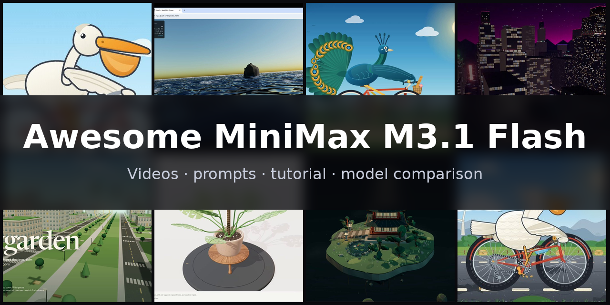](https://www.sandbase.ai/lab/ai-videos/minimax-m3-1-flash?lang=zh-CN&utm_source=github&utm_medium=readme&utm_campaign=awesome-minimax-m3-1-flash&utm_content=banner)

精选 **MiniMax M3.1 Flash 案例**合集：用 MiniMax-M3.1-Flash（MiniMax M3.1 系列中更快、更便宜的一档，2026 年 10 月 19 日发布）做出的视频、提示词和演示。包括 Three.js 与 WebGPU 3D 场景、SVG 与 Canvas 动画、动效、产品界面和可在浏览器里玩的游戏，大多是模型根据提示词写成的单文件网页，均注明作者并链接原帖。

共 **55 条视频**，来自 **44 位创作者** · **7 条**附作者提示词 · 每天从 [SandBase Lab](https://www.sandbase.ai/lab/ai-videos/minimax-m3-1-flash?lang=zh-CN&utm_source=github&utm_medium=readme&utm_campaign=awesome-minimax-m3-1-flash&utm_content=stats) 同步

## 从这里开始

| 我想… | 去这里 |
|---|---|
| 看视频 | 在下方 [按分类浏览](#contents)，或 [在 SandBase Lab 大屏播放](https://www.sandbase.ai/lab/ai-videos/minimax-m3-1-flash?lang=zh-CN&utm_source=github&utm_medium=readme&utm_campaign=awesome-minimax-m3-1-flash&utm_content=quickstart) |
| 复制提示词 | [提示词索引](docs/zh-CN/prompts.md)：所有附带提示词的视频 |
| 自己写提示词 | [提示词写法](docs/zh-CN/prompt-guide.md)：7 条写法和一个填空模板 |
| 做一个视频 | [教程](docs/zh-CN/tutorial.md)：提示词 → HTML → MP4，含 API、CLI 调用和录屏脚本 |
| 选模型 | [MiniMax M3.1 Flash 对比 DeepSeek V4.1 Flash 1017、Claude Opus 5.5 和 Gemini 4 Argon](docs/zh-CN/model-comparison.md) |
| 马上试试 | [在 Lab 竞技场运行 MiniMax M3.1 Flash](https://www.sandbase.ai/lab/x/llm-arena?models=minimax%2Fminimax-m3.1-flash&lang=zh-CN&utm_source=github&utm_medium=readme&utm_campaign=awesome-minimax-m3-1-flash&utm_content=quickstart)，和其他模型并排对比 |

<a id="contents"></a>

## 目录

- [精选](#featured) (8)
- [3D 场景](#3d-scene) (6)
- [动效](#motion-graphics) (13)
- [游戏](#game) (5)
- [产品界面](#ui-demo) (3)
- [讲解](#explainer) (1)
- [测试对比](#comparison) (27)
- [用 MiniMax M3.1 Flash 复刻视频](#recreate)
- [常见问题](#faq)
- [推荐作品](#contribute)

点击预览图播放视频；点击标题前往 SandBase Lab 查看原帖、提示词，并一键 **复刻**；**@作者** 链接到 X 原帖。

<a id="featured"></a>

## 精选

<table>
<tr><td width="33%" valign="top"><a href="https://www.sandbase.ai/lab/media/x/minimax-m3-1-flash/2112134450926739599/video.mp4">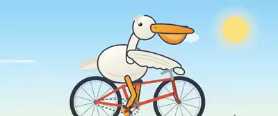</a><br><a href="https://www.sandbase.ai/lab/ai-videos/minimax-m3-1-flash/2112134450926739599?lang=zh-CN&utm_source=github&utm_medium=readme&utm_campaign=awesome-minimax-m3-1-flash&utm_content=card"><b>用MiniCode生成的SVG鹈鹕动画</b></a><br><sub><a href="https://x.com/leo114119/status/2112134450926739599">@leo114119</a></sub></td><td width="33%" valign="top"><a href="https://www.sandbase.ai/lab/media/x/minimax-m3-1-flash/2112212819395432700/video.mp4">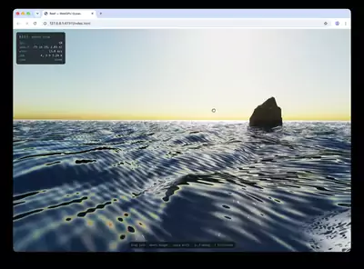</a><br><a href="https://www.sandbase.ai/lab/ai-videos/minimax-m3-1-flash/2112212819395432700?lang=zh-CN&utm_source=github&utm_medium=readme&utm_campaign=awesome-minimax-m3-1-flash&utm_content=card"><b>WebGPU写实水面场景与悬浮相机</b></a><br><sub><a href="https://x.com/ivanfioravanti/status/2112212819395432700">@ivanfioravanti</a> · 0:13 · <a href="https://www.sandbase.ai/lab/ai-videos/minimax-m3-1-flash/2112212819395432700?lang=zh-CN&utm_source=github&utm_medium=readme&utm_campaign=awesome-minimax-m3-1-flash&utm_content=card">提示词</a></sub></td><td width="33%" valign="top"><a href="https://www.sandbase.ai/lab/media/x/minimax-m3-1-flash/2112217267513499850/video.mp4">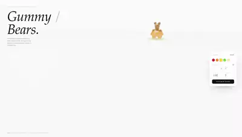</a><br><a href="https://www.sandbase.ai/lab/ai-videos/minimax-m3-1-flash/2112217267513499850?lang=zh-CN&utm_source=github&utm_medium=readme&utm_campaign=awesome-minimax-m3-1-flash&utm_content=card"><b>使用 MiniMax-M3.1-Flash 尝试生成小熊软糖</b></a><br><sub><a href="https://x.com/MiaAI_lab/status/2112217267513499850">@MiaAI_lab</a> · 0:31</sub></td></tr>
<tr><td width="33%" valign="top"><a href="https://www.sandbase.ai/lab/media/x/minimax-m3-1-flash/2112201323106222579/video.mp4">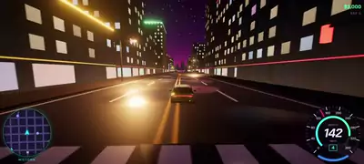</a><br><a href="https://www.sandbase.ai/lab/ai-videos/minimax-m3-1-flash/2112201323106222579?lang=zh-CN&utm_source=github&utm_medium=readme&utm_campaign=awesome-minimax-m3-1-flash&utm_content=card"><b>MiniMax生成的霓虹赛车游戏</b></a><br><sub><a href="https://x.com/kepochnik/status/2112201323106222579">@kepochnik</a> · 1:30</sub></td><td width="33%" valign="top"><a href="https://www.sandbase.ai/lab/media/x/minimax-m3-1-flash/2112187468141465864/video.mp4">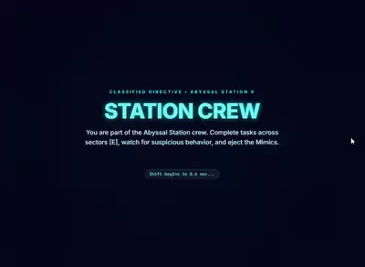</a><br><a href="https://www.sandbase.ai/lab/ai-videos/minimax-m3-1-flash/2112187468141465864?lang=zh-CN&utm_source=github&utm_medium=readme&utm_campaign=awesome-minimax-m3-1-flash&utm_content=card"><b>用MiniMax制作的Among Us复刻游戏</b></a><br><sub><a href="https://x.com/yohakujpn/status/2112187468141465864">@yohakujpn</a> · 1:10</sub></td><td width="33%" valign="top"><a href="https://www.sandbase.ai/lab/media/x/minimax-m3-1-flash/2112178619120534014/video.mp4">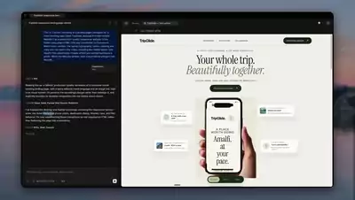</a><br><a href="https://www.sandbase.ai/lab/ai-videos/minimax-m3-1-flash/2112178619120534014?lang=zh-CN&utm_source=github&utm_medium=readme&utm_campaign=awesome-minimax-m3-1-flash&utm_content=card"><b>通过录屏视频重建落地页</b></a><br><sub><a href="https://x.com/PrajwalTomar_/status/2112178619120534014">@PrajwalTomar_</a> · 0:43</sub></td></tr>
<tr><td width="33%" valign="top"><a href="https://www.sandbase.ai/lab/media/x/minimax-m3-1-flash/2112181307111555498/video.mp4">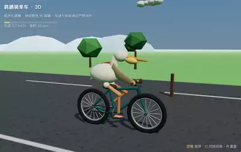</a><br><a href="https://www.sandbase.ai/lab/ai-videos/minimax-m3-1-flash/2112181307111555498?lang=zh-CN&utm_source=github&utm_medium=readme&utm_campaign=awesome-minimax-m3-1-flash&utm_content=card"><b>3D版骑自行车动画测试</b></a><br><sub><a href="https://x.com/mspd4100/status/2112181307111555498">@mspd4100</a> · 0:06</sub></td><td width="33%" valign="top"><a href="https://www.sandbase.ai/lab/media/x/minimax-m3-1-flash/2112206475968086093/video.mp4">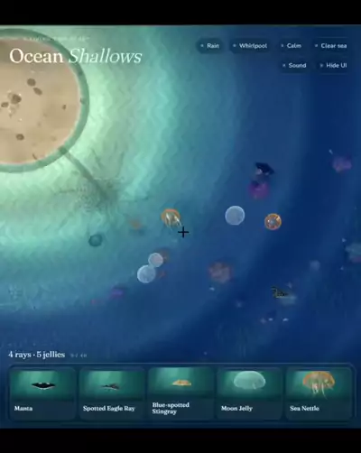</a><br><a href="https://www.sandbase.ai/lab/ai-videos/minimax-m3-1-flash/2112206475968086093?lang=zh-CN&utm_source=github&utm_medium=readme&utm_campaign=awesome-minimax-m3-1-flash&utm_content=card"><b>MiniMax M3.1 Flash生成的前端界面展示</b></a><br><sub><a href="https://x.com/bei351009016/status/2112206475968086093">@bei351009016</a> · 0:14</sub></td></tr>
</table>

<a id="3d-scene"></a>

## 3D 场景

<table>
<tr><td width="33%" valign="top"><a href="https://www.sandbase.ai/lab/media/x/minimax-m3-1-flash/2112111033359933516/video.mp4">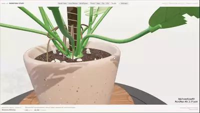</a><br><a href="https://www.sandbase.ai/lab/ai-videos/minimax-m3-1-flash/2112111033359933516?lang=zh-CN&utm_source=github&utm_medium=readme&utm_campaign=awesome-minimax-m3-1-flash&utm_content=card"><b>使用 Three.js 生成的 3D 花盆查看器</b></a><br><sub><a href="https://x.com/ItsmeAjayKV/status/2112111033359933516">@ItsmeAjayKV</a> · 0:32 · <a href="https://www.sandbase.ai/lab/ai-videos/minimax-m3-1-flash/2112111033359933516?lang=zh-CN&utm_source=github&utm_medium=readme&utm_campaign=awesome-minimax-m3-1-flash&utm_content=card">提示词</a></sub></td><td width="33%" valign="top"><a href="https://www.sandbase.ai/lab/media/x/minimax-m3-1-flash/2112121327285084300/video.mp4">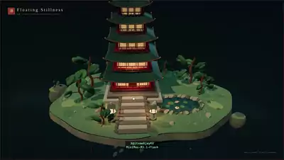</a><br><a href="https://www.sandbase.ai/lab/ai-videos/minimax-m3-1-flash/2112121327285084300?lang=zh-CN&utm_source=github&utm_medium=readme&utm_campaign=awesome-minimax-m3-1-flash&utm_content=card"><b>单次生成的宝塔 3D 场景展示</b></a><br><sub><a href="https://x.com/ItsmeAjayKV/status/2112121327285084300">@ItsmeAjayKV</a> · 0:51</sub></td><td width="33%" valign="top"><a href="https://www.sandbase.ai/lab/media/x/minimax-m3-1-flash/2112181307111555498/video.mp4"></a><br><a href="https://www.sandbase.ai/lab/ai-videos/minimax-m3-1-flash/2112181307111555498?lang=zh-CN&utm_source=github&utm_medium=readme&utm_campaign=awesome-minimax-m3-1-flash&utm_content=card"><b>3D版骑自行车动画测试</b></a><br><sub><a href="https://x.com/mspd4100/status/2112181307111555498">@mspd4100</a> · 0:06</sub></td></tr>
<tr><td width="33%" valign="top"><a href="https://www.sandbase.ai/lab/media/x/minimax-m3-1-flash/2112207157177561460/video.mp4">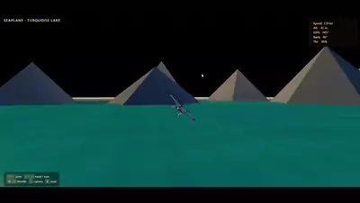</a><br><a href="https://www.sandbase.ai/lab/ai-videos/minimax-m3-1-flash/2112207157177561460?lang=zh-CN&utm_source=github&utm_medium=readme&utm_campaign=awesome-minimax-m3-1-flash&utm_content=card"><b>基于Three.js构建的交互式水上飞机</b></a><br><sub><a href="https://x.com/debugsenpai/status/2112207157177561460">@debugsenpai</a> · 0:26</sub></td><td width="33%" valign="top"><a href="https://www.sandbase.ai/lab/media/x/minimax-m3-1-flash/2112212819395432700/video.mp4"></a><br><a href="https://www.sandbase.ai/lab/ai-videos/minimax-m3-1-flash/2112212819395432700?lang=zh-CN&utm_source=github&utm_medium=readme&utm_campaign=awesome-minimax-m3-1-flash&utm_content=card"><b>WebGPU写实水面场景与悬浮相机</b></a><br><sub><a href="https://x.com/ivanfioravanti/status/2112212819395432700">@ivanfioravanti</a> · 0:13 · <a href="https://www.sandbase.ai/lab/ai-videos/minimax-m3-1-flash/2112212819395432700?lang=zh-CN&utm_source=github&utm_medium=readme&utm_campaign=awesome-minimax-m3-1-flash&utm_content=card">提示词</a></sub></td><td width="33%" valign="top"><a href="https://www.sandbase.ai/lab/media/x/minimax-m3-1-flash/2112257677543829665/video.mp4">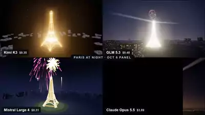</a><br><a href="https://www.sandbase.ai/lab/ai-videos/minimax-m3-1-flash/2112257677543829665?lang=zh-CN&utm_source=github&utm_medium=readme&utm_campaign=awesome-minimax-m3-1-flash&utm_content=card"><b>MiniMax M3.1 Flash 运行三组 3D 场景测试</b></a><br><sub><a href="https://x.com/domsilvestre/status/2112257677543829665">@domsilvestre</a> · 0:35</sub></td></tr>
</table>

<a id="motion-graphics"></a>

## 动效

<table>
<tr><td width="33%" valign="top"><a href="https://www.sandbase.ai/lab/media/x/minimax-m3-1-flash/2112115396434084243/video.mp4">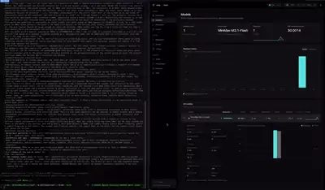</a><br><a href="https://www.sandbase.ai/lab/ai-videos/minimax-m3-1-flash/2112115396434084243?lang=zh-CN&utm_source=github&utm_medium=readme&utm_campaign=awesome-minimax-m3-1-flash&utm_content=card"><b>MiniMax-M3.1-Flash API 速度测试</b></a><br><sub><a href="https://x.com/ivanfioravanti/status/2112115396434084243">@ivanfioravanti</a> · 0:06</sub></td><td width="33%" valign="top"><a href="https://www.sandbase.ai/lab/media/x/minimax-m3-1-flash/2112134450926739599/video.mp4"></a><br><a href="https://www.sandbase.ai/lab/ai-videos/minimax-m3-1-flash/2112134450926739599?lang=zh-CN&utm_source=github&utm_medium=readme&utm_campaign=awesome-minimax-m3-1-flash&utm_content=card"><b>用MiniCode生成的SVG鹈鹕动画</b></a><br><sub><a href="https://x.com/leo114119/status/2112134450926739599">@leo114119</a></sub></td><td width="33%" valign="top"><a href="https://www.sandbase.ai/lab/media/x/minimax-m3-1-flash/2112149035259973835/video.mp4">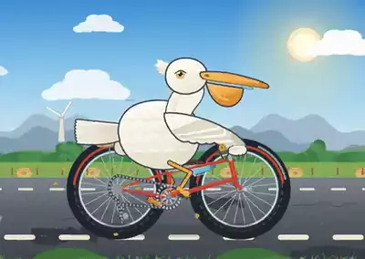</a><br><a href="https://www.sandbase.ai/lab/ai-videos/minimax-m3-1-flash/2112149035259973835?lang=zh-CN&utm_source=github&utm_medium=readme&utm_campaign=awesome-minimax-m3-1-flash&utm_content=card"><b>赛博朋克风格鹈鹕骑车动画</b></a><br><sub><a href="https://x.com/leo114119/status/2112149035259973835">@leo114119</a></sub></td></tr>
<tr><td width="33%" valign="top"><a href="https://www.sandbase.ai/lab/media/x/minimax-m3-1-flash/2112166611805229452/video.mp4">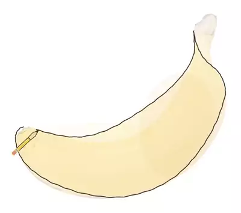</a><br><a href="https://www.sandbase.ai/lab/ai-videos/minimax-m3-1-flash/2112166611805229452?lang=zh-CN&utm_source=github&utm_medium=readme&utm_campaign=awesome-minimax-m3-1-flash&utm_content=card"><b>香蕉绘图测试</b></a><br><sub><a href="https://x.com/AdamHoltererer/status/2112166611805229452">@AdamHoltererer</a> · 0:12</sub></td><td width="33%" valign="top"><a href="https://www.sandbase.ai/lab/media/x/minimax-m3-1-flash/2112178844715381059/video.mp4">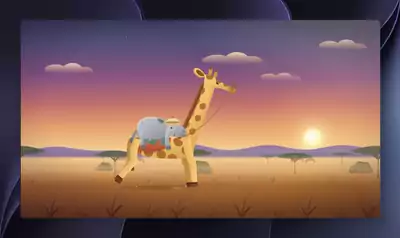</a><br><a href="https://www.sandbase.ai/lab/ai-videos/minimax-m3-1-flash/2112178844715381059?lang=zh-CN&utm_source=github&utm_medium=readme&utm_campaign=awesome-minimax-m3-1-flash&utm_content=card"><b>MiniMax-M3.1-Flash模型效果展示</b></a><br><sub><a href="https://x.com/atomtanstudio/status/2112178844715381059">@atomtanstudio</a> · 0:17</sub></td><td width="33%" valign="top"><a href="https://www.sandbase.ai/lab/media/x/minimax-m3-1-flash/2112179818192408617/video.mp4">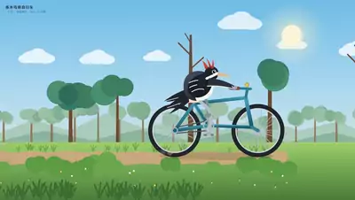</a><br><a href="https://www.sandbase.ai/lab/ai-videos/minimax-m3-1-flash/2112179818192408617?lang=zh-CN&utm_source=github&utm_medium=readme&utm_campaign=awesome-minimax-m3-1-flash&utm_content=card"><b>M3.1-Flash max 性能与生成测试</b></a><br><sub><a href="https://x.com/klarkxy/status/2112179818192408617">@klarkxy</a> · 0:15</sub></td></tr>
</table>

<details>
<summary><b>展开全部 13 条</b></summary>

<table>
<tr><td width="33%" valign="top"><a href="https://www.sandbase.ai/lab/media/x/minimax-m3-1-flash/2112185206387970065/video.mp4">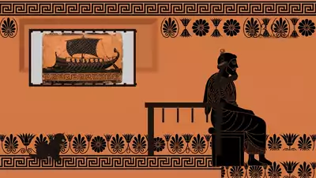</a><br><a href="https://www.sandbase.ai/lab/ai-videos/minimax-m3-1-flash/2112185206387970065?lang=zh-CN&utm_source=github&utm_medium=readme&utm_campaign=awesome-minimax-m3-1-flash&utm_content=card"><b>MiniMax M3.1 Flash生成的视频演示</b></a><br><sub><a href="https://x.com/AISuperDomain/status/2112185206387970065">@AISuperDomain</a> · 0:15</sub></td><td width="33%" valign="top"><a href="https://www.sandbase.ai/lab/media/x/minimax-m3-1-flash/2112194493793333657/video.mp4">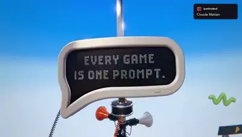</a><br><a href="https://www.sandbase.ai/lab/ai-videos/minimax-m3-1-flash/2112194493793333657?lang=zh-CN&utm_source=github&utm_medium=readme&utm_campaign=awesome-minimax-m3-1-flash&utm_content=card"><b>使用 MiniMax M3.1 Flash 生成的效果演示</b></a><br><sub><a href="https://x.com/quadcode_ai/status/2112194493793333657">@quadcode_ai</a> · 0:24</sub></td><td width="33%" valign="top"><a href="https://www.sandbase.ai/lab/media/x/minimax-m3-1-flash/2112200254590447641/video.mp4">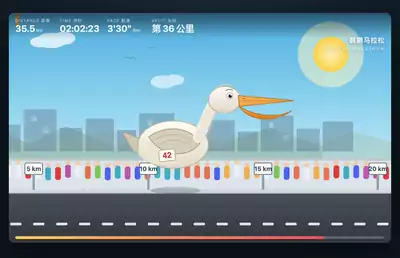</a><br><a href="https://www.sandbase.ai/lab/ai-videos/minimax-m3-1-flash/2112200254590447641?lang=zh-CN&utm_source=github&utm_medium=readme&utm_campaign=awesome-minimax-m3-1-flash&utm_content=card"><b>正在跑马拉松的鹈鹕</b></a><br><sub><a href="https://x.com/geekbb/status/2112200254590447641">@geekbb</a> · 0:11</sub></td></tr>
<tr><td width="33%" valign="top"><a href="https://www.sandbase.ai/lab/media/x/minimax-m3-1-flash/2112217267513499850/video.mp4"></a><br><a href="https://www.sandbase.ai/lab/ai-videos/minimax-m3-1-flash/2112217267513499850?lang=zh-CN&utm_source=github&utm_medium=readme&utm_campaign=awesome-minimax-m3-1-flash&utm_content=card"><b>使用 MiniMax-M3.1-Flash 尝试生成小熊软糖</b></a><br><sub><a href="https://x.com/MiaAI_lab/status/2112217267513499850">@MiaAI_lab</a> · 0:31</sub></td><td width="33%" valign="top"><a href="https://www.sandbase.ai/lab/media/x/minimax-m3-1-flash/2112225953472741531/video.mp4"></a><br><a href="https://www.sandbase.ai/lab/ai-videos/minimax-m3-1-flash/2112225953472741531?lang=zh-CN&utm_source=github&utm_medium=readme&utm_campaign=awesome-minimax-m3-1-flash&utm_content=card"><b>鹈鹕脱把骑摩托车</b></a><br><sub><a href="https://x.com/cnyzgkc/status/2112225953472741531">@cnyzgkc</a> · 0:10</sub></td><td width="33%" valign="top"><a href="https://www.sandbase.ai/lab/media/x/minimax-m3-1-flash/2112241373961416717/video.mp4">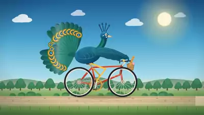</a><br><a href="https://www.sandbase.ai/lab/ai-videos/minimax-m3-1-flash/2112241373961416717?lang=zh-CN&utm_source=github&utm_medium=readme&utm_campaign=awesome-minimax-m3-1-flash&utm_content=card"><b>将孔雀 SVG 动画化为儿童卡通片</b></a><br><sub><a href="https://x.com/SahilPanhotra/status/2112241373961416717">@SahilPanhotra</a> · 0:10</sub></td></tr>
<tr><td width="33%" valign="top"><a href="https://www.sandbase.ai/lab/media/x/minimax-m3-1-flash/2112275978097480186/video.mp4">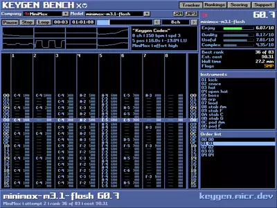</a><br><a href="https://www.sandbase.ai/lab/ai-videos/minimax-m3-1-flash/2112275978097480186?lang=zh-CN&utm_source=github&utm_medium=readme&utm_campaign=awesome-minimax-m3-1-flash&utm_content=card"><b>MiniMax M3.1 Flash 在 Keygen Bench 上的测试</b></a><br><sub><a href="https://x.com/JustMicrock/status/2112275978097480186">@JustMicrock</a> · 0:18</sub></td></tr>
</table>

</details>

<a id="game"></a>

## 游戏

<table>
<tr><td width="33%" valign="top"><a href="https://www.sandbase.ai/lab/media/x/minimax-m3-1-flash/2112166543899378130/video.mp4">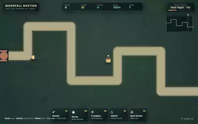</a><br><a href="https://www.sandbase.ai/lab/ai-videos/minimax-m3-1-flash/2112166543899378130?lang=zh-CN&utm_source=github&utm_medium=readme&utm_campaign=awesome-minimax-m3-1-flash&utm_content=card"><b>Moonfall Bastion 塔防游戏测试</b></a><br><sub><a href="https://x.com/AdamHoltererer/status/2112166543899378130">@AdamHoltererer</a> · 0:23</sub></td><td width="33%" valign="top"><a href="https://www.sandbase.ai/lab/media/x/minimax-m3-1-flash/2112187468141465864/video.mp4"></a><br><a href="https://www.sandbase.ai/lab/ai-videos/minimax-m3-1-flash/2112187468141465864?lang=zh-CN&utm_source=github&utm_medium=readme&utm_campaign=awesome-minimax-m3-1-flash&utm_content=card"><b>用MiniMax制作的Among Us复刻游戏</b></a><br><sub><a href="https://x.com/yohakujpn/status/2112187468141465864">@yohakujpn</a> · 1:10</sub></td><td width="33%" valign="top"><a href="https://www.sandbase.ai/lab/media/x/minimax-m3-1-flash/2112201323106222579/video.mp4"></a><br><a href="https://www.sandbase.ai/lab/ai-videos/minimax-m3-1-flash/2112201323106222579?lang=zh-CN&utm_source=github&utm_medium=readme&utm_campaign=awesome-minimax-m3-1-flash&utm_content=card"><b>MiniMax生成的霓虹赛车游戏</b></a><br><sub><a href="https://x.com/kepochnik/status/2112201323106222579">@kepochnik</a> · 1:30</sub></td></tr>
<tr><td width="33%" valign="top"><a href="https://www.sandbase.ai/lab/media/x/minimax-m3-1-flash/2112220100300513770/video.mp4">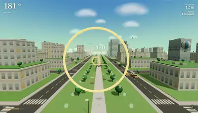</a><br><a href="https://www.sandbase.ai/lab/ai-videos/minimax-m3-1-flash/2112220100300513770?lang=zh-CN&utm_source=github&utm_medium=readme&utm_campaign=awesome-minimax-m3-1-flash&utm_content=card"><b>用单次提示词构建的SkyGarden网页游戏</b></a><br><sub><a href="https://x.com/Amank1412/status/2112220100300513770">@Amank1412</a> · 0:25</sub></td><td width="33%" valign="top"><a href="https://www.sandbase.ai/lab/media/x/minimax-m3-1-flash/2112223208338592187/video.mp4">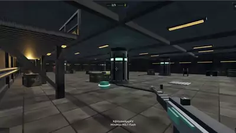</a><br><a href="https://www.sandbase.ai/lab/ai-videos/minimax-m3-1-flash/2112223208338592187?lang=zh-CN&utm_source=github&utm_medium=readme&utm_campaign=awesome-minimax-m3-1-flash&utm_content=card"><b>使用Three.js构建的第一人称竞技场FPS游戏</b></a><br><sub><a href="https://x.com/leo114119/status/2112223208338592187">@leo114119</a> · 1:43</sub></td></tr>
</table>

<a id="ui-demo"></a>

## 产品界面

<table>
<tr><td width="33%" valign="top"><a href="https://www.sandbase.ai/lab/media/x/minimax-m3-1-flash/2112160831118983171/video.mp4">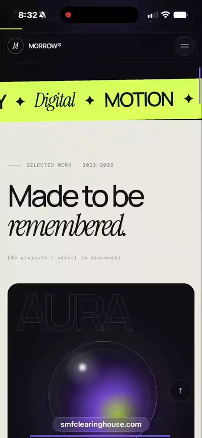</a><br><a href="https://www.sandbase.ai/lab/ai-videos/minimax-m3-1-flash/2112160831118983171?lang=zh-CN&utm_source=github&utm_medium=readme&utm_campaign=awesome-minimax-m3-1-flash&utm_content=card"><b>MiniMax M3.1 单次生成的网站页面展示</b></a><br><sub><a href="https://x.com/MichaelGannotti/status/2112160831118983171">@MichaelGannotti</a> · 1:11</sub></td><td width="33%" valign="top"><a href="https://www.sandbase.ai/lab/media/x/minimax-m3-1-flash/2112178619120534014/video.mp4"></a><br><a href="https://www.sandbase.ai/lab/ai-videos/minimax-m3-1-flash/2112178619120534014?lang=zh-CN&utm_source=github&utm_medium=readme&utm_campaign=awesome-minimax-m3-1-flash&utm_content=card"><b>通过录屏视频重建落地页</b></a><br><sub><a href="https://x.com/PrajwalTomar_/status/2112178619120534014">@PrajwalTomar_</a> · 0:43</sub></td><td width="33%" valign="top"><a href="https://www.sandbase.ai/lab/media/x/minimax-m3-1-flash/2112206475968086093/video.mp4"></a><br><a href="https://www.sandbase.ai/lab/ai-videos/minimax-m3-1-flash/2112206475968086093?lang=zh-CN&utm_source=github&utm_medium=readme&utm_campaign=awesome-minimax-m3-1-flash&utm_content=card"><b>MiniMax M3.1 Flash生成的前端界面展示</b></a><br><sub><a href="https://x.com/bei351009016/status/2112206475968086093">@bei351009016</a> · 0:14</sub></td></tr>
</table>

<a id="explainer"></a>

## 讲解

<table>
<tr><td width="33%" valign="top"><a href="https://www.sandbase.ai/lab/media/x/minimax-m3-1-flash/2112198804128895153/video.mp4">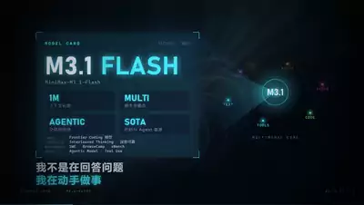</a><br><a href="https://www.sandbase.ai/lab/ai-videos/minimax-m3-1-flash/2112198804128895153?lang=zh-CN&utm_source=github&utm_medium=readme&utm_campaign=awesome-minimax-m3-1-flash&utm_content=card"><b>MiniMax Code与模型的自我介绍视频</b></a><br><sub><a href="https://x.com/klarkxy/status/2112198804128895153">@klarkxy</a> · 1:18 · <a href="https://www.sandbase.ai/lab/ai-videos/minimax-m3-1-flash/2112198804128895153?lang=zh-CN&utm_source=github&utm_medium=readme&utm_campaign=awesome-minimax-m3-1-flash&utm_content=card">提示词</a></sub></td></tr>
</table>

<a id="comparison"></a>

## 测试对比

<table>
<tr><td width="33%" valign="top"><a href="https://www.sandbase.ai/lab/media/x/minimax-m3-1-flash/2112125242415956183/video.mp4">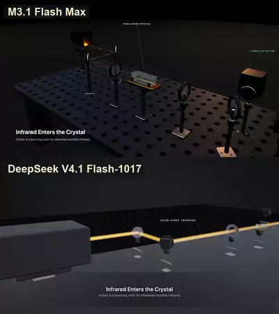</a><br><a href="https://www.sandbase.ai/lab/ai-videos/minimax-m3-1-flash/2112125242415956183?lang=zh-CN&utm_source=github&utm_medium=readme&utm_campaign=awesome-minimax-m3-1-flash&utm_content=card"><b>MiniMax M3.1 对比 DeepSeek V4.1 测试结果</b></a><br><sub><a href="https://x.com/SPAC89/status/2112125242415956183">@SPAC89</a> · 0:30</sub></td><td width="33%" valign="top"><a href="https://www.sandbase.ai/lab/media/x/minimax-m3-1-flash/2112133888613224558/video.mp4">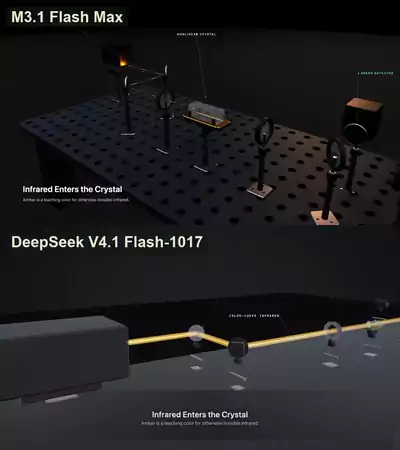</a><br><a href="https://www.sandbase.ai/lab/ai-videos/minimax-m3-1-flash/2112133888613224558?lang=zh-CN&utm_source=github&utm_medium=readme&utm_campaign=awesome-minimax-m3-1-flash&utm_content=card"><b>MiniMax 与 DeepSeek 模型的对比测试</b></a><br><sub><a href="https://x.com/bbfu0382/status/2112133888613224558">@bbfu0382</a> · 0:30</sub></td><td width="33%" valign="top"><a href="https://www.sandbase.ai/lab/media/x/minimax-m3-1-flash/2112159579060486212/video.mp4">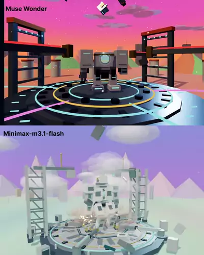</a><br><a href="https://www.sandbase.ai/lab/ai-videos/minimax-m3-1-flash/2112159579060486212?lang=zh-CN&utm_source=github&utm_medium=readme&utm_campaign=awesome-minimax-m3-1-flash&utm_content=card"><b>3D 机甲组装与发射序列对比演示</b></a><br><sub><a href="https://x.com/alohaproxy/status/2112159579060486212">@alohaproxy</a> · 0:34 · <a href="https://www.sandbase.ai/lab/ai-videos/minimax-m3-1-flash/2112159579060486212?lang=zh-CN&utm_source=github&utm_medium=readme&utm_campaign=awesome-minimax-m3-1-flash&utm_content=card">提示词</a></sub></td></tr>
<tr><td width="33%" valign="top"><a href="https://www.sandbase.ai/lab/media/x/minimax-m3-1-flash/2112168890600149125/video.mp4">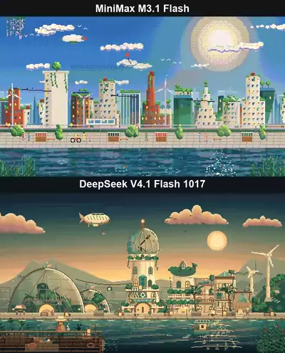</a><br><a href="https://www.sandbase.ai/lab/ai-videos/minimax-m3-1-flash/2112168890600149125?lang=zh-CN&utm_source=github&utm_medium=readme&utm_campaign=awesome-minimax-m3-1-flash&utm_content=card"><b>像素城市：MiniMax 与 DeepSeek 对比</b></a><br><sub><a href="https://x.com/notjazii/status/2112168890600149125">@notjazii</a> · 0:10</sub></td><td width="33%" valign="top"><a href="https://www.sandbase.ai/lab/media/x/minimax-m3-1-flash/2112173892546834486/video.mp4">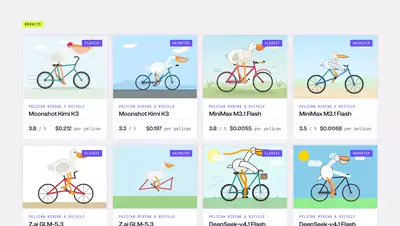</a><br><a href="https://www.sandbase.ai/lab/ai-videos/minimax-m3-1-flash/2112173892546834486?lang=zh-CN&utm_source=github&utm_medium=readme&utm_campaign=awesome-minimax-m3-1-flash&utm_content=card"><b>四款AI模型Pelican测试横向对比</b></a><br><sub><a href="https://x.com/SandbaseAI/status/2112173892546834486">@SandbaseAI</a> · 0:45</sub></td><td width="33%" valign="top"><a href="https://www.sandbase.ai/lab/media/x/minimax-m3-1-flash/2112186946210668839/video.mp4">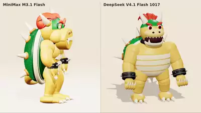</a><br><a href="https://www.sandbase.ai/lab/ai-videos/minimax-m3-1-flash/2112186946210668839?lang=zh-CN&utm_source=github&utm_medium=readme&utm_campaign=awesome-minimax-m3-1-flash&utm_content=card"><b>MiniMax与DeepSeek酷霸王效果对比</b></a><br><sub><a href="https://x.com/ivanainai/status/2112186946210668839">@ivanainai</a> · 0:14</sub></td></tr>
</table>

<details>
<summary><b>展开全部 27 条</b></summary>

<table>
<tr><td width="33%" valign="top"><a href="https://www.sandbase.ai/lab/media/x/minimax-m3-1-flash/2112192337925521881/video.mp4">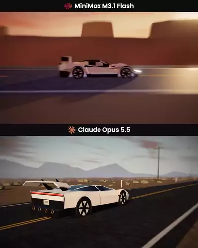</a><br><a href="https://www.sandbase.ai/lab/ai-videos/minimax-m3-1-flash/2112192337925521881?lang=zh-CN&utm_source=github&utm_medium=readme&utm_campaign=awesome-minimax-m3-1-flash&utm_content=card"><b>MiniMax与Claude生成飞行跑车对比</b></a><br><sub><a href="https://x.com/narushima_/status/2112192337925521881">@narushima_</a> · 0:25</sub></td><td width="33%" valign="top"><a href="https://www.sandbase.ai/lab/media/x/minimax-m3-1-flash/2112200201507311699/video.mp4">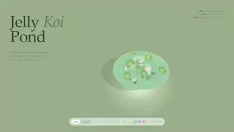</a><br><a href="https://www.sandbase.ai/lab/ai-videos/minimax-m3-1-flash/2112200201507311699?lang=zh-CN&utm_source=github&utm_medium=readme&utm_campaign=awesome-minimax-m3-1-flash&utm_content=card"><b>MiniMax与DeepSeek的Three.js测试</b></a><br><sub><a href="https://x.com/notjazii/status/2112200201507311699">@notjazii</a> · 0:27</sub></td><td width="33%" valign="top"><a href="https://www.sandbase.ai/lab/media/x/minimax-m3-1-flash/2112201004917940321/video.mp4">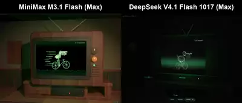</a><br><a href="https://www.sandbase.ai/lab/ai-videos/minimax-m3-1-flash/2112201004917940321?lang=zh-CN&utm_source=github&utm_medium=readme&utm_campaign=awesome-minimax-m3-1-flash&utm_content=card"><b>MiniMax与DeepSeek鹈鹕之梦对比</b></a><br><sub><a href="https://x.com/VulKan42069/status/2112201004917940321">@VulKan42069</a> · 0:45</sub></td></tr>
<tr><td width="33%" valign="top"><a href="https://www.sandbase.ai/lab/media/x/minimax-m3-1-flash/2112201041198620823/video.mp4">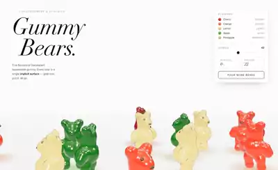</a><br><a href="https://www.sandbase.ai/lab/ai-videos/minimax-m3-1-flash/2112201041198620823?lang=zh-CN&utm_source=github&utm_medium=readme&utm_campaign=awesome-minimax-m3-1-flash&utm_content=card"><b>MiniMax与DeepSeek糖果小熊测试对比</b></a><br><sub><a href="https://x.com/leo114119/status/2112201041198620823">@leo114119</a></sub></td><td width="33%" valign="top"><a href="https://www.sandbase.ai/lab/media/x/minimax-m3-1-flash/2112206241137054071/video.mp4">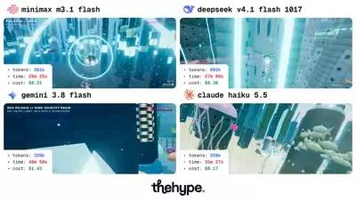</a><br><a href="https://www.sandbase.ai/lab/ai-videos/minimax-m3-1-flash/2112206241137054071?lang=zh-CN&utm_source=github&utm_medium=readme&utm_campaign=awesome-minimax-m3-1-flash&utm_content=card"><b>海底城市潜艇追逐模型对比测试</b></a><br><sub><a href="https://x.com/thehypedotnews/status/2112206241137054071">@thehypedotnews</a> · 0:30</sub></td><td width="33%" valign="top"><a href="https://www.sandbase.ai/lab/media/x/minimax-m3-1-flash/2112207066819375397/video.mp4">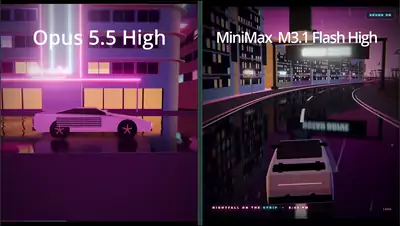</a><br><a href="https://www.sandbase.ai/lab/ai-videos/minimax-m3-1-flash/2112207066819375397?lang=zh-CN&utm_source=github&utm_medium=readme&utm_campaign=awesome-minimax-m3-1-flash&utm_content=card"><b>Opus 5.5 与 MiniMax M3.1 Flash 迈阿密场景对比</b></a><br><sub><a href="https://x.com/davit__yan/status/2112207066819375397">@davit__yan</a> · 0:25 · <a href="https://www.sandbase.ai/lab/ai-videos/minimax-m3-1-flash/2112207066819375397?lang=zh-CN&utm_source=github&utm_medium=readme&utm_campaign=awesome-minimax-m3-1-flash&utm_content=card">提示词</a></sub></td></tr>
<tr><td width="33%" valign="top"><a href="https://www.sandbase.ai/lab/media/x/minimax-m3-1-flash/2112211798493397408/video.mp4">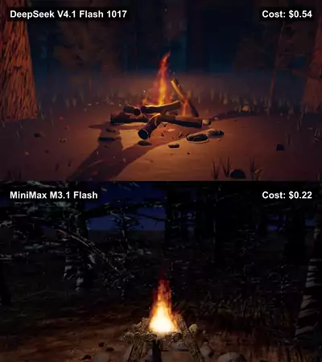</a><br><a href="https://www.sandbase.ai/lab/ai-videos/minimax-m3-1-flash/2112211798493397408?lang=zh-CN&utm_source=github&utm_medium=readme&utm_campaign=awesome-minimax-m3-1-flash&utm_content=card"><b>DeepSeek与MiniMax同提示词测试对比</b></a><br><sub><a href="https://x.com/rubenssoto_ai/status/2112211798493397408">@rubenssoto_ai</a> · 0:30</sub></td><td width="33%" valign="top"><a href="https://www.sandbase.ai/lab/media/x/minimax-m3-1-flash/2112214607607562377/video.mp4">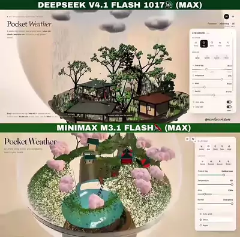</a><br><a href="https://www.sandbase.ai/lab/ai-videos/minimax-m3-1-flash/2112214607607562377?lang=zh-CN&utm_source=github&utm_medium=readme&utm_campaign=awesome-minimax-m3-1-flash&utm_content=card"><b>MiniMax与DeepSeek模型生成效果对比</b></a><br><sub><a href="https://x.com/marcthecreatorr/status/2112214607607562377">@marcthecreatorr</a> · 0:59</sub></td><td width="33%" valign="top"><a href="https://www.sandbase.ai/lab/media/x/minimax-m3-1-flash/2112217467775062514/video.mp4">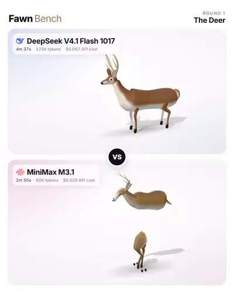</a><br><a href="https://www.sandbase.ai/lab/ai-videos/minimax-m3-1-flash/2112217467775062514?lang=zh-CN&utm_source=github&utm_medium=readme&utm_campaign=awesome-minimax-m3-1-flash&utm_content=card"><b>MiniMax M3.1 Flash 与 DeepSeek V4.1 Flash 基准测试对比</b></a><br><sub><a href="https://x.com/fawnunwrap/status/2112217467775062514">@fawnunwrap</a> · 0:16</sub></td></tr>
<tr><td width="33%" valign="top"><a href="https://www.sandbase.ai/lab/media/x/minimax-m3-1-flash/2112226308868436154/video.mp4"></a><br><a href="https://www.sandbase.ai/lab/ai-videos/minimax-m3-1-flash/2112226308868436154?lang=zh-CN&utm_source=github&utm_medium=readme&utm_campaign=awesome-minimax-m3-1-flash&utm_content=card"><b>MiniMax M3.1 Flash 与 Opus 智能体任务对比</b></a><br><sub><a href="https://x.com/jumperz/status/2112226308868436154">@jumperz</a> · 0:40</sub></td><td width="33%" valign="top"><a href="https://www.sandbase.ai/lab/media/x/minimax-m3-1-flash/2112227205300564211/video.mp4">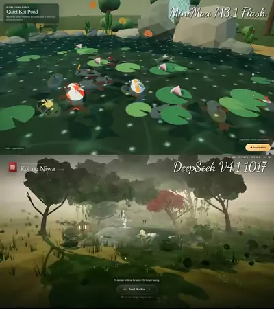</a><br><a href="https://www.sandbase.ai/lab/ai-videos/minimax-m3-1-flash/2112227205300564211?lang=zh-CN&utm_source=github&utm_medium=readme&utm_campaign=awesome-minimax-m3-1-flash&utm_content=card"><b>MiniMax 与 DeepSeek 的 Three.js 锦鲤池对比</b></a><br><sub><a href="https://x.com/aGim_asf/status/2112227205300564211">@aGim_asf</a> · 0:22 · <a href="https://www.sandbase.ai/lab/ai-videos/minimax-m3-1-flash/2112227205300564211?lang=zh-CN&utm_source=github&utm_medium=readme&utm_campaign=awesome-minimax-m3-1-flash&utm_content=card">提示词</a></sub></td><td width="33%" valign="top"><a href="https://www.sandbase.ai/lab/media/x/minimax-m3-1-flash/2112233437574914132/video.mp4">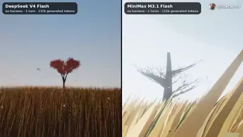</a><br><a href="https://www.sandbase.ai/lab/ai-videos/minimax-m3-1-flash/2112233437574914132?lang=zh-CN&utm_source=github&utm_medium=readme&utm_campaign=awesome-minimax-m3-1-flash&utm_content=card"><b>MiniMax M3.1 Flash 与 DeepSeek 1017 对比测试</b></a><br><sub><a href="https://x.com/loktar00/status/2112233437574914132">@loktar00</a> · 1:45</sub></td></tr>
<tr><td width="33%" valign="top"><a href="https://www.sandbase.ai/lab/media/x/minimax-m3-1-flash/2112238012117680396/video.mp4">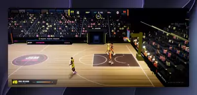</a><br><a href="https://www.sandbase.ai/lab/ai-videos/minimax-m3-1-flash/2112238012117680396?lang=zh-CN&utm_source=github&utm_medium=readme&utm_campaign=awesome-minimax-m3-1-flash&utm_content=card"><b>经典街机游戏 NBA Jam 重制版对比</b></a><br><sub><a href="https://x.com/atomtanstudio/status/2112238012117680396">@atomtanstudio</a> · 1:05</sub></td><td width="33%" valign="top"><a href="https://www.sandbase.ai/lab/media/x/minimax-m3-1-flash/2112238098147135880/video.mp4">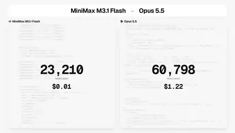</a><br><a href="https://www.sandbase.ai/lab/ai-videos/minimax-m3-1-flash/2112238098147135880?lang=zh-CN&utm_source=github&utm_medium=readme&utm_campaign=awesome-minimax-m3-1-flash&utm_content=card"><b>硬件产品发布落地页设计对比</b></a><br><sub><a href="https://x.com/nutlope/status/2112238098147135880">@nutlope</a> · 0:11</sub></td><td width="33%" valign="top"><a href="https://www.sandbase.ai/lab/media/x/minimax-m3-1-flash/2112238502305804542/video.mp4">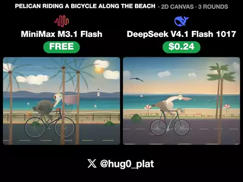</a><br><a href="https://www.sandbase.ai/lab/ai-videos/minimax-m3-1-flash/2112238502305804542?lang=zh-CN&utm_source=github&utm_medium=readme&utm_campaign=awesome-minimax-m3-1-flash&utm_content=card"><b>两款模型的鹈鹕生成效果对比</b></a><br><sub><a href="https://x.com/hug0_plat/status/2112238502305804542">@hug0_plat</a> · 0:10</sub></td></tr>
<tr><td width="33%" valign="top"><a href="https://www.sandbase.ai/lab/media/x/minimax-m3-1-flash/2112245037224382556/video.mp4"></a><br><a href="https://www.sandbase.ai/lab/ai-videos/minimax-m3-1-flash/2112245037224382556?lang=zh-CN&utm_source=github&utm_medium=readme&utm_campaign=awesome-minimax-m3-1-flash&utm_content=card"><b>四款大模型对比生成的超现实海滩场景</b></a><br><sub><a href="https://x.com/jan_volad/status/2112245037224382556">@jan_volad</a> · 0:15 · <a href="https://www.sandbase.ai/lab/ai-videos/minimax-m3-1-flash/2112245037224382556?lang=zh-CN&utm_source=github&utm_medium=readme&utm_campaign=awesome-minimax-m3-1-flash&utm_content=card">提示词</a></sub></td><td width="33%" valign="top"><a href="https://www.sandbase.ai/lab/media/x/minimax-m3-1-flash/2112247645955895455/video.mp4">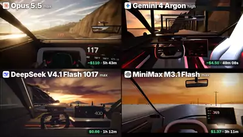</a><br><a href="https://www.sandbase.ai/lab/ai-videos/minimax-m3-1-flash/2112247645955895455?lang=zh-CN&utm_source=github&utm_medium=readme&utm_campaign=awesome-minimax-m3-1-flash&utm_content=card"><b>四款模型生成特斯拉Roadster第一人称驾驶对比</b></a><br><sub><a href="https://x.com/RafaCrackYT/status/2112247645955895455">@RafaCrackYT</a> · 0:30</sub></td><td width="33%" valign="top"><a href="https://www.sandbase.ai/lab/media/x/minimax-m3-1-flash/2112247670760951990/video.mp4">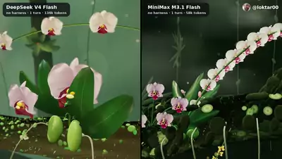</a><br><a href="https://www.sandbase.ai/lab/ai-videos/minimax-m3-1-flash/2112247670760951990?lang=zh-CN&utm_source=github&utm_medium=readme&utm_campaign=awesome-minimax-m3-1-flash&utm_content=card"><b>MiniMax m3.1 Flash 生成效果测试</b></a><br><sub><a href="https://x.com/loktar00/status/2112247670760951990">@loktar00</a> · 1:20</sub></td></tr>
<tr><td width="33%" valign="top"><a href="https://www.sandbase.ai/lab/media/x/minimax-m3-1-flash/2112249487918047629/video.mp4"></a><br><a href="https://www.sandbase.ai/lab/ai-videos/minimax-m3-1-flash/2112249487918047629?lang=zh-CN&utm_source=github&utm_medium=readme&utm_campaign=awesome-minimax-m3-1-flash&utm_content=card"><b>MiniMax与DeepSeek对战四子棋</b></a><br><sub><a href="https://x.com/mhdfaran/status/2112249487918047629">@mhdfaran</a> · 0:36</sub></td><td width="33%" valign="top"><a href="https://www.sandbase.ai/lab/media/x/minimax-m3-1-flash/2112254600925352136/video.mp4"></a><br><a href="https://www.sandbase.ai/lab/ai-videos/minimax-m3-1-flash/2112254600925352136?lang=zh-CN&utm_source=github&utm_medium=readme&utm_campaign=awesome-minimax-m3-1-flash&utm_content=card"><b>特斯拉Roadster警车追击场景对比</b></a><br><sub><a href="https://x.com/atomic_chat_hq/status/2112254600925352136">@atomic_chat_hq</a> · 0:18</sub></td><td width="33%" valign="top"><a href="https://www.sandbase.ai/lab/media/x/minimax-m3-1-flash/2112263410301964712/video.mp4"></a><br><a href="https://www.sandbase.ai/lab/ai-videos/minimax-m3-1-flash/2112263410301964712?lang=zh-CN&utm_source=github&utm_medium=readme&utm_campaign=awesome-minimax-m3-1-flash&utm_content=card"><b>特斯拉Roadster警车追逐场景模型对比</b></a><br><sub><a href="https://x.com/atomic_chat_hq/status/2112263410301964712">@atomic_chat_hq</a> · 0:18</sub></td></tr>
</table>

</details>

**[在 SandBase Lab 查看全部 55 条 →](https://www.sandbase.ai/lab/ai-videos/minimax-m3-1-flash?lang=zh-CN&utm_source=github&utm_medium=readme&utm_campaign=awesome-minimax-m3-1-flash&utm_content=section)**

<a id="recreate"></a>

## 用 MiniMax M3.1 Flash 复刻视频

[SandBase Lab](https://www.sandbase.ai/lab/ai-videos/minimax-m3-1-flash?lang=zh-CN&utm_source=github&utm_medium=readme&utm_campaign=awesome-minimax-m3-1-flash&utm_content=recreate) 的每个视频页都有 **复刻** 按钮：在 Lab 文本竞技场把帖子内容发给 M3.1 Flash，返回可在浏览器直接播放的代码。

用 API 的话，MiniMax M3.1 Flash 在 SandBase 上的模型 ID 是 `minimax/minimax-m3.1-flash`（兼容 OpenAI），自 2026 年 10 月 19 日发布起就是它。把提示词写进 `prompt.txt`，在 [控制台](https://www.sandbase.ai/console/keys?utm_source=github&utm_medium=readme&utm_campaign=awesome-minimax-m3-1-flash) 创建 Key，然后运行：

```bash
jq -n --rawfile prompt prompt.txt \
  '{model: "minimax/minimax-m3.1-flash", max_tokens: 128000, messages: [{role: "user", content: $prompt}]}' |
curl -sS --max-time 900 https://api.sandbase.ai/v1/chat/completions \
  -H "Authorization: Bearer $SANDBASE_API_KEY" \
  -H "Content-Type: application/json" \
  -d @- | jq -r '.choices[0].message.content' | sed '/^```/d' > minimax.html
```

用浏览器打开 `minimax.html`，或在 [SandBase Sandbox](https://www.sandbase.ai/landing/sandbox?utm_source=github&utm_medium=readme&utm_campaign=awesome-minimax-m3-1-flash) 中运行，让生成的代码保持隔离。这个模型的思考始终开启，隐藏的推理 token 也占用 `max_tokens`，所以上面的示例给到 128000。完整步骤见 [教程](docs/zh-CN/tutorial.md)，价格见 [模型页](https://www.sandbase.ai/model/minimax/minimax-m3.1-flash?utm_source=github&utm_medium=readme&utm_campaign=awesome-minimax-m3-1-flash)。

<a id="faq"></a>

## 常见问题

### MiniMax M3.1 Flash 是什么？

MiniMax-M3.1-Flash 是 MiniMax M3.1 系列中更快、更便宜的一档，2026 年 10 月 19 日发布。它接受文本、图片和视频输入，上下文窗口 100 万 token，最多输出 512K token；思考始终开启，推理强度可从 `low` 调到 `max`。MiniMax 称它比 M3 快 3 倍、价格约为三分之一，SandBase 的模型卡片把它标为开放权重模型。在 SandBase 上它是 `minimax/minimax-m3.1-flash`。来源：`sandbase inspect minimax/minimax-m3.1-flash`。

### 这些 MiniMax M3.1 Flash 视频是怎么做出来的？

模型并不直接渲染视频。它写出一个网页（用 Three.js、WebGPU、Canvas 或 SVG 的 HTML），作者再把页面播放过程录下来。也有作者在 MiniMax Code 里运行，让它同时生成页面里的图片和音乐；少数作者让它驱动编码 harness。见 [教程](docs/zh-CN/tutorial.md)。

### 在哪里找到视频的提示词？

标有 **提示词** 的视频，其 Lab 页面上有作者的提示词。[提示词索引](docs/zh-CN/prompts.md) 列出了全部。

### 怎么写好 MiniMax M3.1 Flash 提示词？

指定输出一个独立的 HTML 文件，并说明用哪个渲染方式（Three.js、WebGPU、Canvas 或 SVG）；描述场景、交互操作，以及录屏需要捕捉的状态；禁止外部素材，并让它自测页面。`max_tokens` 要给足：思考始终开启，也占用这个额度。详细写法和模板见 [提示词写法](docs/zh-CN/prompt-guide.md)。

### 怎么调用 MiniMax M3.1 Flash API？

在 SandBase 上模型 ID 是 `minimax/minimax-m3.1-flash`，使用兼容 OpenAI 的 `/v1/chat/completions` 接口，一个 Key 调用所有模型；`reasoning_effort` 可选 `low`、`medium`、`high`、`xhigh`、`max`。见 [复刻](#recreate) 和 [模型页](https://www.sandbase.ai/model/minimax/minimax-m3.1-flash?utm_source=github&utm_medium=readme&utm_campaign=awesome-minimax-m3-1-flash)。

### MiniMax M3.1 Flash 比 DeepSeek V4.1 Flash 1017、Claude Opus 5.5 或 Gemini 4 Argon 更强吗？

创作者大多拿它和 DeepSeek 对比，而且结论不一致。价格上 M3.1 Flash 通常更省：同一段海底场景 $0.21 对 $0.38，像素城市 $0.22 对 $0.54，同一提示词 $0.50 对 $1.15，落地页 $0.014 对 Claude Opus 的 $1.22。效果上则是分裂的：好几位创作者更喜欢它的设计或鹈鹕，也有人认为 DeepSeek 的提示词遵循度和细节更好，还有一位在 Roadster 驾驶对比里把它排在四款之末。目前没有实测结论：Lab [Evals 榜单](https://www.sandbase.ai/lab/evals?lang=zh-CN&utm_source=github&utm_medium=readme&utm_campaign=awesome-minimax-m3-1-flash)（Artificial Analysis 数据，2026-10-19 快照）还没有 MiniMax M3.1 Flash 这一行，唯一的实测结果是 Lab [Pelican Test](https://www.sandbase.ai/lab/pelican-test?lang=zh-CN&utm_source=github&utm_medium=readme&utm_campaign=awesome-minimax-m3-1-flash)：3.25 分，22 个模型中排第 6，每张图约 $0.006。详见 [模型对比](docs/zh-CN/model-comparison.md)。

### 做一个视频要花多少钱？

创作者报告的花费从 $0.014（一个硬件产品落地页）、$0.029（一项基准任务）到 $2.34（特斯拉 Roadster 追逐场景）不等，多数一次生成的页面在 $0.02 到 $0.70 之间。SandBase 标价为每百万输入 token $0.15、每百万输出 token $0.60，推理 token 按输出计费。

### 可以转用这些视频吗？

默认不可以，视频归作者所有。见 [MEDIA-RIGHTS](MEDIA-RIGHTS.md)。

<a id="contribute"></a>

## 推荐作品

发现了应该收录的 MiniMax M3.1 Flash 作品？附上 X 原帖 [提交给我们](https://github.com/sandbase-lab/awesome-minimax-m3-1-flash/issues/new?template=submit-video.yml)。通过后会先加入 SandBase Lab，下一次每日同步时出现在这里。觉得有用的话，点个 ⭐ 能让更多人看到。

## 致谢与权利

所有视频、提示词和帖子归作者所有。每张卡片都注明作者并链接原帖。MIT 许可证只覆盖本仓库的脚本。更正署名或下架视频请见 [MEDIA-RIGHTS](MEDIA-RIGHTS.md)。

与 MiniMax 无隶属或背书关系。

---

由 [SandBase Lab](https://www.sandbase.ai/lab/?lang=zh-CN&utm_source=github&utm_medium=readme&utm_campaign=awesome-minimax-m3-1-flash) 维护 · [全部 AI 视频合集](https://www.sandbase.ai/lab/ai-videos?lang=zh-CN&utm_source=github&utm_medium=readme&utm_campaign=awesome-minimax-m3-1-flash)
